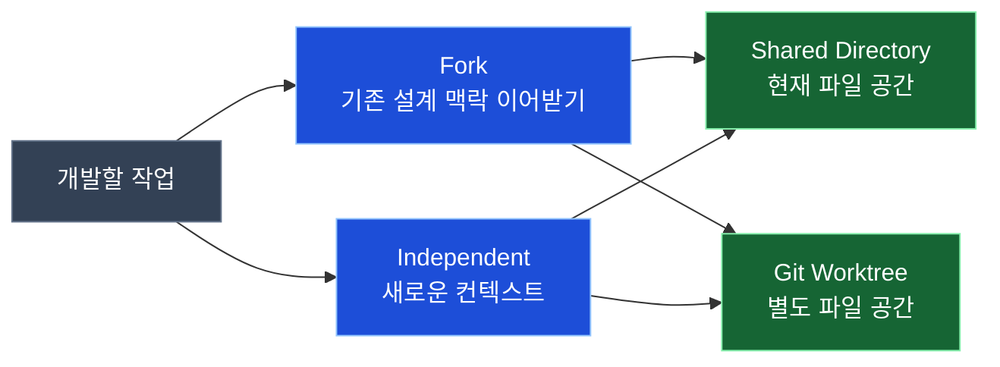

# Pi Compose

**Keep the reasoning. Delegate the work.**

Pi Compose는 [Pi](https://github.com/earendil-works/pi) 위에서 여러 코딩 에이전트의 작업을 **시작하고, 다시 찾고, 결과를 확인하는 과정**을 연결하는 개인용 Harness입니다.

개발을 시작하기 전, 우리는 무엇을 만들지만큼이나 **왜 그렇게 만들어야 하는지** 오래 논의합니다. 짧게 정리한 지시만 다른 에이전트에 전달하면 그 과정에서 결정의 이유나 반드시 지켜야 할 제약이 사라질 수 있습니다. 반대로 모든 탐색과 테스트를 Main 대화에서 처리하면 중요한 설계 맥락이 일시적인 로그로 채워집니다.

Pi Compose는 **설계 맥락이 필요한 개발은 해당 Pi 대화를 Fork하고, 독립적인 조사·테스트는 별도 컨텍스트에서 수행**할 수 있도록 돕습니다. Git Worktree, tmux, workmux를 매번 직접 조합할 필요 없이, 작업에 맞는 방식을 선택해 실행합니다.

> Pi를 대체하는 Agent Runtime이 아닙니다. **Pi의 모델·세션·TUI·Extension·Skill·Theme를 그대로 활용**하면서 개발 작업을 연결합니다.

## Get started

macOS에서 한 줄로 설치할 수 있습니다. **업데이트도 같은 명령**을 사용합니다.

```bash
curl -fsSL https://raw.githubusercontent.com/SEONGMINY/pi-compose/main/scripts/install.sh | bash
```

프로젝트 디렉터리에서 실행하세요.

```bash
cd ~/projects/my-app
pic
```

처음 사용하는 Pi라면 TUI에서 모델 제공자에 로그인하고 모델을 선택합니다.

```text
/login
/model
```

기존 Pi의 인증·모델·세션·설정은 공유됩니다. 설치에는 Node.js 22.19.0 이상과 Git이 필요하며, 누락된 의존성 설치에 Homebrew를 사용합니다. Homebrew 자체나 기존 사용자 설정은 자동 변경하지 않습니다. [설치 세부사항](docs/adr/0006-github-installer.md)

## What changes with Pi Compose?

Pi 자체에도 대화, 세션 Fork·Resume, 도구 호출, 확장 기능이 있습니다. Pi Compose는 이를 새로 만들지 않고 **반복되는 개발 작업 흐름에 연결**합니다.

| 하고 싶은 일 | Pi만 사용한다면 | Pi Compose에서는 |
| --- | --- | --- |
| 설계 맥락을 이어서 개발 | Pi의 세션 Fork를 직접 활용 | **원본 대화와 작업 공간을 선택**해 개발 작업 시작 |
| 코드와 무관한 조사·테스트 | 별도 대화나 도구를 직접 실행 | **독립 컨텍스트**로 작업 분리 |
| 여러 작업 환경 운영 | Git·tmux·workmux를 직접 연결 | **Shared Directory 또는 Worktree**를 선택해 실행 |
| 예전 작업으로 복귀 | Pi 세션을 직접 선택·재개 | 저장 대화와 workmux 작업을 **한 곳에서 찾아 복귀** |
| 결과 확인 | 결과와 Git 변경사항을 직접 확인 | **선택형 Handoff와 독립 검증**을 사용 |

**중요한 선택은 개발자가 하고, 반복적인 준비는 기존 도구가 처리하는 것**이 목표입니다. 작업을 자동으로 분할·실행하거나 Git 변경사항을 임의로 병합하지 않습니다.

## A day with Pi Compose

명령어를 외울 필요는 없습니다. 하고 싶은 일을 설명하거나, 원하는 동작을 직접 선택할 수 있습니다.

**1. Main에서 설계합니다.**

> 회원 API를 만들기 전에 기존 인증 흐름을 확인하자. 토큰 갱신 방식은 유지하고, 그렇게 결정한 이유도 정리하자.

**2. 설계 맥락을 이어받아 개발합니다.**

> 지금까지 논의한 내용을 바탕으로 회원 API를 개발해 줘. 이 대화를 Fork하고 별도 Worktree에서 진행하고 싶어.

명시적으로 실행하려면 `/compose launch 회원 API 구현`을 사용할 수 있습니다. 원본 세션과 작업 공간은 선택 UI에서 고릅니다. 어떤 대화가 Main인지 임의로 추측하지 않습니다.

**3. 독립적인 일은 분리합니다.**

> 외부 SDK 문서를 조사할 작업을 따로 시작해 줘. 현재 설계 대화는 필요 없어.

실행 시 **Independent**를 선택하면 기존 대화를 상속하지 않습니다. Fork 여부와 Shared Directory·Worktree 여부는 서로 다른 선택입니다.

**4. 이전 작업으로 돌아갑니다.**

> 아까 개발하던 회원 API 작업으로 돌아가고 싶어.

또는 `/compose back`으로 작업 목록을 직접 선택합니다. 저장된 Pi 대화를 자연어로 선택한 경우에는 입력창에 정확한 전환 명령이 준비되며 **Enter를 눌러 확정**해야 합니다. Pi 기본 `/resume`도 그대로 사용할 수 있습니다.

**5. 필요할 때 결과를 인계하고 검증합니다.**

선택형 Extension을 활성화하면 `/compose-handoff`로 변경 내용·선택 이유·실행한 검사를 정리하고, `/compose-verify`로 별도 모델의 검증을 요청할 수 있습니다. **인계 보고는 실제 코드의 증거를 대체하지 않습니다.** 자동 병합도 수행하지 않습니다.

[실제 작업 예시와 명령어](docs/USAGE.md)

## Context and workspace are different choices

아래 다이어그램에서 **파란색은 컨텍스트**, **초록색은 파일 작업 공간**을 뜻합니다. 작업 성격에 따라 두 선택을 자유롭게 조합할 수 있습니다.



컨텍스트를 Fork한다고 Worktree가 강제되지는 않습니다. 독립 컨텍스트도 같은 디렉터리에서 작업할 수 있습니다. **순차·병렬 실행 역시 사용자가 작업에 따라 결정**합니다.

이 선택을 분리한 이유와 고려한 비용은 [컨텍스트 위임 결정](docs/adr/0001-context-and-delegation.md), [실행 선택 결정](docs/adr/0002-user-controlled-execution.md)에 정리돼 있습니다.

## Make it yours

Pi Compose는 하나의 대시보드나 고정 워크플로를 강제하지 않습니다. 핵심 Launch는 기본으로 제공하고, 추가 기능은 **Pi의 Package·Extension 체계**로 선택해 사용할 수 있습니다.

| 기본 제공 | 선택해서 추가 |
| --- | --- |
| 작업 실행·미리보기 (`/compose launch`, `/compose preview`) | workmux Dashboard (`/compose-workmux`) |
| 작업 탐색·복귀·재개 (`/compose back`, `/compose resume`) | Handoff (`/compose-handoff`) |
| 자연어 작업 검색·복귀 | 독립 검증 (`/compose-verify`) |

선택형 기능을 사용하려면 다음을 실행합니다.

```bash
pic features
```

Pi 설정 UI에서 필요한 기능을 선택할 수 있습니다. **선택형 패키지는 처음 등록하면 세 기능이 모두 활성화**되므로, 사용하지 않는 기능은 끄면 됩니다. 프로젝트별 설정은 `pic features --local`을 사용합니다.

사용자 정의 Extension·Skill·Theme와 기존 `pi` 명령을 계속 사용할 수 있습니다. 별도의 Pi Compose 플러그인 관리자나 설정 DB는 없습니다. [기능 구성과 세부 사용법](docs/USAGE.md)

## Under the hood

Pi Compose가 담당하는 것은 새로운 실행 엔진이 아니라 **기존 도구 사이의 연결**입니다.

| 도구 | 맡는 역할 |
| --- | --- |
| [Pi](https://github.com/earendil-works/pi) | 모델·대화·Fork·Resume·TUI·확장 기능 |
| Git | 브랜치·Diff·Worktree·변경사항 통합 |
| tmux | 작업 프로세스와 터미널 세션 |
| [workmux](https://github.com/raine/workmux) | Worktree 작업 실행·전환·Dashboard 연계 |
| **Pi Compose** | 사용자가 고른 실행 방식의 준비·복귀·선택형 인계·검증 연결 |

**Main의 맥락은 다음 설계를 위해 남겨둡니다.** 독립적인 탐색과 변경 검증은 가능한 한 Main 밖에서 처리하고, 이후 판단에 필요한 결과만 돌아오게 하는 방향입니다. 이 철학과 기술적 경계는 [Architecture](docs/ARCHITECTURE.md)에 있습니다.

## Documentation

- [Usage](docs/USAGE.md) — 명령어·선택 UI·작업 복귀·선택형 기능 사용법
- [PRD](docs/PRD.md) · [Domain Stories](docs/domain-stories/01-as-is-and-pain-points.md) — 해결하려는 문제와 사용 흐름
- [Architecture](docs/ARCHITECTURE.md) · [TRD](docs/TRD.md) — 도구별 역할과 구현 판단
- [Design decisions](docs/README.md) · [Implementation Plan](docs/IMPLEMENTATION_PLAN.md) — 합의한 선택, 구현·검증 기록

---

Pi Compose는 개인 개발 환경을 위해 만들고 있는 프로젝트입니다. **설치와 `pic` TUI 실행은 macOS에서 검증했지만**, 모델 인증을 포함한 모든 멀티 에이전트 Fork·Handoff·Verify 시나리오가 끝까지 검증된 것은 아닙니다. 범위는 [검증 문서](docs/validation/phase6-integration.md)를 참고해 주세요.
