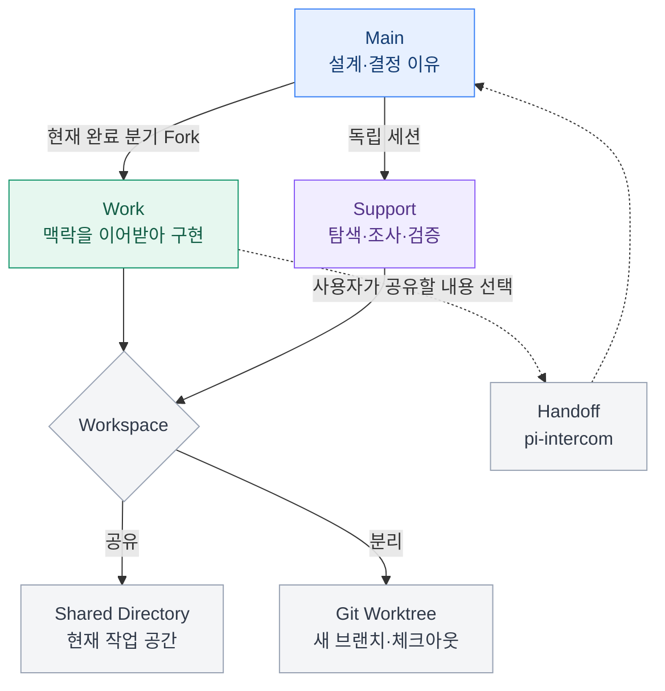

# Pi Compose

**설계는 Main에 남기고, 개발은 그 대화를 이어받은 Work에서 진행합니다.**

AI와 개발 방향을 논의할 때는 무엇을 만들지뿐 아니라 **왜 그렇게 결정했는지, 무엇을 바꾸면 안 되는지**까지 정합니다. 이 내용을 짧게 요약해 다른 에이전트에게 전달하면 중요한 배경이 빠질 수 있어요. 그렇다고 설계하던 대화에 코드 탐색, 디버깅, 테스트 로그까지 모두 쌓고 싶지는 않았습니다.

**Pi Compose는 [Pi](https://github.com/earendil-works/pi)의 실제 세션 Fork를 중심으로, 여러 코딩 에이전트와 개발하는 흐름을 [Ghostty](https://ghostty.org/)에서 연결하는 Harness입니다.**

<p align="center">
  <a href="./docs/assets/readme/overview-demo.mp4">
    
  </a>
</p>

<p align="center"><em>전체 흐름: Main에서 설계 → Work에 구현 위임 → 결과 확인 → 원래 Main에서 다음 결정. 이미지 클릭 시 데모 영상.</em></p>

**핵심은 세 가지예요.** Main의 설계 맥락을 보존하고, Work에서는 그 맥락 그대로 개발하고, 필요한 결과만 사용자가 선택해 전달합니다. 독립적인 탐색·조사는 Support에서 처리해요.

## 어떤 개발 경험을 만들고 있나요?

프로필 API에 `displayName`을 추가하는 작업을 예로 들어볼게요. 기존 앱과의 호환성 때문에 `label`은 유지하기로 했습니다.

### 1. Main에서는 왜 그렇게 결정했는지 논의합니다

`pic`에서 Main을 만들거나 기존 Pi 세션을 선택해, API 계약과 대안을 논의합니다.

> `displayName`을 추가하되, 기존 클라이언트가 `label`을 읽고 있으니 당장은 제거하지 않기로 하자.

Main에는 이런 **결정과 이유**가 계속 남아 있어야 합니다. 구현 중의 긴 도구 출력까지 같은 대화에 쌓을 필요는 없어요.

### 2. Work는 그 대화를 Fork해 별도 공간에서 개발합니다

Main의 Pi 입력창에서 다음과 같이 요청합니다.

```text
>>w 앞서 합의한 프로필 API 변경을 구현해줘. label 호환성은 유지해.
```

Pi Compose는 Main의 **완료된 활성 대화 분기**를 새 Work에 이어받도록 구성하고, 명령을 입력한 Agent의 Git HEAD에서 새 Worktree를 만듭니다. Work는 원래 논의를 참고해 코드를 수정하되, 작업 로그는 Main에 자동으로 추가하지 않습니다.


*같은 결정 배경을 가진 Work, 별도의 Pi 세션과 Git 작업 디렉터리.*

### 3. 작업을 확인하고 필요한 내용만 공유합니다

`pic`의 프로덕트·Agent 목록에서 기존 Work의 Ghostty Split으로 이동할 수 있습니다. Work의 Pi 화면에는 최근 요청·도구 결과·Assistant 답변을 **원본 기록과 연결한 Summary 정보층**이 표시되도록 구성했습니다.


*현재 Summary는 기록 발췌 중심입니다. 의미 기반 요약이나 중요 결정 자동 후보 추출까지 구현된 것은 아닙니다.*

결과 중 Main에 알려야 할 내용이 있다면, Work의 Pi TUI에서 직접 공유합니다.

```text
/compose handoff
```

사용자가 **원본 내용, 수신 Agent, 전달 문구를 선택**하고 검토한 뒤 전송을 요청합니다. 새 제안과 실행 로그를 Main에 자동 주입하지 않습니다. 전송한 내용이 자동으로 승인되는 것도 아니에요.


*무엇을 전달할지, 누구에게 보낼지는 사용자가 결정합니다.*

### 4. Main으로 돌아와 다음 결정을 이어갑니다

Overview에서 기존 Main을 선택하면 **같은 Pi 대화**로 돌아가는 흐름입니다. Main의 요구사항, 버린 대안, 금지사항은 그대로 남고, Work에서 생성한 긴 실행 로그를 통째로 받아올 필요가 없습니다.


*원래 설계 대화는 이어지고, 개발 과정은 별도 세션에 남습니다.*

코드 탐색이나 자료 조사처럼 전체 설계 맥락이 필요하지 않은 작업은 `>s`로 **독립적인 Support**에 맡길 수 있습니다.

## Context와 Workspace는 별개예요

**Context는 어떤 Pi 대화를 이어받을지**, **Workspace는 어느 디렉터리에서 파일을 수정할지**를 뜻합니다. 두 선택을 구분해야 불필요하게 긴 대화를 가져오거나 같은 파일을 동시에 수정하는 일을 줄일 수 있어요.



| 입력 | Context | Workspace |
| --- | --- | --- |
| `>w 작업` | 현재 Pi 대화를 Fork | 현재 디렉터리 공유 |
| `>>w 작업` | 현재 Pi 대화를 Fork | 새 Git Worktree |
| `>s 작업` | 독립 Pi 세션 | 현재 디렉터리 공유 |
| `>>s 작업` | 독립 Pi 세션 | 새 Git Worktree |

`>w @세션 작업`과 `>>w @세션 작업`으로 같은 프로덕트에 속한 **다른 Pi 세션**을 선택하는 경로도 있습니다. Fork할 대화의 출처가 달라도 파일을 수정하는 디렉터리는 **명령을 입력한 Agent 기준**으로 정합니다.

> [!IMPORTANT]
> Git Worktree는 기존 작업 디렉터리의 **미커밋 변경사항을 복사하지 않습니다**. Shared Directory에서는 여러 Agent가 같은 파일을 수정할 수 있어요. Worktree 분리와 Git 변경사항 병합은 다른 작업이며, 병합은 자동으로 수행하지 않습니다.

## Pi만 사용할 때와 무엇이 다른가요?

Pi는 이미 세션 Fork·Resume과 Extension을 지원하고, Ghostty는 Split, Git은 Worktree를 제공합니다. [workmux](https://github.com/raine/workmux)도 Pi 세션 Fork와 Worktree 실행을 지원해요.

**Pi Compose의 차이는 새로운 런타임이 아니라 이 선택들을 하나의 개발 흐름으로 연결한다는 점**입니다.

| 기존에 직접 다루던 것 | Pi Compose에서 연결하려는 것 |
| --- | --- |
| Pi 세션 파일·Fork·Resume | Main·Work·Support 관계와 정확한 원본 대화 선택 |
| 터미널 Split과 작업 중인 Pi | 프로덕트·Agent별 탐색과 기존 Ghostty 화면으로 이동 |
| 브랜치·Worktree 실행 | Context와 별개로 Shared/Worktree 선택 |
| Agent 간 메시지 | 사용자 선택형 Handoff, 발신 근거와 결과 구분 |

Pi의 모델·세션·Extension·설정은 그대로 사용합니다. 다른 Agent Runtime이나 별도 데스크톱 GUI를 만드는 프로젝트가 아닙니다.

## 설치하고 시작하기

**macOS · Node.js 22.19.0 이상 · [Ghostty](https://ghostty.org/) · [Pi](https://github.com/earendil-works/pi)** 환경을 기준으로 개발하고 있습니다. 기존 Pi가 있다면 설치 스크립트는 그 설정과 세션을 유지하도록 작성돼 있어요.

```bash
curl -fsSL https://raw.githubusercontent.com/SEONGMINY/pi-compose/main/scripts/install.sh | bash
```

설치 후 Ghostty에서 프로젝트 디렉터리를 열고 실행합니다.

```bash
cd /path/to/your-project
pic
```

`pic`의 Overview에서 **`n`으로 Main을 만들거나 `o`로 저장된 Pi 세션을 선택**합니다. 새로운 Main에서는 Pi의 `/login`과 `/model`로 인증·모델을 설정할 수 있어요. 기존 Main의 설계를 논의한 다음 `>w` 또는 `>>w`로 Work에 개발을 맡깁니다.

<details>
<summary><strong>Overview 조작과 다른 명령어 보기</strong></summary>

| 입력 | 역할 |
| --- | --- |
| `1` · `2` · `3` | 프로덕트별 / 전체 Agent / 메시지 기록 보기 |
| `n` · `o` | 새 Main 만들기 / 저장된 Pi 세션에서 Main 열기 |
| `Enter` | 선택한 Agent의 기존 Ghostty Terminal로 이동 |
| `v` · `r` | 선택 Agent의 기록 근거 보기 / 실행 기록 다시 조회 |
| `q` | Agent 유지·종료 선택 |
| `>w @세션 작업` | 같은 프로덕트의 다른 Pi 대화를 선택해 Work로 Fork |
| `/compose handoff` | 원본 내용과 수신 Agent를 직접 선택해 공유 |
| `/compose messages` | Pi에 남은 Handoff 발신·수신 기록 조회 |

자세한 명령과 예외 상황은 [사용 가이드](docs/USAGE.md)를 참고하세요.

</details>

> [!NOTE]
> **현재는 개발 중인 Preview 코드입니다.** Ghostty/Pi 전체 실행 흐름은 아직 실사용 통합 검증 전이며, 설치 스크립트에는 이전 버전의 `tmux`·`workmux` 설치 과정이 남아 있습니다. 현재 Summary는 원본 기록 중심이고, 의미 요약·중요 결정 후보·완성된 메시지 Sidebar와 복구 UX는 구현 중입니다. 처음 사용하는 환경에서는 테스트 프로젝트에서 확인하는 편이 안전합니다.

## 더 알아보기

[사용 가이드](docs/USAGE.md)에서 실제 명령을, [PRD](docs/PRD.md)에서 확정한 제품 정책을, [Architecture](docs/ARCHITECTURE.md)에서 Pi·Ghostty·Git의 역할을 확인할 수 있어요. 구현 진척과 남은 작업은 [Implementation Plan](docs/IMPLEMENTATION_PLAN.md)에 정리했습니다.

<!-- README media assets are reserved for actual macOS Ghostty/Pi captures.
     Do not merge this README before adding and checking these files:
     overview-preview.png, overview-demo.mp4, work-fork.png,
     summary-overlay.png, handoff-review.png, main-return.png. -->
