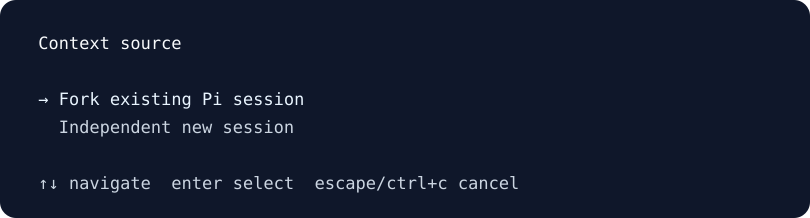
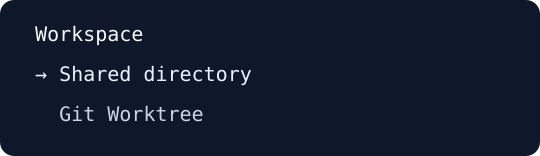

# Pi Compose

**Keep the reasoning. Delegate the work.**

Main Agent와 오래 논의한 요구사항을 다른 에이전트에게 맡길 때, **결정한 이유와 반드시 지켜야 할 제약까지** 이어가고 싶었습니다. 반대로 독립적인 코드 탐색이나 리서치까지 Main에서 처리하고 싶지는 않았습니다.

**Pi Compose는 설계의 맥락이 필요한 개발은 이어서 맡기고, 독립적인 일은 분리해 진행할 수 있도록 돕는 [Pi](https://github.com/earendil-works/pi) 기반 코딩 Harness입니다.** 작업을 시작하거나 다시 찾을 때 Pi 세션·Git Worktree·tmux를 매번 직접 연결하는 부담을 줄입니다.

### 개발을 맡길 때, 실제로 보이는 화면

`/compose launch`를 실행하면 어떤 대화를 이어받을지 직접 선택합니다.



<sub>macOS에서 `pic`을 실행해 확보한 실제 **선택 메뉴의 터미널 출력**을 크롭·SVG로 재구성했습니다. 모델 응답이나 개발 완료 화면은 아닙니다. [재현 기록](https://github.com/SEONGMINY/pi-compose/actions/runs/40220845621)</sub>

## 시작하기

macOS에서는 한 줄로 설치합니다. **업데이트도 같은 명령**입니다.

```bash
curl -fsSL https://raw.githubusercontent.com/SEONGMINY/pi-compose/main/scripts/install.sh | bash
```

원하는 프로젝트에서 시작하세요.

```bash
cd ~/projects/my-app
pic
```

처음 실행했다면 Pi TUI에서 `/login`으로 모델 제공자를 인증하고 `/model`로 모델을 선택합니다. 이미 Pi를 사용 중이라면 기존 인증·세션·설정·Extension·Skill·Theme를 그대로 사용합니다.

[설치 환경 및 주의사항](docs/adr/0006-github-installer.md)

## 하나의 작업을 맡기는 과정

예를 들어 Main에서 회원 API의 인증 정책을 논의했다고 가정해 보겠습니다.

> 토큰 갱신 방식은 바꾸지 않기로 했어. 기존 클라이언트와의 호환성 때문이야. 이 조건을 유지하면서 회원 API를 개발하고 싶어.

새 개발 에이전트에게 이를 몇 줄로 다시 요약하는 대신, **그 이유를 논의했던 Pi 대화를 원본으로 선택**할 수 있습니다.

```text
/compose launch 회원 API 구현
```

앞에서 본 컨텍스트 선택에 이어, 코드를 어느 디렉터리에서 변경할지도 고릅니다.



<sub>실제 `/compose launch`의 두 번째 선택 메뉴를 캡처한 터미널 출력입니다. Shared Directory와 Git Worktree 중 하나를 선택할 수 있습니다. [재현 기록](https://github.com/SEONGMINY/pi-compose/actions/runs/40220845621)</sub>

**이전에는 여러 도구를 직접 연결해야 했던 작업을, 이제 하나의 시작 흐름에서 선택합니다.**

| 사용자가 결정하는 것 | Pi Compose가 연결하는 것 |
| --- | --- |
| 어떤 대화의 맥락이 필요한가? | Pi의 **세션 Fork** 또는 새로운 독립 세션 |
| 현재 파일 공간을 사용할까, 변경을 분리할까? | 기존 디렉터리 또는 Git Worktree |
| 언제 시작할까? | 선택된 작업에 맞는 Pi·tmux·workmux 실행 |

Fork는 기존 대화의 맥락을 이어받는 **Pi의 기능**입니다. Worktree는 **Git의 기능**입니다. Pi Compose는 이 기능들을 새로 만드는 대신, 개발 작업을 맡기는 과정에서 함께 선택하고 실행하도록 연결합니다.

> Fork했다고 해서 Worktree가 강제되지는 않습니다. 어느 세션을 원본으로 삼을지, 작업 디렉터리를 나눌지, 언제 실행할지는 사용자가 결정합니다.

## Main에는 다음 판단에 필요한 것만

설계 맥락이 필요 없는 SDK 조사·코드 탐색·테스트는 **Independent**로 시작할 수 있습니다. 모든 작업에 긴 Main 대화를 복사할 필요가 없기 때문입니다.

개발 중에는 다음처럼 필요한 동작만 요청하면 됩니다.

| 하고 싶은 일 | Pi Compose에서 |
| --- | --- |
| 독립적인 조사 작업 시작 | 자연어로 요청하거나 `/compose launch`에서 Independent 선택 |
| 예전에 하던 작업 찾기 | “회원 API 작업으로 돌아가고 싶어” 또는 `/compose back` |
| 구현 결과 정리 | 선택형 `/compose-handoff` |
| 별도 컨텍스트에서 변경 검토 | 선택형 `/compose-verify` |

Handoff는 변경한 내용·선택 이유·수행한 검사·남은 문제를 **간결하게 정리**합니다. 독립 검증은 실제 변경을 별도 Pi 모델 호출로 살펴볼 수 있습니다. 두 기능 모두 요청해서 사용하는 선택형 Extension이며, Handoff가 곧 검증 완료나 Git 병합을 의미하지는 않습니다.

자연어로 저장된 Pi 대화를 선택했을 때는 정확한 전환 명령이 입력창에 준비됩니다. **Enter로 확정해야** 대화가 전환됩니다. 더 많은 옵션을 알아야만 시작할 수 있도록 만들지는 않았습니다. [작업별 사용 가이드](docs/USAGE.md)

## 필요한 만큼만 확장하기

기본 제공 기능은 **작업 실행·미리보기·탐색·복귀**입니다. 다음 기능은 Pi Package로 선택해서 더할 수 있습니다.

| 선택형 Extension | 역할 |
| --- | --- |
| Dashboard | workmux의 실행·Worktree 화면 열기 |
| Handoff | 개발 결과 인계 |
| Verify | 별도 Pi 호출로 변경사항 확인 |

```bash
pic features
```

Pi의 설정 UI에서 사용할 Extension을 고릅니다. 처음 선택형 패키지를 등록하면 세 기능이 모두 켜지므로, 쓰지 않는 기능은 끌 수 있습니다. Pi Compose 전용 설정 DB나 Plugin Manager는 없으며, 기존 Pi의 Package·Extension·Skill·Theme를 계속 활용할 수 있습니다.

## 왜 Pi 위에 만들었나요?

**Pi는 모델·대화·세션·TUI·확장을 담당하고, Pi Compose는 작업 간 연결을 담당합니다.** Git은 코드와 Worktree, tmux는 실행 세션, workmux는 Worktree 실행·전환을 맡습니다.

새로운 Runtime이나 자동 개발 스케줄러를 만드는 대신, 사용자가 직접 결정해야 할 부분은 남기고 반복적인 실행 준비를 연결합니다. Main이 모든 로그와 Diff를 받아 분석하도록 강제하지도 않습니다.

이 프로젝트를 만들게 된 배경과 세부 설계는 별도 문서에 있습니다.

- [사용 가이드](docs/USAGE.md) — 실행·복귀·인계·검증 방법
- [문제와 시나리오](docs/domain-stories/01-as-is-and-pain-points.md) · [설계 선택](docs/README.md)
- [아키텍처](docs/ARCHITECTURE.md) · [PRD](docs/PRD.md) · [Implementation Plan](docs/IMPLEMENTATION_PLAN.md)

<sub>Pi Compose는 개인 개발 환경을 위한 프로젝트입니다. 실제 `pic` 실행과 선택 UI는 macOS에서 확인했습니다. 모델 인증을 이용한 여러 에이전트의 개발·인계·검증 흐름 전체를 검증한 것은 아닙니다. [검증 기록](docs/validation/phase6-integration.md)</sub>
