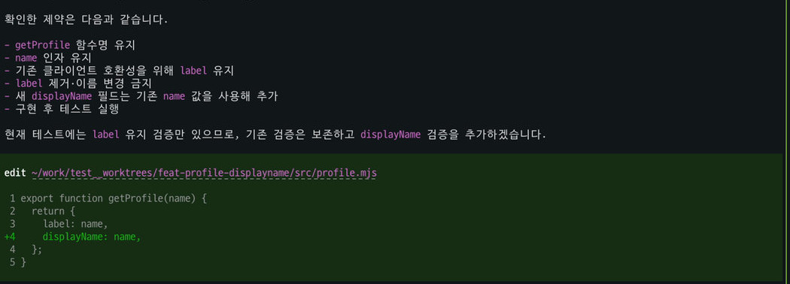
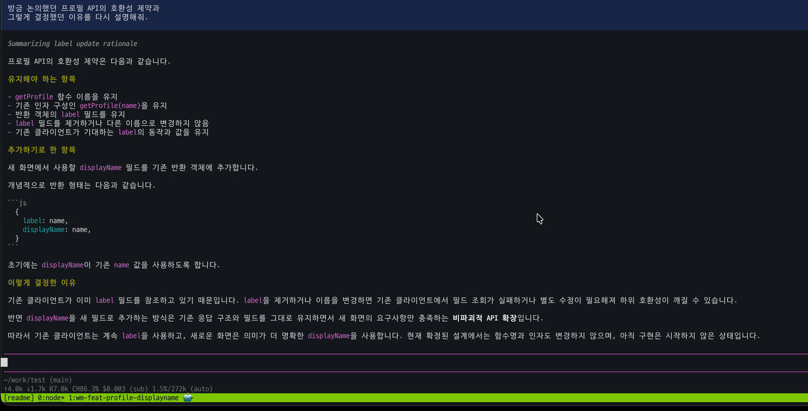

# Pi Compose

**Main에서 논의한 내용은 남겨두고, 개발은 다른 Pi 에이전트에게 맡길 수 있어요.**

Pi에서 요구사항과 설계 이유를 충분히 논의한 뒤, 별도 에이전트에서 구현하고 싶을 때가 있습니다. 새 에이전트에게 같은 내용을 다시 설명하거나, 세션과 작업 디렉터리·터미널을 준비하는 과정은 번거롭고요.

Pi Compose는 **기존 대화를 이어받아 개발할지, 새 대화로 시작할지**, 그리고 **같은 디렉터리에서 작업할지, Git Worktree로 분리할지** Pi 안에서 선택하고 실행하는 도구예요. 원래 대화는 유지하면서 여러 작업을 분리해 진행할 수 있습니다.

Pi와 [workmux](https://github.com/raine/workmux)만으로도 비슷한 작업을 할 수 있어요. workmux도 한 명령으로 Pi 세션을 Fork하고 Worktree에서 에이전트를 실행할 수 있습니다. Pi Compose의 차이는 **Pi 대화 안에서 원본 세션을 고르고, Fork/Independent와 Shared/Worktree를 선택해 실행**한다는 점이에요. 매번 Worktree가 필요한 것도 아닙니다.

## 실제로 사용해 보면

예를 들어 Main에서 프로필 API를 논의하면서 기존 클라이언트와의 호환성을 위해 `label`을 유지하기로 결정했다고 해볼게요. 설계를 마친 다음, Main에서 개발 에이전트를 실행합니다.

```text
/compose launch 앞서 합의한 API 변경을 구현해줘
```

Pi Compose가 기존 대화를 이어받을지, 어느 작업 공간에서 개발할지 묻습니다. 이 예시에서는 **Fork existing Pi session → Git Worktree → Current Pi session**을 선택하고 새 브랜치 이름을 입력했습니다.

그러면 원래 대화를 Fork한 Pi가 별도 Worktree와 tmux 창에서 개발을 시작합니다. Main에 합의했던 이유와 제약도 새 에이전트가 참고할 수 있어요. 원래 Main 대화에는 새 에이전트의 수정 과정이나 긴 실행 로그가 쌓이지 않습니다.



*Fork된 개발 에이전트. 기존 제약을 확인한 뒤 별도 작업 디렉터리에서 코드를 변경했습니다.*

개발 작업을 확인한 뒤에는 tmux에서 원래 Main 창으로 돌아갈 수 있습니다. 아래 화면처럼 기존 설계 대화를 이어서 진행할 수 있어요.



*다시 돌아온 Main. 이전에 합의한 내용이 남아 있고, 개발 에이전트의 로그는 Main 대화에 추가되지 않았습니다.*

위 화면은 실제 macOS 사용 녹화의 서로 다른 시점에서 추출했습니다. **하나의 Fork 개발 작업과 Main 복귀를 보여주는 예시**이며, 여러 에이전트의 진행 상태를 통합해서 보여주는 화면은 아닙니다.

### 다른 종류의 작업이라면?

코드 탐색이나 테스트처럼 이전 대화가 필요 없다면 **Independent new session**으로 시작할 수 있어요. 작업 파일을 따로 분리할 필요가 없다면 **Shared directory**를 선택하면 됩니다. 모든 작업에서 Fork나 Worktree를 사용할 필요는 없어요.

이전에 작업한 대화나 Worktree를 다시 찾으려면 `/compose back`을 사용하세요. 현재 버전에서 **tmux 창으로 이동하는 것과 저장된 작업을 탐색하는 것은 서로 다른 동작**입니다. 자세한 복귀 방법은 [사용 가이드](docs/USAGE.md)에 정리했습니다.

## 설치 및 첫 실행

현재 macOS에서 설치할 수 있고, Node.js 22.19.0 이상이 필요해요.

```bash
curl -fsSL https://raw.githubusercontent.com/SEONGMINY/pi-compose/main/scripts/install.sh | bash
```

Worktree 작업을 하려면 tmux 안에서 `pic`을 실행하세요.

```bash
cd /path/to/your-project
tmux new-session -s pic-work pic
```

이미 tmux를 사용 중이라면 `pic`만 실행하면 됩니다. 처음 Pi를 사용한다면 `/login`으로 로그인하고 `/model`로 모델을 선택하세요. 설치에 필요한 tmux와 workmux는 Homebrew로 설치할 수 있으며, Homebrew 자체는 미리 준비해야 합니다.

**사용 전 주의:** Git Worktree에는 원래 디렉터리의 미커밋 변경사항이 복사되지 않습니다. Shared directory에서 여러 에이전트가 같은 파일을 수정하면 변경이 겹칠 수 있어요. 작업 실행과 결과 확인, Git 병합은 개발자가 직접 결정합니다.

작업 결과 정리(Handoff), 독립 코드 검토(Verify), workmux Dashboard는 `pic features`로 추가할 수 있어요. 세부 명령과 실행 옵션은 [사용 가이드](docs/USAGE.md), 설계 이유와 제약은 [설계 문서](docs/README.md)에서 확인할 수 있습니다.