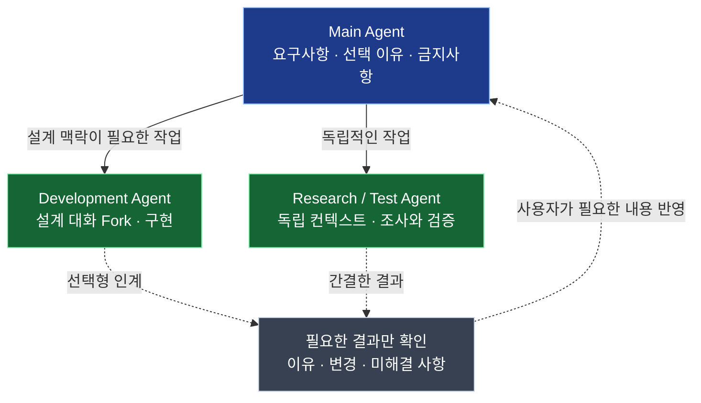

# Pi Compose

**Keep the reasoning. Delegate the work.**

요구사항을 충분히 논의했는데, 개발 에이전트에게 다시 설명해야 한다면?  
조사와 테스트 때문에 Main 대화가 로그로 가득 찬다면?

**Pi Compose는 중요한 설계 맥락은 이어가고, 독립적인 작업은 분리하도록 돕는 [Pi](https://github.com/earendil-works/pi) 기반 코딩 Harness입니다.** 에이전트를 실행하고 이전 작업으로 돌아가기 위해 Git Worktree·tmux·Pi 세션을 매번 직접 연결하는 일을 줄입니다.

## 이렇게 사용합니다

아래는 **사용 흐름을 설명하기 위한 요청 예시**입니다. 실제 TUI 캡처나 실행 결과를 재현한 화면은 아닙니다.

```text
# 1. Main — 설계의 이유와 제약을 충분히 논의
"회원 API를 만들기 전에 인증 흐름부터 정리하자.
 토큰 갱신 방식은 바꾸지 말고, 그 이유도 같이 정리해 줘."

# 2. Development — 논의한 맥락을 이어받아 구현
"지금까지 논의한 내용으로 회원 API를 개발해 줘.
 이 대화를 Fork하고 별도 Worktree에서 작업하고 싶어."

# 3. Research — Main 맥락 없이 독립적으로 조사
"외부 SDK 변경사항은 별도 에이전트에서 조사해 줘.
 지금 대화 컨텍스트는 필요 없어."

# 4. Return — 이전 작업으로 복귀
"아까 개발하던 회원 API 작업으로 돌아가고 싶어."
```

**사용자는 어떤 일을 맡길지 결정하고, Pi Compose는 선택한 방식으로 작업을 시작하거나 다시 찾는 과정을 연결합니다.** 개발 도중 필요하면 선택형 Handoff와 독립 검증을 이용해 결과를 정리할 수 있습니다.

### Main의 맥락은 남기고, 작업은 나눕니다



Main의 대화를 Fork하면 **무엇을 결정했는지뿐 아니라 왜 결정했는지**도 이어받아 개발할 수 있습니다. 반대로 자료 조사·테스트처럼 독립적인 일은 별도 컨텍스트에서 수행해 Main에 일시적인 로그를 쌓지 않는 방식입니다.

이것은 **사용 가능한 작업 방식**이지 모든 요청에 자동으로 실행되는 파이프라인은 아닙니다. 결과 인계·검증도 요청한 경우에만 수행하며, Fork와 Compaction이 원문의 모든 뉘앙스를 완벽히 보존한다고 보장하지는 않습니다.

## 시작하기

macOS에서 설치합니다. **업데이트도 같은 명령을 다시 실행**합니다.

```bash
curl -fsSL https://raw.githubusercontent.com/SEONGMINY/pi-compose/main/scripts/install.sh | bash
```

프로젝트 디렉터리에서 Pi Compose를 실행합니다.

```bash
cd ~/projects/my-app
pic
```

Pi를 처음 사용한다면 TUI에서 인증하고 모델을 선택합니다.

```text
/login
/model
```

기존 Pi의 모델·인증·세션·설정은 그대로 사용합니다. 설치는 현재 macOS를 대상으로 하며 Node.js 22.19.0 이상이 필요합니다. [설치 환경과 주의사항](docs/adr/0006-github-installer.md)

## Pi와 무엇이 다른가요?

**Pi가 모델 실행·대화·Fork·Resume·TUI와 확장 기능을 제공합니다.** Pi Compose는 개발 작업의 시작·복귀·인계에 필요한 도구들을 연결합니다.

| 작업 | Pi Compose가 더하는 경험 |
| --- | --- |
| 개발 맡기기 | **Pi 원본 대화**와 **현재 디렉터리 또는 Git Worktree**를 각각 선택해 실행 |
| 독립 작업 시작 | 설계 맥락을 상속하지 않는 새 세션으로 실행 |
| 이전 작업으로 돌아가기 | 저장된 Pi 대화와 workmux 작업을 함께 찾아 선택 |
| 개발 결과 확인 | 선택형 Handoff·별도 Pi 검증으로 Main에 긴 Diff를 직접 쌓지 않고 결과 확인 |

컨텍스트(Fork / Independent)와 코드 작업 공간(Shared Directory / Git Worktree)은 **독립적인 선택**입니다. 순차·병렬 실행을 강제하지 않으며, Git 병합과 Worktree 정리도 사용자가 결정합니다.

새로운 Agent Runtime, 세션 DB, Git 병합 엔진을 만들지 않습니다. [Pi](https://github.com/earendil-works/pi) · [Git](https://git-scm.com/) · [tmux](https://github.com/tmux/tmux) · [workmux](https://github.com/raine/workmux)의 기능을 조합합니다.

## 직접 선택해서 사용할 수도 있습니다

자연어로 작업을 요청하거나, 모델 호출 없이 Slash Command와 Pi 선택 UI를 사용할 수 있습니다.

```text
/compose launch 회원 API 구현    # 새 작업 시작
/compose back                  # 이전 작업 선택
/compose preview 회원 API 구현   # 실행 전 계획 확인
```

저장된 대화를 자연어로 선택할 때는 **정확한 전환 명령을 입력창에 준비**하고, 사용자가 Enter로 확정합니다. 닫힌 Worktree의 대화를 새 Pi 프로세스로 재개할 때도 확인이 필요합니다. [작업별 사용법](docs/USAGE.md)

### 원하는 기능만 더하기

기본 작업 실행·복귀 기능 외에 다음 기능은 선택형 Pi Extension입니다.

| 기능 | 사용 예 |
| --- | --- |
| **Dashboard** | workmux 작업 화면 열기 — `/compose-workmux` |
| **Handoff** | 변경 내용·이유·남은 문제 정리 — `/compose-handoff` |
| **Verify** | 별도 Pi 모델로 변경사항 검증 — `/compose-verify` |

```bash
pic features
```

Pi 설정 UI에서 필요한 기능을 선택합니다. 최초 패키지 등록 시 세 기능이 모두 활성화되므로 사용하지 않는 것은 비활성화하세요. **Pi의 기존 Extension·Skill·Theme·Package도 계속 조합할 수 있습니다.** [선택형 기능 설정](docs/USAGE.md#handoff와-독립-검증-선택형)

## 더 알아보기

- [사용 가이드](docs/USAGE.md) — 실제 명령, 작업 선택, 이전 세션 재개
- [왜 만들었는가](docs/domain-stories/01-as-is-and-pain-points.md) · [어떤 흐름을 지향하는가](docs/domain-stories/02-to-be-and-scenarios.md)
- [PRD](docs/PRD.md) · [Architecture](docs/ARCHITECTURE.md) · [설계 결정](docs/README.md)

---

Pi Compose는 개인용 프로젝트입니다. 설치와 `pic` TUI 실행은 macOS에서 확인했지만, 실제 모델을 이용한 멀티 에이전트 Fork·Handoff·Verify의 모든 흐름을 완전히 검증한 것은 아닙니다. [검증 범위](docs/validation/phase6-integration.md)
