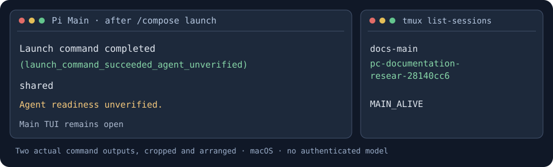

# Pi Compose

**Keep the reasoning. Delegate the work.**

Main Agent와 오래 논의한 설계의 **이유와 제약은 그대로 이어서 개발하고**, 그 맥락이 필요 없는 조사·테스트는 따로 진행하고 싶었습니다.

**Pi Compose는 그 작업을 [Pi](https://github.com/earendil-works/pi) 위에서 연결하는 코딩 Harness입니다.** 개발 에이전트의 실행·작업 공간 준비·이전 작업 탐색을 Pi, Git, tmux, workmux로 조합해, 도구를 관리하는 대신 개발에 집중할 수 있게 돕습니다.

### 작업을 맡기면, 그다음에는?

<figure>
  
</figure>

실제 macOS에서 **Independent + Shared Directory**를 선택한 결과입니다. Pi Compose가 새 tmux 세션을 만들었고 Main Pi 세션은 계속 남아 있었습니다. **두 명령의 출력 일부를 읽기 쉽게 재배치한 SVG**이며, 실제 하나의 분할 화면을 캡처한 이미지는 아닙니다. 모델 인증이 없어 새 에이전트의 실제 코드 작업은 확인하지 못했습니다. [실행 기록](https://github.com/SEONGMINY/pi-compose/actions/runs/40226451266)

Pi Compose의 역할은 여기까지 모든 일을 자동 처리하는 것이 아닙니다. **어떤 맥락을 이어받을지, 파일 작업을 분리할지, 결과를 언제 확인할지**는 사용자가 선택하고, 반복적인 실행 준비를 연결합니다.

## 시작하기

macOS에서 설치합니다. **업데이트도 같은 한 줄**입니다.

```bash
curl -fsSL https://raw.githubusercontent.com/SEONGMINY/pi-compose/main/scripts/install.sh | bash
```

원하는 프로젝트에서 실행하세요.

```bash
cd ~/projects/my-app
pic
```

처음 사용하는 Pi라면 TUI에서 `/login`으로 로그인하고 `/model`에서 모델을 선택합니다. 기존 Pi의 인증·세션·설정·Extension·Skill·Theme는 그대로 사용합니다. [설치 환경](docs/adr/0006-github-installer.md)

## 실제로 작업할 때

**1. Main에서 충분히 논의합니다.**

> 회원 API를 만들자. 기존 토큰 갱신 방식은 클라이언트 호환성 때문에 유지해야 해.

**2. 그 맥락을 이어서 개발을 맡깁니다.**

```text
/compose launch 회원 API 구현
```

Pi 선택 화면에서 **Fork existing Pi session**을 고르고 원본 대화를 지정합니다. 그다음 현재 디렉터리(Shared Directory) 또는 별도 Git Worktree를 선택합니다. 새로운 개발 에이전트에게 결정의 이유를 짧게 다시 요약하는 대신, **Pi가 제공하는 세션 Fork**를 사용하는 방식입니다.

다른 맥락이 필요 없는 조사라면 같은 화면에서 **Independent new session**을 선택할 수 있습니다. Context와 Workspace는 별개 선택이므로 Fork하더라도 Worktree가 강제되지는 않습니다.

**3. 시작한 작업을 확인하고, Main은 다음 일을 이어갑니다.**

- **Shared Directory:** 별도 tmux 세션에서 Pi를 실행합니다. 현재는 `tmux list-sessions` 등으로 직접 해당 세션을 확인합니다.
- **Git Worktree:** workmux가 브랜치·작업 디렉터리와 tmux 창을 만듭니다. workmux Dashboard를 선택적으로 열어 작업을 살펴볼 수 있습니다.

Pi Compose는 작업 **실행 명령이 성공했는지** 보고합니다. 모델이 실제로 코드를 작성 중인지까지 자동으로 확인해 주지는 않습니다. 독립 실행을 요청했다고 Main의 대화가 자동 종료되지도 않습니다.

**4. 이전 작업으로 돌아갑니다.**

```text
/compose back
```

현재 프로젝트의 저장된 Pi 대화와 workmux 작업을 Pi 선택 UI에서 찾습니다. 자연어로 “아까 회원 API 작업으로 돌아가고 싶어”라고 요청할 수도 있습니다. 저장된 대화의 전환은 사용자 Enter로 확정해야 합니다.

현재 **Shared Directory에서 새로 띄운 tmux 세션은 이 목록으로 통합 탐색되지 않습니다.** 그런 경우에는 tmux에서 직접 전환해야 합니다. 닫힌 Worktree를 재개할 때는 정확한 Pi 세션을 선택하고 새 프로세스 실행을 승인해야 합니다.

**5. 필요한 경우 결과를 인계하고 검증합니다.**

```text
/compose-handoff
/compose-verify main
```

두 명령은 아래 선택형 Extension을 켠 경우 사용할 수 있습니다. Handoff는 **구현 내용·선택 이유·검사·미해결 문제**를 정리하고, Verify는 별도의 읽기 전용 Pi 호출로 Git 변경사항을 검토합니다. 결과가 **자동으로 Main에 통합되거나 Git에 병합되는 것은 아닙니다.** 현재 세션에서 확인하고 필요한 내용을 직접 이어갑니다.

[자세한 작업별 사용법](docs/USAGE.md)

## Pi와 무엇이 다른가요?

| 이미 있는 기능 | Pi Compose가 더하는 연결 |
| --- | --- |
| **Pi:** 모델 실행, 세션 Fork·Resume, TUI, Extension | 개발 작업에서 Context 선택과 실행 흐름 연결 |
| **Git:** 브랜치와 Worktree | 사용자 선택에 따라 같은 디렉터리 또는 분리된 공간 준비 |
| **tmux · workmux:** 프로세스·창·작업 전환 | 실행과 작업 복귀 경로 연결 |

Pi Compose는 **새로운 Agent Runtime이나 자동 스케줄러가 아닙니다.** 사용자가 Git 명령과 세션 파일·실행 옵션을 매번 직접 이어 붙이던 일부 과정을 단순화합니다. 중요한 결정과 검증은 사용자에게 남겨둡니다.

## 필요한 기능만 조합하기

기본 `pic`에는 작업 실행·미리보기(`/compose launch`, `/compose preview`)와 작업 탐색·복귀(`/compose back`)가 포함됩니다.

```bash
pic features
```

선택형 Package를 등록하면 Pi 설정 UI에서 **workmux Dashboard / Handoff / Verify**를 개별적으로 켜고 끌 수 있습니다. 처음 등록할 때는 세 기능이 모두 활성화됩니다. Dashboard는 tmux 안에서 사용할 때 `/compose-workmux`로 열 수 있습니다.

Pi Compose는 특정 Dashboard를 강제하지 않습니다. 기존 Pi의 Package·Extension·Skill·Theme와 사용자 정의 기능도 계속 사용할 수 있습니다. 설정을 새로 관리하는 별도 플러그인 시스템은 없습니다.

## 문서와 현재 검증 범위

- [사용 가이드](docs/USAGE.md) — 직접 선택, 복귀, Handoff·Verify의 사용 방법
- [왜 만들었는가](docs/domain-stories/01-as-is-and-pain-points.md) · [주요 설계 결정](docs/README.md)
- [Architecture](docs/ARCHITECTURE.md) · [실제 작업 흐름 검증과 남은 UX 문제](docs/validation/readme-journey.md)

<sub>Pi Compose는 개인용 프로젝트입니다. macOS에서 설치·선택 UI·Independent Shared 실행·Git Worktree 생성은 확인했습니다. 인증된 모델을 이용한 Main 대화 Fork → 코드 작성 → Handoff → 독립 검증 → Main 복귀의 전체 과정은 아직 실사용 검증하지 않았습니다.</sub>
