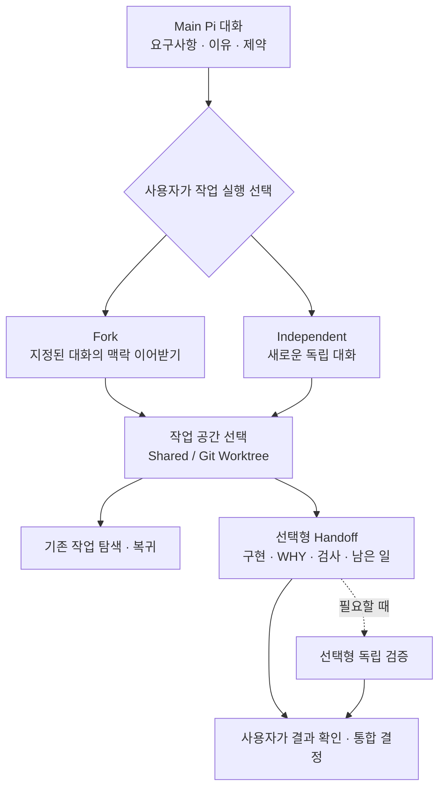

# Pi Compose

**설계의 맥락을 이어서 개발하고, 독립적인 일은 분리해서 진행하는 Pi 기반 코딩 에이전트 Harness.**

[Pi](https://github.com/earendil-works/pi)로 요구사항을 정리하다 보면 결정한 이유, 포기한 대안, 반드시 지켜야 할 제약이 대화에 쌓입니다. 구현을 다른 에이전트에게 맡길 때 이 맥락을 다시 설명하거나, 여러 작업을 오가기 위해 세션과 Worktree를 직접 관리하는 일은 번거롭습니다.

**Pi Compose는 이런 반복 작업을 줄이기 위해 만들었습니다.** 대화 컨텍스트를 이어받는 개발 작업과 독립적인 조사 작업을 상황에 맞게 시작하고, 이전 작업으로 돌아가거나 결과를 인계·검증하는 데 필요한 Pi·Git·tmux·workmux 기능을 연결합니다.

새로운 AI Agent Runtime이 아닙니다. **Pi를 그대로 사용하면서 작업을 시작하고 이어가는 경험을 확장합니다.**

## 시작하기

macOS에서 설치합니다. **업데이트도 같은 명령**을 다시 실행하면 됩니다.

```bash
curl -fsSL https://raw.githubusercontent.com/SEONGMINY/pi-compose/main/scripts/install.sh | bash
```

원하는 프로젝트로 이동해 시작합니다.

```bash
cd ~/projects/my-app
pic
```

처음 실행했다면 Pi TUI에서 모델 제공자에 로그인하고 모델을 선택합니다.

```text
/login
/model
```

OpenAI, Anthropic 등 **Pi가 지원하는 제공자**를 사용할 수 있습니다. Azure OpenAI 전용 환경이 아닙니다. 기존 Pi의 인증과 모델 설정이 있다면 그대로 사용합니다.

> 설치 스크립트는 현재 **macOS용**입니다. Node.js 22.19.0 이상이 필요하고, 누락된 프로그램을 설치할 때 Homebrew를 사용합니다. Homebrew 자체나 기존 Pi 설정을 임의로 변경하지 않습니다. [설치 방식과 주의사항](docs/adr/0006-github-installer.md)

## 일반 Pi와 무엇이 다른가요?

Pi만으로도 대화, 세션 Fork·Resume, 모델 선택, Extension·Skill·Theme 구성이 가능합니다. Pi Compose는 그 위에 **개발 작업의 실행·복귀·인계 흐름**을 연결합니다.

| 하고 싶은 일 | Pi 기본 기능 | Pi Compose에서 추가되는 경험 |
| --- | --- | --- |
| 요구사항·설계 논의 | Pi 대화와 세션 | **그대로 사용.** Main 대화를 별도 시스템으로 옮기지 않음 |
| 논의 내용을 이어받아 개발 | Pi 세션 Fork | **원본 대화와 작업 공간을 선택**해 개발 에이전트 실행 |
| 독립적인 조사·작업 시작 | Pi 새 세션 | **Shared Directory 또는 Git Worktree**를 선택해 실행 |
| 이전 작업으로 돌아가기 | Pi `/resume` | 저장 대화와 workmux 작업 후보를 **한 선택 UI에서 탐색** |
| 결과 인계·검증 | Pi의 모델·도구를 직접 활용 | **선택형 Handoff·독립 검증** 기능 연결 |

모델 실행, 인증, 대화 저장, Extension과 TUI는 **Pi가 담당**합니다. Pi Compose는 작업에 필요한 선택과 기존 도구의 실행을 연결합니다.

## 이런 식으로 사용합니다

### 1. Main Agent에서 먼저 논의하기

평소처럼 `pic`에서 대화합니다.

> 회원 API를 만들려고 해. 기존 인증 흐름을 먼저 살펴보고 요구사항부터 정리하자. 토큰 갱신 방식은 바꾸지 않았으면 좋겠어.

결정한 이유와 지켜야 할 조건을 Main 대화에 남깁니다. **이 단계에서는 개발 에이전트를 자동으로 만들지 않습니다.**

### 2. 맥락이 필요한 개발은 Fork하기

> 지금까지 논의한 내용을 바탕으로 회원 API 개발 에이전트를 실행해 줘. 현재 대화를 Fork하고 별도 Worktree에서 작업하고 싶어.

또는 직접 명령을 입력합니다.

```text
/compose launch 회원 API 구현
```

Pi의 선택 UI에서 **Fork할 원본 세션**, **Shared Directory 또는 Git Worktree**, 필요한 브랜치를 선택합니다. 가장 최근 대화를 Main으로 추측하지 않습니다.

### 3. 독립적인 일은 분리하기

> 외부 SDK 문서를 조사할 에이전트를 별도로 실행해 줘. 지금 대화 컨텍스트는 필요 없어.

```text
/compose launch 외부 SDK 조사
```

선택 UI에서 **Independent**를 고르면 기존 대화를 상속하지 않는 별도 세션으로 시작합니다. 코드 탐색·자료 조사처럼 Main에서 이어받을 맥락이 없는 일에 사용할 수 있습니다.

### 4. 이전 작업으로 돌아가기

> 아까 진행하던 회원 API 작업으로 돌아가고 싶어.

또는 모델 호출 없이 직접 선택합니다.

```text
/compose back
/compose back 회원 API
```

저장된 Pi 대화를 고르면 현재 Pi 안에서 전환합니다. 자연어로 선택한 **저장 대화는 입력창에 정확한 전환 명령을 준비하므로 Enter로 확정**해야 합니다. Worktree 작업은 상태에 따라 이동하거나, 정확한 저장 대화를 선택한 뒤 승인받아 재개합니다.

Pi 기본 저장 세션만 선택하려면 **`/resume`**도 그대로 사용할 수 있습니다.

### 5. 결과 인계와 필요한 검증

선택형 Extension을 활성화했다면 개발 세션에서 다음 명령을 사용할 수 있습니다.

```text
/compose-handoff
/compose-verify
```

Handoff는 **무엇을 변경했는지, 왜 그렇게 했는지, 실제로 어떤 검사를 했는지, 무엇이 남았는지** Git 상태와 함께 정리합니다. 수신자를 지정하면 승인 후 workmux를 통해 보고서를 보낼 수 있습니다.

독립 검증은 별도 Pi 모델 호출로 변경 사항을 살펴봅니다. **Handoff는 검증 완료를 뜻하지 않고, 검증 결과도 자동 병합으로 이어지지 않습니다.**

[각 단계의 선택 기준과 세부 사용법](docs/USAGE.md)

## 작업 흐름 한눈에 보기



Fork/Independent는 **대화 컨텍스트 선택**, Shared/Worktree는 **파일 작업 공간 선택**입니다. 둘은 서로 독립적입니다. 작업의 순서나 병렬 실행, 최종 Git 통합 시점도 사용자가 결정합니다.

## 원하는 방식으로 제어하기

| 방식 | 이런 경우에 |
| --- | --- |
| **자연어** | 원하는 결과는 알지만 어떤 명령을 써야 할지 모를 때 |
| **Slash Command** | 실행·복귀 대상을 직접 선택하고 모델 호출을 줄이고 싶을 때 |
| **Pi 선택 UI / TUI** | 원본 세션·작업 공간·이전 작업을 눈으로 확인하고 고를 때 |

일반 Pi의 모델·인증·세션·Skill·Theme 기능은 그대로 유지됩니다. `pic`은 기존 Pi 설정을 사용하며 사용자 정의 Extension도 추가할 수 있습니다.

## 기본 기능과 선택형 기능

| 구분 | 기능 | 사용 진입점 |
| --- | --- | --- |
| **기본** | 새 작업 실행, 실행 계획 미리보기 | `/compose launch` · `/compose preview` |
| **기본** | 기존 작업 찾기·복귀, 명시적 세션 재개 | `/compose back` · `/compose resume` |
| 선택형 | workmux Dashboard | `/compose-workmux` |
| 선택형 | 개발 결과 Handoff | `/compose-handoff` |
| 선택형 | 별도 모델의 독립 검증 | `/compose-verify` |

선택형 기능이 필요하면 한 번 등록합니다.

```bash
pic features
```

Pi의 설정 UI가 열립니다. **처음 등록하면 세 기능이 모두 활성화**되므로, 쓰지 않는 기능은 여기서 끄면 됩니다. 프로젝트별로 설정하려면 `pic features --local`을 사용할 수 있습니다.

이 기능들은 Pi의 **Package·Extension**으로 제공됩니다. 다른 Extension·Skill·Theme를 추가하거나 View를 바꿀 수도 있으며, 일반 `pi` 명령도 계속 사용할 수 있습니다. Pi Compose 전용 Plugin Manager나 별도의 설정 DB는 없습니다.

[자세한 확장 및 설정 방법](docs/USAGE.md#handoff와-독립-검증-선택형)

## 어디까지 제공하나요?

Pi Compose는 **자동 개발 오케스트레이터가 아닙니다.** 개발 에이전트 생성과 새로운 Pi 프로세스 재개, 결과 전달 등 영향이 있는 작업은 사용자의 선택·승인을 따릅니다. Git 자동 병합·Worktree 강제 정리도 수행하지 않습니다.

설치·`pic` TUI 실행과 일부 Pi/tmux/workmux 연동은 격리 환경에서 확인했습니다. 실제 모델을 사용하는 여러 에이전트 간 Fork 맥락 보존, Handoff 수신, 독립 검증의 모든 시나리오가 끝까지 검증된 것은 아닙니다. 자세한 범위는 [검증 기록](docs/validation/phase6-integration.md)과 [Implementation Plan](docs/IMPLEMENTATION_PLAN.md)에 남겨두었습니다.

## 더 알아보기

- [사용 가이드 — 명령과 선택 기준](docs/USAGE.md)
- [PRD — 왜 이런 흐름을 선택했는가](docs/PRD.md)
- [Architecture — Pi·Git·tmux·workmux의 역할](docs/ARCHITECTURE.md)
- [설계 결정 및 구현·검증 문서](docs/README.md)

---

Pi Compose는 개인 개발 환경을 위해 만들고 있는 프로젝트입니다. 기존 Pi의 유연성을 유지하면서, **Harness를 관리하는 시간보다 개발과 리서치에 쓰는 시간을 늘리는 것**이 목표입니다.
