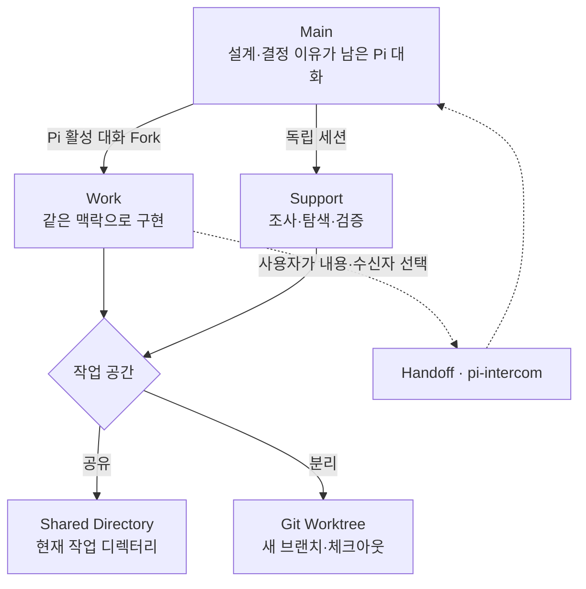

# Pi Compose

**설계를 논의하던 Pi 대화는 남겨두고, 구현은 그 대화를 이어받은 다른 Pi 에이전트에게 맡길 수 있어요.**

AI와 개발 방향을 논의하다 보면 구현할 기능뿐 아니라 *왜 그렇게 결정했는지*, *어떤 대안을 제외했는지*, *무엇을 바꾸면 안 되는지*까지 정하게 됩니다. 작업을 새 에이전트에게 짧게 요약해서 전달하면 이런 배경이 빠지기 쉽습니다.

그렇다고 설계하던 대화에서 코드 탐색, 구현, 테스트, 긴 오류 로그까지 모두 처리하고 싶지는 않았습니다.

**Pi Compose는 원래 대화의 맥락을 유지한 채, 개발 작업을 분리하기 위해 만든 [Pi](https://github.com/earendil-works/pi) 기반 코딩 에이전트 Harness입니다.**

[](docs/assets/readme/overview-demo.mp4)

*Main에서 설계를 논의하고, Work에 구현을 맡긴 뒤, 필요한 결과만 확인하는 흐름. 이미지를 클릭하면 전체 데모를 볼 수 있어요.*

## 실제로 사용해 보면

예를 들어 프로필 API에 `displayName`을 추가하면서, 이전 클라이언트와의 호환성을 위해 `label`은 계속 유지하기로 했다고 해볼게요.

### 1. Main에는 설계와 결정 이유를 남깁니다

`pic`에서 프로덕트를 선택하고 Main을 엽니다. Main에서는 요구사항, 기존 API 계약, 대안을 함께 논의해요.

이 대화에는 **`label`을 유지해야 하는 이유**도 남습니다. 개발 작업 때문에 이 대화를 다른 세션으로 바꾸거나 처음부터 다시 설명할 필요가 없습니다.

### 2. 같은 맥락으로 Work를 만들어 개발합니다

설계 논의가 끝나면 Main에서 다음과 같이 입력합니다.

```text
>>w 앞서 합의한 프로필 API 변경을 구현해줘.
```

`>>w`는 **현재 Pi 대화를 Fork한 Work**를 만들고, 파일은 **새 Git Worktree**에서 수정하도록 요청합니다. 새 Work에는 논의했던 맥락이 이어지지만, 이후 코드 탐색·도구 출력·수정 기록은 원래 Main 대화에 쌓이지 않아요.


*Work는 원본 설계 제약을 참고해 개발하고, Main은 그대로 남아 있습니다.*

### 3. 작업 내용 중 필요한 것만 확인하고 공유합니다

Work가 작업하는 동안 `pic`에서는 프로덕트별 Agent를 보거나 기존 Ghostty Split으로 이동할 수 있습니다. Summary 정보층에서는 최근 요청·도구 결과·Assistant 응답을 원본 기록과 연결해 확인할 수 있어요.

중요한 내용을 다른 에이전트에게 전달하고 싶을 때는 Work의 Pi TUI에서 직접 선택합니다.

```text
/compose handoff
```

보낼 원본 내용과 받을 Agent를 고르고, 전송할 문구를 검토한 뒤 공유합니다. **Work의 전체 로그나 새 제안이 Main의 대화에 자동으로 들어가지는 않습니다.** 공유했다는 사실과 그 내용을 승인했다는 사실도 구분합니다.


*필요한 내용만 사용자가 선택합니다. 전송 성공은 수신 모델이 실제로 내용을 처리했다는 뜻은 아니에요.*

### 4. Main으로 돌아와 다음 결정을 이어갑니다

프로덕트 목록에서 원래 Main을 선택하면 기존 Pi 화면으로 돌아갑니다. Work에서 발생한 긴 실행 로그 대신 **처음 논의했던 요구사항과 결정 이유를 바탕으로** 다음 작업을 이어갈 수 있어요.


*Work의 작업 기록을 Main에 전부 옮기지 않아도, 원래 설계 대화는 그대로 이어집니다.*

반대로 기존 대화가 필요 없는 파일 탐색이나 독립적인 조사는 `>s`로 Support에 맡길 수 있습니다. 모든 작업을 Main의 긴 대화에서 Fork할 필요는 없기 때문입니다.

## 어떻게 동작하나요?

**대화의 맥락(Context)**과 **파일을 수정할 공간(Workspace)**을 분리해서 생각하면 이해하기 쉬워요.



**Main**은 문제 정의와 설계의 원본 대화입니다. **Work**는 지정한 Pi 세션의 완료된 대화 지점을 실제로 Fork해 맥락이 중요한 개발에 사용합니다. **Support**는 기존 대화를 상속하지 않는 독립 Pi 세션입니다.

파일 작업은 별개예요. `>w`와 `>s`는 현재 디렉터리를 공유하고, `>>w`와 `>>s`는 명령을 입력한 Agent의 **현재 Git HEAD**에서 새 Worktree를 만듭니다. Worktree에 원본 디렉터리의 미커밋 변경사항이 복사되지는 않습니다.

## Pi만 사용할 때와 무엇이 다른가요?

Pi는 이미 세션 Fork·Resume과 Extension을 제공하고, Git에는 Worktree가 있으며, Ghostty는 Split을 제공합니다. Pi Compose가 이 기능들을 새로 만든 것은 아닙니다.

| 기존 도구가 제공하는 기능 | Pi Compose에서 연결하는 경험 |
| --- | --- |
| **Pi** — 대화, Fork, Resume, Extension | Main·Work·Support를 구분하고 원하는 대화 맥락으로 작업 시작 |
| **Ghostty** — 터미널·Split·포커스 | `pic`에서 Agent를 탐색하고 기존 Pi 터미널로 이동 |
| **Git** — 브랜치·Worktree | 맥락 상속과 별개로 파일 작업 공간 선택 |
| **pi-intercom** — Agent 간 메시지 | 사용자가 원본 내용과 수신자를 선택해 필요한 정보만 전달 |

**Pi Compose는 또 다른 Agent Runtime이나 자동 작업 스케줄러가 아닙니다.** Pi의 확장성을 유지하면서, 직접 조합해야 했던 개발 흐름을 하나로 연결하는 프로젝트예요.

## 설치 및 첫 실행

현재 설치 스크립트는 **macOS**용이며 **Node.js 22.19.0 이상**이 필요합니다. [Ghostty](https://ghostty.org/)에서 실행하는 것을 기준으로 개발하고 있어요.

```bash
curl -fsSL https://raw.githubusercontent.com/SEONGMINY/pi-compose/main/scripts/install.sh | bash
```

설치 후 원하는 프로젝트에서 실행합니다.

```bash
cd /path/to/your-project
pic
```

`pic`의 관리 화면에서 `n`은 새 Main 생성, `o`는 저장된 Pi 세션 선택, `1`·`2`·`3`은 각각 프로덕트·전체 Agent·메시지 보기입니다. Main을 처음 열었다면 Pi의 `/login`과 `/model`로 인증과 모델을 설정할 수 있어요.

**사용 전 확인:** 현재 `main`에는 Ghostty 중심 코드와 이전 실행 구조가 함께 남아 있습니다. 설치 스크립트도 레거시 `tmux`·`workmux`를 설치하며, 이는 새 Ghostty 경험의 필수 의존성이라는 뜻이 아닙니다. Native 실행·Fork·Handoff·Overlay의 전체 macOS 실사용 흐름은 아직 통합 검증 전이고, Summary의 의미 요약과 중요 결정 자동 후보·완성된 메시지 Sidebar도 구현 중입니다.

## 더 알아보기

실행 명령과 제약은 [사용 가이드](docs/USAGE.md), 중요한 제품 결정은 [PRD](docs/PRD.md), 구조와 구현 범위는 [Architecture](docs/ARCHITECTURE.md)와 [Implementation Plan](docs/IMPLEMENTATION_PLAN.md)에서 확인할 수 있어요.
