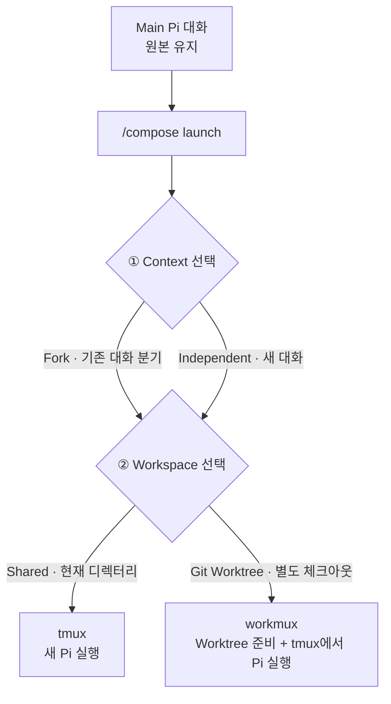

# Pi Compose

**설계를 논의하던 대화는 남겨두고, 구현은 다른 [Pi](https://github.com/earendil-works/pi) 에이전트에게 맡길 수 있어요.**

> **현재 제품 방향 (2026-10-30, 설계 확정 범위 / 구현 미완료):** Pi + Ghostty에서 Main은 계속 보이고, 정확히 Fork된 Work 및 독립 Support는 별도 Pi 터미널에서 작업합니다. 완료 결과 Summary Overlay는 필수 요구사항이며, Work의 중요 결정은 사용자 요청 시에만 Main 컨텍스트로 인계합니다. 기존 `docs/*`와 `AGENTS.md`를 활용해 중요한 승인 결정을 보존합니다.
>
> **Orca 통합은 중단**, tmux/workmux는 신규 방향에서 사용하지 않습니다. 아래의 Orca·tmux·workmux 명령, 스크린샷, 설치 안내는 **기존 구현의 사용 기록**이며 현행 제품의 실행 방법으로 오인하면 안 됩니다. 기존 코드·세션·Worktree는 보존합니다.
>
> [현재 확정 정책 및 미확정 사항](docs/PRD.md#0-최신-사용자-결정--2026-10-30) · [문서 안내](docs/README.md)

## 아래 내용은 이전 구현 안내 (역사적 자료)

AI와 요구사항을 논의할 때는 구현할 기능뿐 아니라 **왜 그렇게 결정했는지, 어떤 대안을 제외했고 무엇을 바꾸면 안 되는지**도 함께 정합니다. 새 에이전트에게 결과만 짧게 전달하면 이런 배경이나 강한 제약이 빠질 수 있어요.

한 대화에서 구현과 테스트까지 진행하면 코드 탐색 결과와 오류, 긴 실행 로그까지 쌓입니다. Pi Compose에서는 **원래 대화를 유지하면서, 그 대화를 이어받은 새 에이전트에게 개발을 맡길 수 있어요.**

## 실제로 사용해 보면

예를 들어 프로필 API에 `displayName`을 추가하면서, 기존 클라이언트와의 호환성을 위해 `label` 필드는 유지하기로 했다고 해볼게요. 설계를 논의하던 Pi 화면에서 이렇게 요청합니다.

```text
/compose launch 앞서 합의한 API 변경을 구현해줘
```

이번 작업에는 앞서 논의한 제약이 중요하므로 **기존 대화를 이어받고(Fork), 코드 변경은 별도 Git Worktree에 분리**합니다. 실제 메뉴에서는 `Fork existing Pi session` → `Git Worktree` → `Current Pi session`을 고르고 새 브랜치 이름을 입력해요.

새 에이전트는 기존 대화를 참고해 별도 작업 공간에서 개발합니다. 구현 중에 발생하는 도구 출력이나 테스트 로그는 원래 대화에 쌓이지 않아요.


*기존 `label` 필드의 제약을 확인하고 코드를 변경한 개발 에이전트.*

작업을 확인한 뒤 tmux 창을 전환하면, 원래 대화에서 설계 논의를 이어갈 수 있습니다.


*별도 에이전트의 실행 로그 없이 남아 있는 원래 Pi 대화.*

두 화면은 실제 macOS 사용 녹화에서 가져왔습니다. 원래 창으로 돌아오는 건 tmux에서 하고, 저장된 다른 Pi 대화나 workmux 작업을 찾을 때는 `/compose back`을 사용해요. [사용 가이드](docs/USAGE.md)에 자세한 방법을 정리했습니다.

## 어떻게 동작하나요?

작업을 시작할 때 **어떤 대화를 바탕으로 할지(Context)**와 **어느 디렉터리에서 파일을 수정할지(Workspace)**를 따로 정합니다.



설계 이유나 제약이 중요한 개발이라면 Pi의 **Fork**로 이전 대화를 이어받습니다. 기존 논의가 필요 없는 코드 탐색이나 테스트는 **Independent**로 시작할 수 있어요. 모든 작업에 긴 대화를 가져갈 필요는 없기 때문입니다.

파일 작업 공간은 별개로 선택합니다. **Shared Directory**는 현재 디렉터리를 사용하고, **Git Worktree**는 별도 브랜치와 체크아웃을 만듭니다. Worktree는 변경사항을 분리하기 좋지만 브랜치와 디렉터리를 추가로 관리해야 해요.

선택한 작업 공간에 따라 실행 방식도 달라집니다. Shared는 tmux에서 Pi를 실행하고, Worktree는 workmux가 작업 디렉터리와 tmux 실행을 준비합니다.

## Pi나 workmux만 사용할 때와 무엇이 다른가요?

Pi도 대화를 Fork할 수 있고, [workmux](https://github.com/raine/workmux)는 Pi 세션을 Fork해 Worktree에서 실행하는 기능을 지원해요. 특정 대화를 지정할 때는 `--fork=<session-id>` 같은 옵션을 사용할 수 있습니다.

Pi Compose에서는 **현재 Pi 화면에서 `/compose launch`를 실행하고 대화와 작업 공간을 메뉴에서 선택**합니다. 세션 ID와 실행 옵션을 직접 조합하는 대신, 작업마다 필요한 방식을 고르고 실행할 수 있어요.

## 설치 및 첫 실행

현재 macOS에서 설치할 수 있고, Node.js 22.19.0 이상이 필요해요.

```bash
curl -fsSL https://raw.githubusercontent.com/SEONGMINY/pi-compose/main/scripts/install.sh | bash
```

Worktree 작업을 하려면 tmux 안에서 `pic`을 실행하세요.

```bash
cd /path/to/your-project
tmux new-session -s pic-work pic
```

이미 tmux를 사용 중이라면 `pic`만 실행하면 됩니다. 처음 Pi를 사용한다면 `/login`으로 로그인하고 `/model`에서 모델을 선택하세요. 필요한 tmux와 workmux는 설치 스크립트가 Homebrew로 설치할 수 있으며, Homebrew 자체는 미리 준비해야 합니다.

**사용 전 주의:** Git Worktree에는 원래 디렉터리의 미커밋 변경사항이 복사되지 않습니다. Shared Directory에서 여러 에이전트가 같은 파일을 수정하면 변경이 겹칠 수 있어요. 작업 실행과 결과 확인, Git 병합은 개발자가 직접 결정합니다.

작업 결과 정리(Handoff), 독립 코드 검토(Verify), workmux Dashboard는 `pic features`로 추가할 수 있어요. 자세한 명령어는 [사용 가이드](docs/USAGE.md), 설계 이유와 제약은 [설계 문서](docs/README.md)에서 확인할 수 있습니다.
