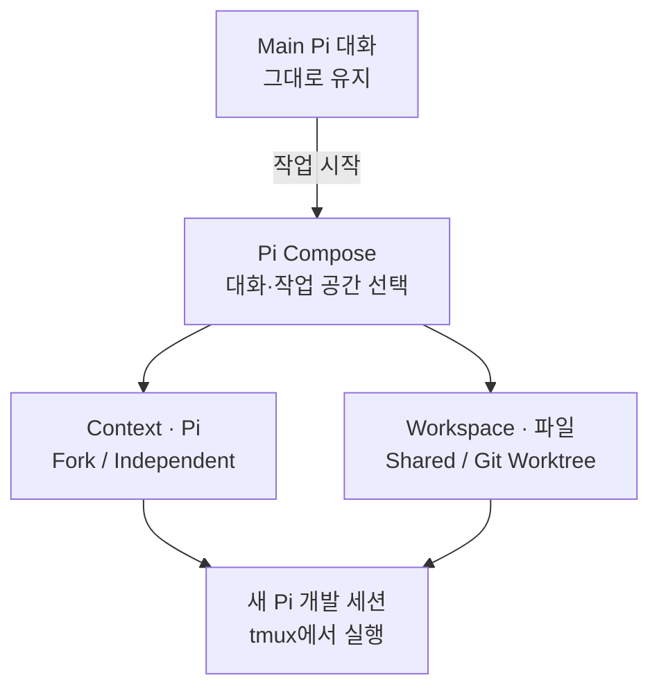

# Pi Compose

**Main에서 논의한 내용은 남겨두고, 개발은 다른 Pi 에이전트에게 맡길 수 있어요.**

[Pi](https://github.com/earendil-works/pi)에서 요구사항과 설계 이유까지 논의했는데, 개발을 따로 맡기려면 그 배경을 다시 설명하거나 새 세션과 작업 디렉터리를 준비해야 할 때가 있습니다.

Pi Compose는 **원래 대화를 유지하면서 다른 Pi 에이전트에게 작업을 맡기는 과정**을 연결해요. Pi 안에서 이어받을 대화와 작업 공간을 선택하면, 그에 맞게 새 에이전트를 실행합니다.

## 실제로 사용해 보면

예를 들어 Main에서 프로필 API를 논의하면서 기존 클라이언트와의 호환성을 위해 `label`을 유지하기로 결정했다고 해볼게요. 설계를 마친 다음, Main에서 개발 에이전트를 실행합니다.

```text
/compose launch 앞서 합의한 API 변경을 구현해줘
```

Pi Compose가 기존 대화를 이어받을지, 어느 작업 공간에서 개발할지 묻습니다. 이 예시에서는 **Fork existing Pi session → Git Worktree → Current Pi session**을 선택하고 새 브랜치 이름을 입력했습니다.

그러면 원래 대화를 Fork한 Pi가 별도 Worktree와 tmux 창에서 개발을 시작합니다. Main에 합의했던 이유와 제약도 새 에이전트가 참고할 수 있어요. 원래 Main 대화에는 새 에이전트의 수정 과정이나 긴 실행 로그가 쌓이지 않습니다.


*Fork된 개발 에이전트의 실제 화면. 기존 `label` 유지 제약과 변경된 코드를 확인할 수 있습니다.*

개발 작업을 확인한 뒤에는 tmux에서 원래 Main 창으로 돌아갈 수 있습니다. 아래 화면처럼 기존 설계 대화를 이어서 진행할 수 있어요.


*원래 Main의 실제 화면. 앞서 결정한 내용과 그 이유를 그대로 이어서 설명합니다.*

위 화면은 실제 macOS 사용 녹화의 서로 다른 시점에서 추출했습니다. **하나의 Fork 개발 작업과 Main 복귀를 보여주는 예시**이며, 여러 에이전트의 진행 상태를 통합해서 보여주는 화면은 아닙니다.

### 다른 종류의 작업이라면?

코드 탐색이나 테스트처럼 이전 대화가 필요 없다면 **Independent new session**으로 시작할 수 있어요. 작업 파일을 따로 분리할 필요가 없다면 **Shared directory**를 선택하면 됩니다. 모든 작업에서 Fork나 Worktree를 사용할 필요는 없어요.

이전에 작업한 대화나 Worktree를 다시 찾으려면 `/compose back`을 사용하세요. 현재 버전에서 **tmux 창으로 이동하는 것과 저장된 작업을 탐색하는 것은 서로 다른 동작**입니다. 자세한 복귀 방법은 [사용 가이드](docs/USAGE.md)에 정리했습니다.

## 어떻게 동작하나요?

Pi Compose는 **대화 맥락(Context)**과 **코드 작업 공간(Workspace)**을 따로 선택해요. Fork를 선택해도 Worktree가 자동으로 만들어지지는 않고, Independent 세션도 Worktree에서 실행할 수 있습니다.



**대화 맥락은 Pi가 관리합니다.** Fork는 사용자가 지정한 Pi 대화를 분기해 새 세션에서 이어받고, Independent는 원본 대화를 이어받지 않고 새로 시작해요. 원래 Main 대화는 그대로 남습니다.

**파일 작업 공간은 별개의 선택입니다.** Shared는 현재 디렉터리를 함께 사용합니다. Git Worktree는 별도 브랜치와 체크아웃을 만들어요. 대화를 Fork한다고 파일까지 복사되는 것은 아닙니다.

**실행 준비는 Pi Compose가 연결합니다.** Shared는 tmux에서 Pi를 실행하고, Worktree는 workmux가 Git Worktree와 tmux 실행을 준비해요. Pi Compose가 새로운 세션·Worktree 기능을 직접 구현하거나 Git 변경을 자동으로 병합하지는 않습니다.

## Pi나 workmux만 사용할 때와 무엇이 다른가요?

Pi에서도 대화를 Fork할 수 있고, [workmux](https://github.com/raine/workmux)도 한 명령으로 Pi 세션을 Fork해 Git Worktree에서 실행할 수 있어요.

차이는 **실행할 작업을 선택하는 과정**에 있습니다. workmux를 직접 사용한다면 실행 옵션을 정하고, 특정 Pi 대화를 이어받을 때는 `--fork=<session-id>`처럼 원본을 지정할 수 있습니다. Pi Compose에서는 **Main 대화 안에서 `/compose launch`를 실행하고, 이어받을 대화와 작업 공간을 메뉴에서 고릅니다.** Git Worktree를 사용하지 않고 현재 디렉터리에서 시작하는 것도 같은 흐름에서 선택할 수 있어요.

## 설치 및 첫 실행

현재 macOS에서 설치할 수 있고, Node.js 22.19.0 이상이 필요해요.

```bash
curl -fsSL https://raw.githubusercontent.com/SEONGMINY/pi-compose/main/scripts/install.sh | bash
```

Worktree 작업을 하려면 tmux 안에서 `pic`을 실행하세요.

```bash
cd /path/to/your-project
tmux new-session -s pic-work pic
```

이미 tmux를 사용 중이라면 `pic`만 실행하면 됩니다. 처음 Pi를 사용한다면 `/login`으로 로그인하고 `/model`로 모델을 선택하세요. 설치에 필요한 tmux와 workmux는 Homebrew로 설치할 수 있으며, Homebrew 자체는 미리 준비해야 합니다.

**사용 전 주의:** Git Worktree에는 원래 디렉터리의 미커밋 변경사항이 복사되지 않습니다. Shared directory에서 여러 에이전트가 같은 파일을 수정하면 변경이 겹칠 수 있어요. 작업 실행과 결과 확인, Git 병합은 개발자가 직접 결정합니다.

작업 결과 정리(Handoff), 독립 코드 검토(Verify), workmux Dashboard는 `pic features`로 추가할 수 있어요. 세부 명령과 실행 옵션은 [사용 가이드](docs/USAGE.md), 설계 이유와 제약은 [설계 문서](docs/README.md)에서 확인할 수 있습니다.
