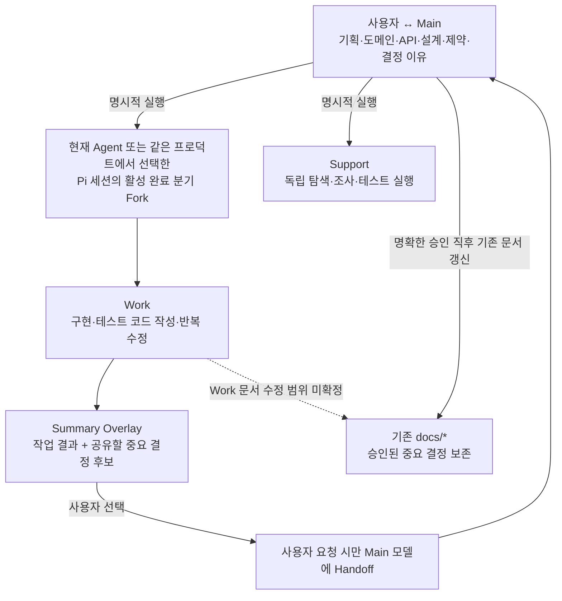
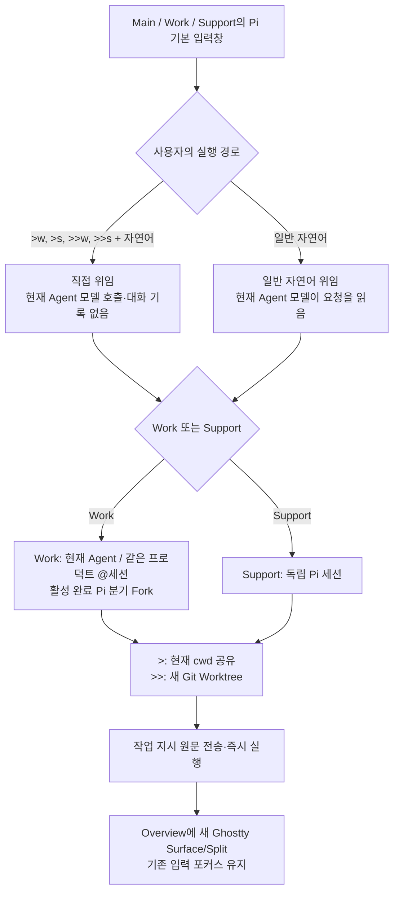
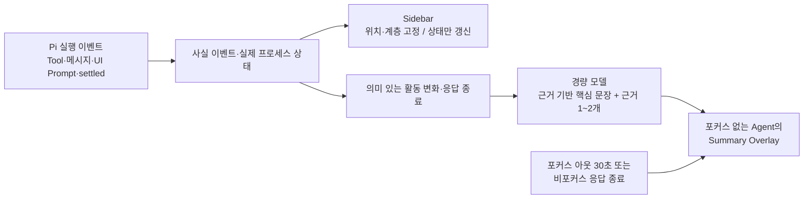

# Architecture — Pi Compose

- 기준: [PRD](PRD.md) (2026-10-31 합의)
- 상태: **책임 경계 설계 / Ghostty 중심 구현·실사용 검증 전**

## 1. 설계 원칙

Pi Compose는 **Pi 위에 얇게 얹는 Harness**입니다. 새로운 대화 엔진·터미널 관리자·독립 Git 엔진·상시 문서 동기화 서비스를 만들지 않습니다.

Main의 실제 Pi 대화에 요구사항, 도메인 정책, 설계와 결정 이유를 축적합니다. Work는 **명령어를 입력한 현재 Agent** 또는 **같은 프로덕트에서 `@세션`으로 선택한 Pi 세션**의 활성 완료 분기를 정확히 Fork하고 개발 기록을 별도 세션에 둡니다. 맥락이 불필요한 작업은 Support 독립 세션에 위임합니다. **컨텍스트 원본과 실제 Git 작업 디렉터리는 별개**입니다.

## 2. 책임과 소유권

| 담당 | 소유하는 것 | 소유하지 않는 것 |
| --- | --- | --- |
| 사용자 | 중요 계약 변경 승인, Work/Support 시작, Main 수신, **종료/백그라운드 선택**, Git 통합·문서 롤백 선택 | 반복적인 터미널·Git 명령 조합 |
| **Pi** | 세션 트리·JSONL·Fork·Resume·모델·Extension·Compaction·TUI | Git 작업 공간 복제/병합 |
| **Ghostty** | **Agent별 고유 터미널(Surface)과 Pi 프로세스 실행**, Overview의 Split·별도 작업 Tab 배치, 포커스·종료·최소화/숨김 | Agent의 의미적 완료·문서 정책 판단 |
| **Pi Compose** | **프로덕트→여러 Main→관련 Agent 탐색**, 전체 Agent 보기, **별도 메시지 관리 사이드바**, **생성 요청 Agent·Fork 원본 세션·Workspace의 구분**, Summary Overlay/Handoff의 최소 기능 | 별도 LLM 런타임·계약 DB·범용 메시징 Broker |
| **Git** | 파일·브랜치·Worktree·변경 이력·코드/문서 통합 | Pi 대화 분기/모델 컨텍스트 |
| **프로젝트 문서** | 승인된 중요한 계약과 선택 이유 | 모든 대화/실행 로그의 영구 사본 |

## 3. 기본 컨텍스트 흐름

- **Summary는 사람에게 표시하는 화면**입니다. 자동으로 Main의 Pi 대화에 메시지를 추가하지 않습니다. Work A의 공유 후보를 다른 Work에 보내려면 **사용자가 수신 Work와 전송을 선택**해야 합니다. 통신은 기존 `pi-intercom`을 재사용하며 Pi Compose의 **작은 Extension은 Summary와 대상 선택·전송 연결**만 담당합니다. 수신 Work가 응답 중이라면 **현재 Pi 턴 종료 후** 모델에 반영하며 진행 중인 턴을 끊거나 조향하지 않습니다. 기능 개발 전체의 완료 여부는 별도로 판정하지 않습니다. Pi 턴 종료 감지는 기술 검증 대상입니다.
- 중요 결정의 공유 후보는 Work Summary에서 **자동 표시**하지만 'Main에 미반영' 여부를 정확한 근거 없이 확정 표시하지 않습니다.
- Pi 대화 롤백과 Git 파일 롤백은 별개입니다. 서로를 자동으로 되돌리지 않습니다.

### 3.1 탐색 계층과 메시지 관리

- **프로덕트별 보기**: `Pillo`, `Pi Compose`처럼 프로젝트 또는 제품을 기준으로 묶고, 프로덕트 아래 여러 Main과 관련 Work/Support를 탐색합니다. Main 화면 표기에는 `Main ·` 접두어를 붙이지 않고 `복약관리` 등 이름만 보여줍니다.
- **전체 Agent 보기**: 프로덕트를 가로질러 실제 Main/Work/Support의 상태와 소속을 파악합니다. 그룹을 바꿔도 같은 세션/관계를 바라봅니다.
- **메시지 관리 사이드바**: 별도 진입점에서 전달 내역·대기/수신/실패 등 사용자가 조치할 상태를 관리합니다. Summary Overlay의 중요한 결정 **공유 후보**와 실제 `pi-intercom` **전송 메시지**는 별개입니다. 화면에 표시된 메시지가 다른 Agent의 모델에 반영된 것은 아닙니다.
- **사이드바는 `pic` Overview Tab 내부에만 표시**합니다. 별도 Ghostty 작업 Tab에는 표시하지 않습니다. Overview로 돌아오면 관리 TUI와 그 Tab에 남아 있는 실제 Pi TUI를 다시 볼 수 있어야 합니다. Main의 위치와 Overview의 수명은 독립적입니다.
- `pic`의 관리 TUI는 Overview에 남고, 각 실행 Main·Work·Support는 **자신의 고유 Ghostty Surface에서 실제 Pi TUI**를 사용합니다. 초기에는 여러 Surface를 Overview Split으로 동시에 표시합니다. 사용자가 Ghostty 기본 드래그로 기존 Surface를 작업 Tab으로 옮기면 Overview의 해당 Split에서만 빠집니다. 사이드바에서 Agent를 선택하면 **그 Surface의 현재 위치로 포커스**합니다. Surface ID/TTY, 실제 Tab 위치와 Pi 세션 연결은 검증 대상입니다.
- **Agent마다 기존 Surface와 Pi 프로세스를 유지**하며, 새 Agent는 생성 순서에 따라 마지막 생성 Agent 옆에 Split으로 추가합니다. 작업 상태가 바뀌어도 배치·Sidebar 관계를 재정렬하지 않습니다. 별도 Tab 이동은 사용자 선택이며, 인위적인 Agent 수 제한/자동 숨김·이동·정리는 하지 않습니다. Main도 다른 작업 Tab으로 이동할 수 있습니다. 화면 이동을 Pi 재실행/Resume 또는 동일 TUI의 복제로 흉내 내지 않습니다. 첫 버전은 **Ghostty 기본 수동 드래그**를 사용하고 자동 이동 메뉴는 후속 과제로 남깁니다. **Herdr App·herdr-core·별도 멀티플렉서/프로세스 실행 계층** 및 전역 GUI는 도입하지 않습니다.

### 3.2 위임 입력에서 실행까지

- **`>w`, `>s`, `>>w`, `>>s`**는 모든 Main/Work/Support의 Pi 입력 첫머리에 작성하는 확정 위임 문법입니다. `>`는 현재 디렉터리를 공유하고 `>>`는 새 Git Worktree를 생성합니다. **역할·중첩 깊이에 인위적 생성 제한을 두지 않고**, 사용자 직접 위임과 모델의 자율 위임 권한은 구분합니다(자율 위임은 추후 결정). Pi `input` 이벤트 등 기존 Extension API로 **명령을 입력한 Agent 모델 호출 이전**에 처리하고, 단축어/선택용 세션 토큰을 제외한 원본 지시를 전달합니다. 일반 자연어 위임도 유지하며 **Compose 전용 키보드 단축키·기존 Pi/Ghostty 키 변경은 하지 않습니다.**
- **`>w @` / `>>w @`**는 **같은 프로덕트의 Main·Work·Support 세션**만 자동완성합니다. 실행 중·종료된 저장 세션 모두 포함하고, **이름·최근 작업 한 줄·Workspace 정보**로 구분하며 **Pi 세션 ID**로 정확히 선택합니다. 이름·최근 작업 내용으로 검색하고 기존 Summary 또는 사실에 근거한 최근 지시를 사용하되 입력마다 LLM을 호출하지 않습니다. 일반 Pi `@` 파일 참조를 덮어쓰지 않으며, API 호환성과 종료 세션의 활성 leaf 식별은 검증 대상입니다.
- `@세션`이 없는 Work 명령은 **명령 입력 Agent 자신의 완료된 Pi 컨텍스트**를 Fork합니다. `@세션`을 붙인 경우에는 해당 저장 세션의 완료 지점을 Fork하되 **Workspace는 명령 입력 Agent 기준**으로 유지합니다. 생성 요청 계층과 실제 Fork 출처는 별도 관계로 관리합니다.
- 새 Work/Support는 **별도 Pi 세션·프로세스·실제 Ghostty Surface**를 소유합니다. 실행 실패 시 동일 지시의 중복 실행을 피하고 원문을 보존합니다. Main의 원본 Pi 대화 및 진행 중 응답은 손상시키지 않습니다.
- 개별 Agent 클릭/Overlay 포커스/Sidebar 탐색은 **같은 실행 중 Surface를 찾는 동작**입니다. Tab 이동 때 새 Pi 프로세스 또는 TUI 복제를 만들어서는 안 됩니다. Sidebar는 Overview에만 유지합니다.

### 3.3 실행 상태 → Sidebar와 Summary Overlay

- Pi `agent_settled`는 안정적인 응답 종료 신호로 사용하지만 구현/테스트의 실질 완료를 의미하지 않습니다. 명시적인 Pi UI Prompt는 사용자 선택 대기의 근거가 되며, 단순 질문은 자동으로 차단 상태가 되지 않습니다.
- Overlay는 Pi TUI와 독립된 **표시 계층**입니다. Agent 포커스 시 즉시 해제하며, 포커스가 없을 때 30초 후 또는 응답 종료 시에만 보여줍니다. 30초는 **시각 표시 타이머**이며 30초 간격 LLM 호출이나 감시가 아닙니다. Ghostty가 실제 Surface 위 겹침을 허용하는지 구현 전 확인해야 합니다.
- 요약용 모델 호출은 실제 Agent의 모델 대화에 컨텍스트를 삽입하지 않고, Tool·메시지·Git 근거가 충분할 때 제한적으로 사용합니다. 활동 의미를 가공하되 진행률/성공·공유 Directory 변경의 소유권을 추측하지 않습니다. 전체 실행 로그는 해당 Pi 세션에 둡니다.
- Sidebar의 상태 표시와 Summary의 내용은 분리합니다. `새 응답`은 확인 시 해제할 수 있지만 실제 `확인 필요`는 포커스만으로 해제하지 않습니다. 상태에 따라 Agent 위치/크기/포커스는 바꾸지 않습니다.

## 4. Fork / Independent / Workspace

| Agent | `>` — Shared Directory | `>>` — Git Worktree |
| --- | --- | --- |
| **Work** | 명령 입력 Agent의 cwd에서 현재 Agent/선택된 `@세션`의 완료 분기 Fork | 동일한 Pi Fork + **명령 입력 Agent의 현재 브랜치 HEAD** 기준 독립 Worktree 생성 |
| **Support** | 명령 입력 Agent의 cwd에서 독립 Pi 세션 생성 | 독립 Pi 세션 + **명령 입력 Agent의 현재 브랜치 HEAD** 기준 독립 Worktree 생성 |

- `@세션`은 **Pi 대화의 Fork 원본만** 바꿉니다. 선택한 세션의 cwd/브랜치가 달라도 명령 입력 Agent의 cwd·HEAD가 Git Workspace 기준이며, 다른 프로덕트의 세션 Fork는 지원하지 않습니다. **Shared Directory는 입력 Agent가 실제 사용 중인 디렉터리**이므로 그 디렉터리가 이미 Worktree여도 그대로 공유합니다.
- 새 Worktree는 독립 브랜치/체크아웃을 만들고 **기존 디렉터리·브랜치를 수정하지 않습니다**. 미커밋 변경은 새 Worktree에 자동 복사하지 않으며, 변경이 있을 때는 안내만 하고 강제 커밋·반복 승인 Gate를 두지 않습니다. 마지막 Workspace 선택 기억, Git 자동 Merge/삭제를 도입하지 않습니다. 브랜치명·detached HEAD·동시 생성/실패는 기술 검증 대상입니다.
- **생성 요청 Agent, 실제 Fork 원본 세션 ID와 완료 leaf, 새 Work Pi 세션 ID, Workspace 경로/브랜치**를 각각 식별합니다. 미완성 응답이나 최근 세션을 임의로 원본으로 추측하지 않습니다.
- Fork는 프로젝트 파일/미커밋 상태를 복제하지 않습니다. Shared Directory의 동시 수정 위험과 Worktree 간 아직 통합되지 않은 변경은 Git 책임입니다. 원본 세션의 후속 결정이나 다른 Work 문서 변경은 새 Work에 자동 반영되지 않습니다.

## 5. Ghostty 터미널과 세션 수명

- Overview 기본 화면에는 여러 Agent의 실제 Pi TUI가 Split으로 표시됩니다. 사용자가 **Main·Work·Support 중 어느 Agent든 기존 Surface를 다른 작업 Tab에 드래그**할 수 있습니다. 이동한 Agent의 Surface는 Overview에서 빠져도 실제 Pi 프로세스와 세션, 사이드바 관계는 유지해야 합니다. Overview를 보는 것과 Agent를 Overview로 다시 배치하는 것은 별개입니다. Split을 닫은 채 Pi만 별도로 유지하는 실행 계층은 만들지 않습니다. **새 Tab 준비·드래그 왕복·마지막 Surface 이동·포커스·프로세스 연속성은 실사용 검증 전**입니다.
- Work/Support의 Summary Overlay는 원래 Pi TUI·프로세스를 대체하지 않는 **임시 가림층**입니다. 포커스 아웃 30초 또는 비포커스 응답 종료에 표시되며, 해당 Surface에 포커스하면 즉시 해제됩니다. 별도의 토글·'Pi TUI 열기' 화면을 만들지 않습니다. Overlay/Surface 결합과 포커스 이벤트 연동은 검증 전입니다.
- **`pic` 내부 종료 UI에서만** **백그라운드로 유지(최소화/숨김)** 또는 **Agent 종료** 중 선택합니다. 유지 시 Ghostty와 기존 Surface·Agent를 살려둡니다. Agent 종료 시 Pi 기록과 Git 파일은 보존합니다. **Ghostty의 `Cmd+Q`와 일반 창 닫기는 가로채지 않으며**, Ghostty 자체 Quit 후 Agent만 별도 생존하는 구조도 범위 밖입니다. 최소화/숨김과 실제 프로세스 수명은 검증 대상입니다.
- **완전 종료 후 재실행**에서는 사용자가 Main을 **명시적으로 선택**합니다. 선택한 Main만 재개하고 관련 Work/Support를 자동으로 재생성·실행하지 않습니다. **백그라운드로 유지한 뒤 다시 화면을 표시하는 행동은 재실행과 구분**하며, 기존 실행 중인 Agent에 복귀해야 합니다.
- **개별 Agent의 응답 중단은 Pi의 `Esc`**를 사용하고, 프로세스 종료와 구분합니다. Sidebar의 종료는 실제 Pi 프로세스·Surface를 닫되 Pi 세션 기록·Git 파일/Worktree를 보존합니다. 실행 중 종료는 영향 확인, 유휴 상태 종료는 직접 처리합니다.
- 종료된 Agent는 기존 Main 관계와 Sidebar 위치를 유지하며, **행 클릭 즉시 기존 Pi 세션을 새 프로세스/Surface로 열고 포커스**합니다. **세션 재개는 대화 복원·입력 대기**, **작업 재개는 사용자의 새 지시 후 실행**으로 분리합니다. 정상·비정상 종료 모두 원본 Main 재-Fork, 이전 지시·실패 Tool 자동 재전송/재실행을 금지합니다. Compose 목록에서 제거할 수 있는 대상은 종료된 Agent뿐이고 Pi 세션·Git 데이터 자체는 삭제하지 않습니다. 보관함 시스템은 도입하지 않습니다.
- Pi 자체 종료·Ghostty Surface 닫기까지 실제 프로세스 상태와 연결하고 비정상 종료를 구분합니다. **생성에 실패한 Agent의 Sidebar 항목과 Main 관계는 유지**하며, 세션 존재/실행 여부가 불명확하다고 자동 중복 생성하거나 최초 지시를 재전송하지 않습니다. Sidebar 재시도 버튼이나 별도 복구 화면은 도입하지 않고 기존 Overview/터미널에서 확인 가능한 오류를 표시합니다. 개별 종료/재개와 `pic` 전체 종료 선택은 별개입니다.
- 중단된 외부 명령을 자동 재개하는 시스템을 만들지 않습니다.

## 6. 문서와 맥락의 경계

`AGENTS.md`는 짧은 프로젝트 문서 안내자이며, 실제 확정 계약은 기존 `docs/*`의 해당 원본에 유지합니다. 중요한 승인 결정은 Main의 짧은 지침과 Pi 기본 파일 도구로 **즉시 기존 문서를 갱신**하는 방향입니다. 신규 문서 생성은 사용자 확인이 필요합니다.

Main이 자신의 컨텍스트에서 관련 계약과 변경 이유를 알고 있으므로 먼저 간단한 지침을 사용합니다. 누락이 실제로 확인되기 전에 별도 감지 Extension이나 계약 DB를 도입하지 않습니다.

맥락이 없는 세션이 관련 문서를 읽는 것은 사용자의 **명시적 요청**으로만 시작합니다. Skill은 가능한 구현 수단이며 모든 `docs/*`를 상시 적재하지 않습니다.

## 7. 다음 설계 질문

- Work A의 중요 결정 공유 후보는 Summary에 자동 표시하고, **수신 Work와 전송은 사용자가 명시적으로 선택**합니다. 전달 수단은 **`pi-intercom` + 최소 Compose Extension**으로 확정했고, 응답 중인 Work에는 **현재 Pi 턴 종료 후 모델 반영**하도록 합니다. 턴 종료를 위한 기술적 이벤트, 대기 큐·수신 상태/확인·중복 처리와 Work 간 미반영 상태 추적은 미확정입니다.
- Work에서 기존 문서를 갱신하는 역할의 범위와 다른 Worktree와의 문서 통합 방식.
- Summary의 **실제 Ghostty Surface Overlay 구현**, 근거 수집과 경량 모델 비용·갱신 제약, 상태 감지·비정상 종료·Resume 복구 구현 및 Handoff 대상과 명시적 수신 방식. 표시 정책·30초·정보 우선순위·종료 후 클릭 재개 자체는 확정.
- **Pi의 `>w @` 세션 선택 자동완성·현재 프로덕트 판별·실행/종료 세션의 완료 leaf 식별**, 입력 Agent와 원본 세션/실제 Git 작업 공간의 분리, Git Worktree 생성·브랜치 충돌/실패를 안전하게 다루는 API.
- Ghostty/Pi에서 **기존 Surface의 Split 생성·고유 식별·수동 Tab 이동/복귀·현재 위치 기반 포커스와 프로세스 연속성**, Overlay, `pic` Overview의 **프로덕트/Agent/메시지 사이드바**, `pic` 내부 종료 선택과 Ghostty 숨김·세션 복구를 구현하는 실제 API. **자동 Surface 이동은 후속 과제**입니다.

긴 실행 로그와 전체 Diff는 원본 Work/Support에 두고, Main에 무단 삽입하거나 모든 세션에 방송하지 않습니다.
