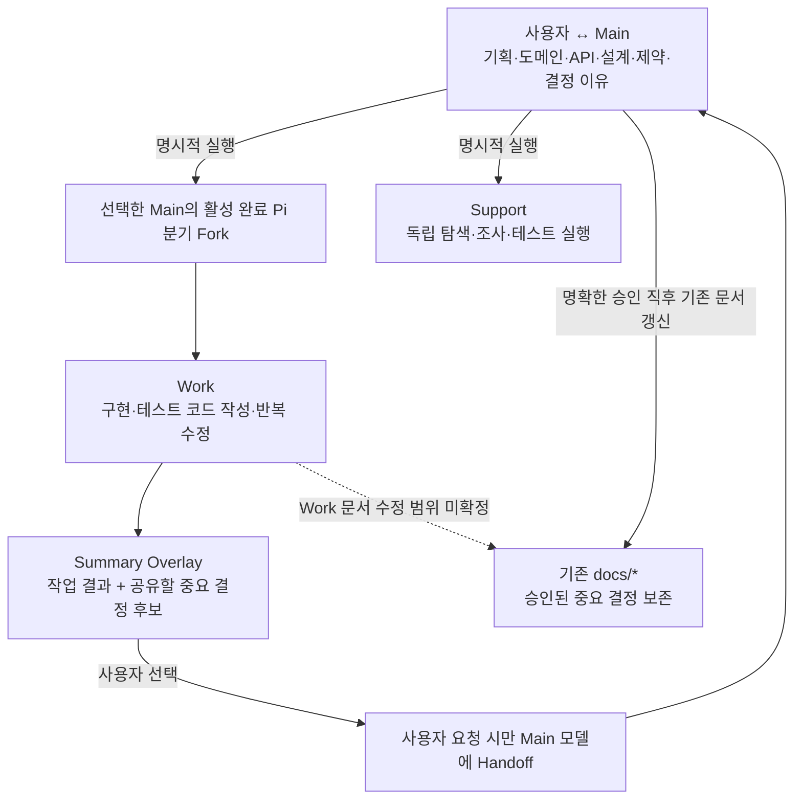

# Architecture — Pi Compose

- 기준: [PRD](PRD.md) (2026-10-30 합의)
- 상태: **책임 경계 설계 / Ghostty 중심 구현·실사용 검증 전**

## 1. 설계 원칙

Pi Compose는 **Pi 위에 얇게 얹는 Harness**입니다. 새로운 대화 엔진·터미널 관리자·독립 Git 엔진·상시 문서 동기화 서비스를 만들지 않습니다.

Main의 실제 Pi 대화에 요구사항, 도메인 정책, 설계와 결정 이유를 축적합니다. Work는 그 **활성 완료 분기를 정확히 Fork**하고 개발 기록을 별도 세션에 둡니다. 맥락이 불필요한 작업은 Support 독립 세션에 위임합니다.

## 2. 책임과 소유권

| 담당 | 소유하는 것 | 소유하지 않는 것 |
| --- | --- | --- |
| 사용자 | 중요 계약 변경 승인, Work/Support 시작, Main 수신, **종료/백그라운드 선택**, Git 통합·문서 롤백 선택 | 반복적인 터미널·Git 명령 조합 |
| **Pi** | 세션 트리·JSONL·Fork·Resume·모델·Extension·Compaction·TUI | Git 작업 공간 복제/병합 |
| **Ghostty** | 터미널 영역·분할·화면 포커스·종료 | Agent의 의미적 완료·문서 정책 판단 |
| **Pi Compose** | **프로덕트→여러 Main→관련 Agent 탐색**, 전체 Agent 보기, **별도 메시지 관리 사이드바**, 정확한 Main↔Work 관계, Summary Overlay/Handoff의 최소 기능 | 별도 LLM 런타임·계약 DB·범용 메시징 Broker |
| **Git** | 파일·브랜치·Worktree·변경 이력·코드/문서 통합 | Pi 대화 분기/모델 컨텍스트 |
| **프로젝트 문서** | 승인된 중요한 계약과 선택 이유 | 모든 대화/실행 로그의 영구 사본 |

## 3. 기본 컨텍스트 흐름

- **Summary는 사람에게 표시하는 화면**입니다. 자동으로 Main의 Pi 대화에 메시지를 추가하지 않습니다. Work A의 공유 후보를 다른 Work에 보내려면 **사용자가 수신 Work와 전송을 선택**해야 합니다. 통신은 기존 `pi-intercom`을 재사용하며 Pi Compose의 **작은 Extension은 Summary와 대상 선택·전송 연결**만 담당합니다. 수신 Work가 응답 중이라면 **현재 Pi 턴 종료 후** 모델에 반영하며 진행 중인 턴을 끊거나 조향하지 않습니다. 기능 개발 전체의 완료 여부는 별도로 판정하지 않습니다. Pi 턴 종료 감지는 기술 검증 대상입니다.
- 중요 결정의 공유 후보는 Work Summary에서 **자동 표시**하지만 'Main에 미반영' 여부를 정확한 근거 없이 확정 표시하지 않습니다.
- Pi 대화 롤백과 Git 파일 롤백은 별개입니다. 서로를 자동으로 되돌리지 않습니다.

### 3.1 탐색 계층과 메시지 관리

- **프로덕트별 보기**: `Pillo`, `Pi Compose`처럼 프로젝트 또는 제품을 기준으로 묶고, 프로덕트 아래 여러 Main과 관련 Work/Support를 탐색합니다. Main 화면 표기에는 `Main ·` 접두어를 붙이지 않고 `복약관리` 등 이름만 보여줍니다.
- **전체 Agent 보기**: 프로덕트를 가로질러 실제 Main/Work/Support의 상태와 소속을 파악합니다. 그룹을 바꿔도 같은 세션/관계를 바라봅니다.
- **메시지 관리 사이드바**: 별도 진입점에서 전달 내역·대기/수신/실패 등 사용자가 조치할 상태를 관리합니다. Summary Overlay의 중요한 결정 **공유 후보**와 실제 `pi-intercom` **전송 메시지**는 별개입니다. 화면에 표시된 메시지가 다른 Agent의 모델에 반영된 것은 아닙니다.
- **표시 범위는 `pic` 실행 화면 내부**입니다. Ghostty 전체에 고정되는 사이드바가 아닙니다. Main·Work·Support 및 Pi Compose 내부 화면을 이동할 때는 유지하지만, 일반 Ghostty 탭으로 전환하면 보이지 않고 `pic` 화면으로 복귀하면 다시 표시됩니다.
- Ghostty의 개별 분할과 Pi TUI 사이에서 `pic` 화면을 유지하는 방법, 세션 선택 시 사이드바와 실제 Pi 터미널의 포커스/배치를 연결하는 방법은 검증 대상입니다. **Ghostty의 모든 탭에 전역 UI를 주입하거나 별도 데스크톱 GUI를 만드는 것은 현재 요구사항이 아닙니다.**

## 4. Fork / Independent / Workspace

| 컨텍스트 | Shared Directory | Git Worktree |
| --- | --- | --- |
| Main Fork (Work) | 원본 완료 분기 Fork, 같은 체크아웃 | 원본 완료 분기 Fork, 별도 체크아웃 |
| Independent (Support) | 새 Pi 세션, 같은 체크아웃 | 새 Pi 세션, 별도 체크아웃 |

- 원본 Main 세션 ID·활성 완료 leaf·새 Work 세션 ID는 정확히 식별해야 합니다. 미완성 응답이나 임의의 최근 세션을 원본으로 추측하지 않습니다.
- Fork는 프로젝트 파일/미커밋 상태를 복제하지 않습니다. Shared Directory의 동시 수정 위험과 Worktree 간 아직 통합되지 않은 변경은 Git 책임입니다.
- Fork 후 Main의 추가 결정이나 다른 Work의 문서 변경이 Work에 자동 반영되지는 않습니다.

## 5. Ghostty 터미널과 세션 수명

- 실행 중 Main은 화면에 계속 표시하고 Work/Support의 터미널을 분할해 보여줍니다. 상세 레이아웃과 Split API 적용은 **실기 검증 대상**입니다.
- Work의 Summary Overlay는 원래 Pi TUI를 대체하지 않습니다. 사용자가 해당 영역을 선택하면 실제 Pi 화면으로 돌아갑니다. 완료 신호와 화면 조작 구현은 미확정입니다.
- **종료 요청 UX**: 사용자가 **백그라운드로 유지(최소화)** 또는 **Agent 종료** 중 선택합니다. 백그라운드 선택 시 Agent의 작업이 계속 실행돼야 하며, 종료 선택 시 실행 Agent만 종료하고 Pi 세션 기록과 Git 파일은 보존합니다. 일반 창 닫기와 앱 Quit은 다른 경계이므로, Ghostty가 살아 있는 숨김/최소화 상태로 충분한지 또는 별도 프로세스 소유자가 필요한지는 검증 전까지 미확정입니다.
- **완전 종료 후 재실행**에서는 사용자가 Main을 **명시적으로 선택**합니다. 선택한 Main만 재개하고 관련 Work/Support를 자동으로 재생성·실행하지 않습니다. **백그라운드로 유지한 뒤 다시 화면을 표시하는 행동은 재실행과 구분**하며, 기존 실행 중인 Agent에 복귀해야 합니다.
- 중단된 외부 명령을 자동 재개하는 시스템을 만들지 않습니다.

## 6. 문서와 맥락의 경계

`AGENTS.md`는 짧은 프로젝트 문서 안내자이며, 실제 확정 계약은 기존 `docs/*`의 해당 원본에 유지합니다. 중요한 승인 결정은 Main의 짧은 지침과 Pi 기본 파일 도구로 **즉시 기존 문서를 갱신**하는 방향입니다. 신규 문서 생성은 사용자 확인이 필요합니다.

Main이 자신의 컨텍스트에서 관련 계약과 변경 이유를 알고 있으므로 먼저 간단한 지침을 사용합니다. 누락이 실제로 확인되기 전에 별도 감지 Extension이나 계약 DB를 도입하지 않습니다.

맥락이 없는 세션이 관련 문서를 읽는 것은 사용자의 **명시적 요청**으로만 시작합니다. Skill은 가능한 구현 수단이며 모든 `docs/*`를 상시 적재하지 않습니다.

## 7. 다음 설계 질문

- Work A의 중요 결정 공유 후보는 Summary에 자동 표시하고, **수신 Work와 전송은 사용자가 명시적으로 선택**합니다. 전달 수단은 **`pi-intercom` + 최소 Compose Extension**으로 확정했고, 응답 중인 Work에는 **현재 Pi 턴 종료 후 모델 반영**하도록 합니다. 턴 종료를 위한 기술적 이벤트, 대기 큐·수신 상태/확인·중복 처리와 Work 간 미반영 상태 추적은 미확정입니다.
- Work에서 기존 문서를 갱신하는 역할의 범위와 다른 Worktree와의 문서 통합 방식.
- Summary 상태/필드, Handoff 대상과 명시적 수신 방식.
- Ghostty/Pi에서 Split, Overlay, **프로덕트/Agent/메시지 사이드바**, 종료 선택 알림과 백그라운드 유지·세션 복구를 구현하는 실제 API.

긴 실행 로그와 전체 Diff는 원본 Work/Support에 두고, Main에 무단 삽입하거나 모든 세션에 방송하지 않습니다.
