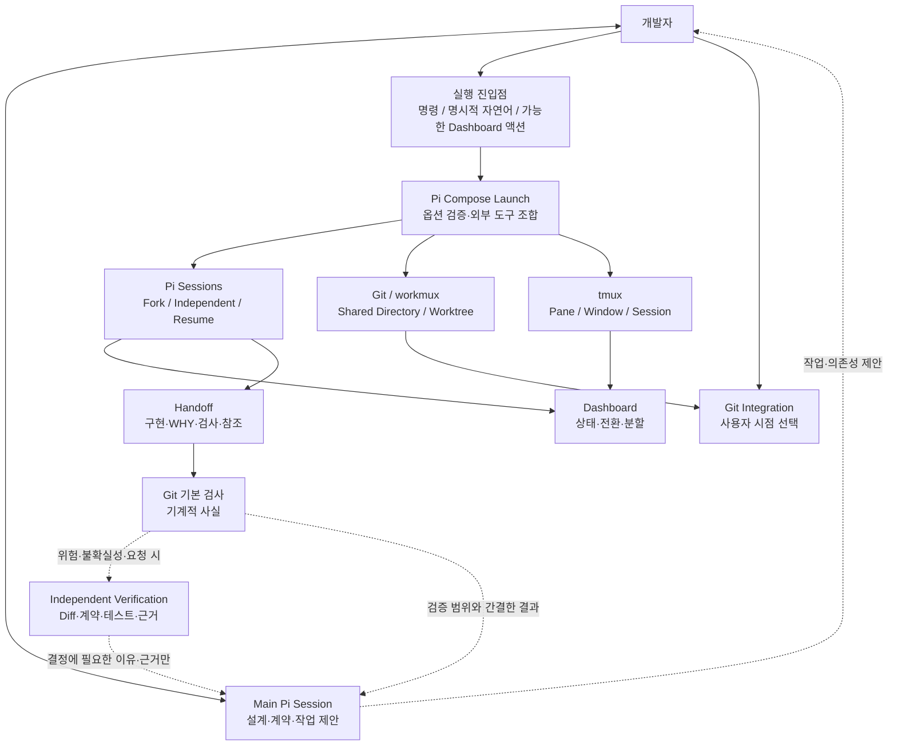
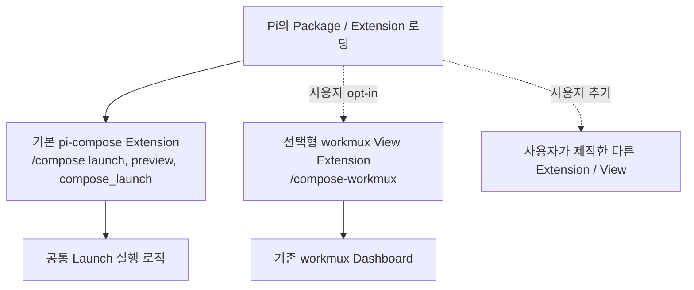
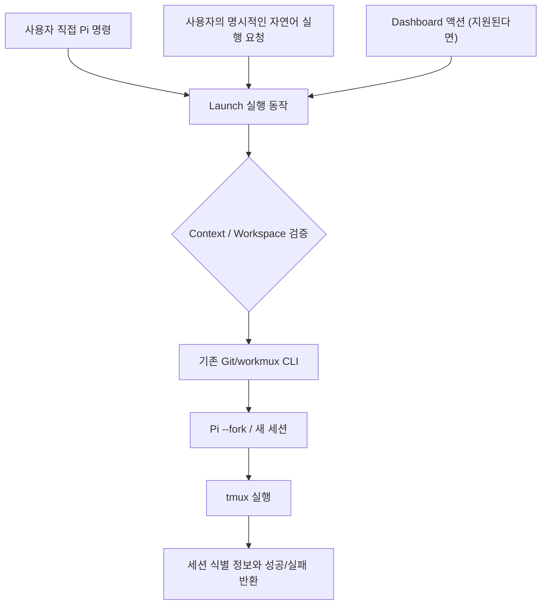
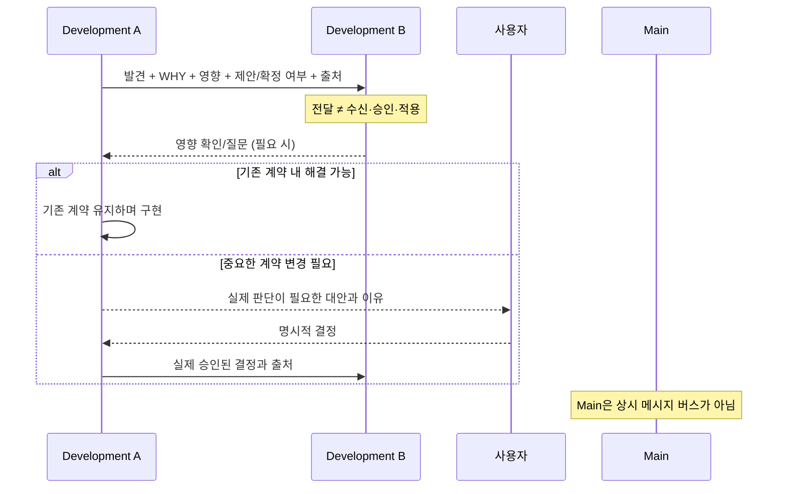
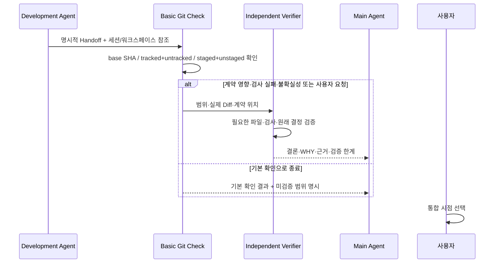

# Architecture — Pi Compose

- 상태: **논의된 책임·경계 확정 / 구현 상세와 패키지 연결 방식 미확정**
- 작성일: 2026-10-25
- 제품 계약: [PRD](PRD.md), 기술 후보 및 검증: [TRD](TRD.md)

## 1. 아키텍처 목표

**Pi Compose는 Pi의 Runtime 위에 실행 선택과 반복 작업을 연결하는 경량 Harness**다.

- Main Agent: 오래 논의한 요구사항, 원인, 거절된 대안, 강한 금지, 다음 제품 결정을 담당.
- 실행 계층: **사용자가 승인·선택한** 컨텍스트와 작업 공간 조합을 기존 CLI로 실현.
- 개발 세션: Pi의 세션·모델·도구·Compaction을 그대로 사용.
- 검증 세션: 변경 분석·테스트 로그·계약 확인을 Main에서 격리.
- Git 통합: 사용자가 요청한 시점에 기존 Git 도구로 진행.
- **View는 선택 사항:** Dashboard를 설치하지 않아도 기본 Launch는 동작해야 한다. 사용자가 Pi의 Extension·Package 방식으로 View를 선택·교체한다.

## 2. 논리적 구성도



그림은 **논리적 책임**이다. `Launch`, `Handoff`, `Verification`이 각각 별도 서버·프로세스·상태 머신이라는 뜻은 아니다.

## Pi 기본 Package와 선택형 View (ADR 0004)



- `package.json`의 `pi.extensions`는 **Launch Extension만 등록**한다.
- 선택형 workmux View는 자동 탐색 대상에서 벗어난
  `extensions/optional/workmux-dashboard.ts` 파일로 제공한다.
  필요한 사용자는 `pi -e <파일>` 또는 `settings.json`의 `extensions`로 로드한다.
- Pi Compose 고유의 `View Provider`, `Plugin Registry`를 만들지 않는다.
- `src/launch.ts`는 Dashboard 모듈을 import하지 않으며,
  View 교체를 위해 Launch를 수정하지 않는다.
- `src/dashboard.ts`와 기존 `pi-compose dashboard` CLI는 workmux 전용 구현으로 남아
  **사용자가 명시적으로 사용할 때만** 호출된다.
- **Worktree Launch는 여전히 `workmux add`를 사용한다.** View와 실행 백엔드는 별개 책임이며,
  현재 불필요한 범용 실행 백엔드 어댑터를 만들지 않는다.
- [ADR 0004](adr/0004-pi-native-optional-views.md)에 이 결정의 이유와 대안을 기록한다.

## 3. 책임과 의존 관계

| 구성 요소 | Owns | Does not own |
| --- | --- | --- |
| 사용자 | 중요한 제품 계약 결정, 개발 세션 명시적 실행, 통합 시점 | 매번 Pi/Git/tmux 명령 조립 |
| Main | 요구사항·작업 계획과 근거·다음 결정 | 모든 실제 Diff·로그 분석, 자동 개발 스케줄링 |
| Pi Compose Launch | 명시적 입력, 유효성 검사, 기존 CLI 조합, 실패 보고, 생성 결과 연결 | Pi Session 원본 기록, Git history, LLM Runtime |
| Pi | 세션 Fork/Resume/New, 컨텍스트·Compaction, 도구 | Worktree 내용 복제, Git 자동 병합 |
| Git/workmux | Git 변경·브랜치·Worktree, 기존 자동 준비와 대시보드 후보 | 사용자 승인·제품 계약 판단 |
| tmux | 실행 Pane/Window, 프로세스 지속 및 전환 | 작업의 의미적 완료 |
| **선택형 View / Dashboard** | 사용자가 선택할 경우 관찰·직접 조작 | 기본 Launch의 필수 종속성, 모든 실행의 영구 Source of Truth |
| Handoff | 구현 에이전트의 핵심 주장·검사·참조 | 계약 승인, 객관적 검증 완료 증거 |
| 독립 검증 | 실제 코드 변경·원본 계약 비교, 범위·불확실성 표시 | 사용자 계약 변경 결정 |
| 통합 Git 도구 | 사용자 지시에 따른 Merge/기존 명령 | 자율적 통합 시점 결정 |

## 4. 서로 독립적인 실행 차원

```text
Execution choice
 ├─ Context: Fork(sourceSession) | Independent
 ├─ Workspace: Shared(cwd) | Worktree(repo, branch, base)
 └─ Scheduling: Execute now / user launches later; serial or parallel per dependencies
```

**Context Fork ≠ Git Worktree Fork.**

| | Shared Directory | Git Worktree |
| --- | --- | --- |
| **Fork context** | Pi Fork + 기존 cwd | Pi Fork + 별도 cwd (workmux 우선 검증) |
| **Independent context** | Pi 새 세션 + 기존 cwd | Pi 새 세션 + 별도 cwd |

- Worktree는 격리를 제공하지만 원본의 미커밋 변경을 복제하지 않는다.
- Shared Directory를 병렬로 쓸 경우 Git이 각 에이전트의 변경을 정확히 분리할 수 없다. 강제 사용 금지가 아니라 한계 표시가 적절하다.
- 의존성이 높은 개발을 병렬로 시작하지 않을 수 있지만 **순차 개발 = Shared Directory**는 아니다.

## 5. 실행 진입점과 세션 생명주기

### 5.1 여러 진입점, 하나의 실행 동작



실제 구현은 **선정된 CLI의 한 명령으로 여러 단계를 수행**할 수 있다. 위 세 단계가 Pi Compose의 자체 엔진이라는 뜻이 아니다.

### 5.2 New / Fork / Resume는 다른 행위

| 동작 | 필요한 근거 |
| --- | --- |
| New independent | 새 독립 세션, 지정된 cwd |
| Fork | 사용자가 명시한 원본 세션/경로를 보존해 새 세션 생성 |
| Resume | 이미 생성된 **해당** 세션을 이어받음; 새 Fork 자동 생성 금지 |
| Close/Stop | 실행 프로세스를 종료하거나 대시보드에서 숨기는 동작 |
| Handoff | 작업의 완료 주장과 참조를 전달하는 **의미적 신호** |
| Integrate | 기존 Git 명령으로 코드 병합 또는 동일 디렉터리 결과 반영 |
| Cleanup | Worktree·tmux 자원 정리; Integrate와 동일하지 않음 |

동일 명령 재실행 시 기존 세션·Worktree를 찾고, 새 생성을 해야 하는지 재개해야 하는지 구분한다.

### 5.3 기존 Pi 세션의 정확한 재개 (Phase 3)

- Resume은 **원래 Pi Session JSONL 경로를 명시적으로 지정**한다. `pi --session <path>`를 사용하며, 가장 최근 세션을 임의로 `--continue`하지 않는다.
- Shared Directory는 세션 헤더에 기록된 cwd와 선택한 실제 cwd가 동일해야 한다.
- Worktree는 `git worktree list --porcelain -z`에서 선택한 브랜치의 실제 경로를 확인하고, 동일 cwd에 속한 Pi 대화만 재개한다.
- 기존 변경의 존재 여부는 Git에서 확인할 뿐 임의로 Reset·Clean·Remove하지 않는다.
- Pi Session 파일과 cwd에서 결정적인 tmux 대상 이름을 만들고 `tmux has-session`으로 조회한다. 실제 새 Pi 시작 직전에도 재확인한다.
- **대상 이름을 이미 점유했으면 생성하지 않는다.** 다른 tmux Session 이름이나 일반 터미널의 중복 Pi 실행은 확인되지 않을 수 있으므로 결과에 한계를 표시한다.
- 읽기 전용 `inspect`는 `worktree-existing`, `branch-only`, `not-found`를 구분하여 실패 후 상태를 판단하는 데 도움을 준다.
- **사용자 작업 삭제가 수반되는 자동 Cleanup은 구현하지 않는다.** 정확한 삭제 대상과 사용자 허용 범위는 별도 판단이 필요하다.
- 선택형 View나 Dashboard가 없어도 이 흐름은 동작하도록 구성했다.

실제 코드/검증: [Phase 3](validation/phase3-resume.md).

### 5.4 필수 식별값

**기존 시스템 기록을 재사용하는 연결 정보:** 원본 Pi Session ID/path, 새 Pi Session ID/path, 작업 cwd, repo/branch/base SHA(해당 시), tmux 대상, Handoff 참조. 영구 계약 DB/Workflow DSL은 만들지 않는다. 저장 방식은 구현 시 패키지의 반환값을 확인해 결정한다.

## 6. 협업 메시지 흐름



- 의미 없는 파일 변경은 알리지 않는다. 관련 Agent의 전제에 영향을 주는 발견에 집중.
- 에이전트가 제시한 “사용자 승인” 주장만으로 **새 계약을 만들 수 없다**.
- 워크트리 간 메시지는 코드 변경 자체를 동기화하지 않는다.
- 동료 식별 방법과 메시징 패키지는 아직 미확정이다.

## 7. Handoff와 검증의 데이터 경계



검증 결과의 신뢰 계층은 다음과 같다.

1. 사용자의 실제 결정과 프로젝트 기존 계약: **판단 근거**.
2. Git/코드/테스트: **현실의 구현 상태**.
3. Handoff: 개발 Agent가 보고한 내용(**검증 대상**).
4. Verifier의 결론: 확인 범위가 명시된 **해석과 권고**.

**중요:** 코드가 현재 그렇게 동작한다는 관찰을 새로운 사용자 요구사항으로 승격하지 않는다. 충분히 검증하지 않았으면 “확인하지 않음”을 숨기지 않는다.

## 8. 기본 Git 검사 기준

- `base SHA`와 현재 HEAD/Worktree 상태를 명시한다.
- 전체 변경 **경로**를 발견한다. 실제 코드 읽기는 계약 위험/영향을 기준으로 우선순위를 정한다.
- tracked, untracked, staged, unstaged 변경을 고려한다.
- Shared Directory 병렬 수정에서는 어떤 변경이 누구 소유인지 **추정하지 않는다**.
- 실행 중 코드가 수정될 수 있으므로 검사 시점/상태와 통합할 코드 상태의 일치 여부를 확인한다.
- 병합 충돌 없음·개별 테스트 통과만으로 통합 완료를 선언하지 않는다.

## 9. 실패와 안전한 복구

| 실패 | 원칙 |
| --- | --- |
| Worktree 생성 후 Pi 실행 실패 | 생성된 Worktree와 실패 지점을 확인; 재시도 또는 안전한 정리 |
| 이미 존재하는 branch/cwd/session | 중복 생성 대신 발견·재개 경로 고려 |
| tmux Pane 종료 | Pi 세션 기록까지 삭제된 것으로 가정하지 않음 |
| 원본 Pi 세션 경로 없음 | 임의의 최근 세션 Fork 금지, 정확한 식별 실패 보고 |
| Worktree dirty 상태 | 사용자 미커밋·신규 파일 보존, 자동 삭제 금지 |
| Hook·Dashboard 호환성 문제 | 실행은 Pi/Git/tmux로 가능해야 하며 제품 계약 축소 금지 |
| 검증 중 코드가 추가 변경 | 기존 검증 결론을 새 코드 상태에 그대로 적용하지 않음 |

## 10. 의도적으로 없는 구성

- 자동 개발 에이전트 작업 Scheduler / Task Graph Engine.
- 독립 세션 전체의 메시지를 저장·중재하는 자체 서버.
- 저장된 계약을 코드 관찰로 자동 업데이트하는 Contract DB.
- 전체 프로젝트에 적용되는 다단계 필수 Approval Gate.
- 전용 Git Merge Engine / 모든 파일을 고정 깊이로 스캔하는 범용 Reviewer.
- 외부 Dashboard를 교체하기 위한 자체 UI Runtime.

실제 도구 조합에서 기능 공백이 확인되면 **좁은 Extension/Script**를 추가할 수 있다. 전체 프레임워크를 미리 만들지 않는다.

→ [TRD](TRD.md) · [Implementation Plan](IMPLEMENTATION_PLAN.md) · [ADR](adr/0003-composable-execution-and-verification.md)


## PR #3 — 실제 구현한 B안 책임 경계 (2026-10-26)

초기의 Mermaid는 아키텍처의 **논리적 역할**이며 별도 Runtime 또는 커스텀 Dashboard의 구현 완료를 뜻하지 않습니다. PR #3 이후 현재 구현은 다음과 같이 나눠집니다.

| 사용자가 하는 일 | 구현 경로 | 상태/데이터의 정본 |
| --- | --- | --- |
| 명시적 자연어·명령 위임 | extensions/compose.ts → planLaunch() → Pi 기본 confirm → executeLaunch() | Pi 원본 Session, Git 및 tmux/workmux |
| Main ↔ 관련 Agent 복귀 | extensions/task-hub.ts → Pi Native select → 정확한 tmux session+window | tmux. 작업 관계는 작은 TaskRecord 연결 정보 |
| 제품 간 Agent 관찰·미리보기 | /compose monitor → 기존 workmux Dashboard | workmux Hook/Pane/Git |
| 같은 프로젝트의 다른 기능 대화 | /compose sessions → SessionManager.list() 및 switchSession() | Pi 기존 저장 Session |
| 개발 결과와 독립 검토 | /compose-handoff · /compose-verify → 유일한 Worktree 기록에 스냅샷 연결 | Git 결과, 사용자/검토자 진술 |
| 과거 tmux·Worktree 수동 재개 | /compose back · /compose resume | Pi/Git/tmux/workmux |

일반 Pi 대화와 Compose의 메뉴를 단일 Dashboard에 모두 구현하지 않습니다. Pi의 내장 select/confirm UI를 사용하고, workmux가 제공하는 실시간 상태·출력 UI는 직접 재구현하지 않습니다. 인증된 Pi를 macOS에서 실행한 전체 사용 경험은 **검증 전**입니다.

### 식별 계약과 Handoff의 경계

- 원본 Pi Session ID와 Context(Fork/Independent), Workspace(Shared/Worktree)는 사용자가 지정한 실행 선택입니다.
- 연결된 기존 tmux session+window가 사라지면 다른 이름·경로로 추측하지 않고 이동을 거절합니다.
- Worktree 경로·workmux handle·브랜치는 실제 조회 결과와 정확히 일치해야만 이동 가능하다고 표시합니다.
- Handoff/Verify를 Worktree 작업 기록에 연결하려면 프로젝트 루트+Worktree 경로+브랜치에 유일한 후보 하나가 있어야 합니다. 인계와 검토는 기록 당시 Git HEAD 기준이며 개발 완료·통합 승인이 아닙니다.
- Shared Directory의 Git 변경을 어떤 Agent가 작성했는지는 자동으로 알아낼 수 없습니다. 그 결과를 특정 작업의 변경으로 추측 연결하지 않습니다.
- 특정 Pi Child Session ID의 실제 기동 완료는 Launch 명령 성공만으로 증명할 수 없습니다.

**선택형 workmux View를 위한 ADR 0004의 Package 정책은 유지**하면서, 기본 /compose monitor에서 같은 기존 workmux Dashboard를 불러올 수 있게 했습니다. 추가 Backend Registry는 도입하지 않았습니다.
