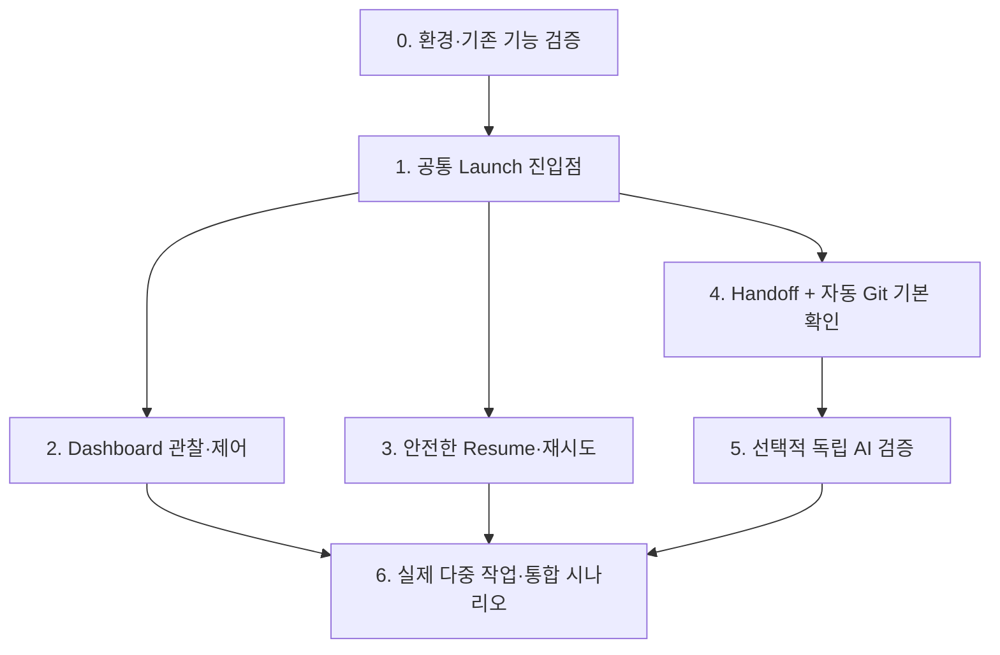

# Implementation Plan — 단계별 구현 및 검증

- 상태: **제품 요구사항에 대한 실행 계획 초안**. 기술 검증 결과에 따라 하위 구현 방법은 변경 가능.
- 작성일: 2026-10-25
- 참고: [PRD](PRD.md) · [TRD](TRD.md) · [Architecture](ARCHITECTURE.md)
- 전제: **설계 문서 작성과 코드 구현은 별개**다. 이 문서가 존재한다는 사실은 구현·호환성 검증 완료를 의미하지 않는다.

## 1. 계획의 기준

- 먼저 **실제 사용자 반복 조작을 줄이는 최소 흐름**을 완성하고, 이후 인계·검증을 연결한다.
- 기능이 없는 부분은 만들 수 있지만, 이미 존재하는 Pi·Git·tmux 기능을 새 엔진으로 복제하지 않는다.
- 사용자가 실제 개발 에이전트 생성·통합 시점을 통제한다.
- Context, Workspace, 순차/병렬 실행은 독립 선택. 네 가지 실행 조합을 유지한다.
- Main 컨텍스트를 도구 로그·긴 Diff로 채우지 않는다.
- 예상 일정·정량 성능 목표는 실측 근거 없이 임의 설정하지 않는다.
- 단계별 기능 검증은 필요하지만, **사람이 모든 단계를 승인해야 다음 단계로 가는 Gate**를 만들지 않는다.

## 2. 구현 의존 관계

이 그림은 개발 의존성이지 자체 실행 Task Graph를 만들라는 뜻이 아니다. 독립적인 단계는 병렬 구현해도 된다.

## 3. Phase 0 — 기존 기능과 호환성 확인

> **상태: 부분 검증으로 종료.** 현재 의사결정에 반드시 필요하지 않은 Pi·workmux 실연동 검증은 기능을 실제 연결·실행할 때 수행한다. [검증 기록](validation/phase0-baseline.md). 이 미검증 항목은 Phase 1을 차단하지 않는다.

### 수행

1. 실제 테스트 환경의 Pi, Git, tmux, Node, workmux 버전을 기록한다. `Pi v1.4.0`과 `workmux v0.1.277`은 **조사 당시 버전**이지 영구 고정 의존성이 아니다.
2. 기존 소스를 분석하여 `workmux add --fork`의 Pi 세션 탐색 조건, ID 선택, 작업 cwd, 실패 복구·기존 Worktree 재개를 확인한다.
3. 사용자 작업이 없는 별도 테스트 레포에서 실제 Pi로 **Fork + Worktree**를 실행한다.
4. Fork 원본 파일이 변경되지 않는지, 새 Pi 세션이 새 cwd를 사용하는지, 원래 설계상 강한 제약이 실제 작업에 반영되는지 확인한다.
5. Shared Directory에서 Fork/Independent를 실행·재개하고 대시보드에서 인식되는지 확인한다.
6. Dashboard/Hook 설치 전후의 상태 추적, 분할·전환, 기존 Extension과의 충돌 가능성을 점검한다.

### 산출·판정

| 검증 | 기대 결과 | 실패 시 |
| --- | --- | --- |
| Worktree + Pi Fork | 지정 원본 사용, 별도 cwd·Pi 세션, 원본 보존 | Pi `--fork`와 Git/tmux 직접 조합하는 경량 실행 코드 검토 |
| Shared Directory 2모드 | 지정 cwd에 New/Fork 및 Resume | 작은 실행 Script·Extension 검토 |
| Dashboard | Shared·Worktree 세션 관찰·전환 가능 | workmux 단독/ccmux 대안 비교 |
| Pi 상태 Hook | 실제 상태·불명확 상태 구분 | 부분 지원과 제한을 드러냄; 허위 완료 표시 금지 |

**P0에서 제품 기능을 축소하지 않는다.** 불충분한 패키지라면 보완 비용과 사용 비용을 평가한다. 큰 POC는 필요가 확인된 부분에만 적용한다.

## 4. Phase 1 — 공통 Launch

> **상태: 일부 구현.** CLI Launch와 Pi `/compose launch|preview` 명시적 명령을 작성하고 11개 단위 테스트를 통과했다. 실사용 Pi·workmux 연동 및 자연어 Tool·Dashboard 경로는 남아 있다. [구현 범위와 검증 기록](validation/phase1-launch.md).

### 구현 범위

- 초기 사용자 진입점: Pi 명시적 명령(예: `/compose launch`)과, 필요한 경우 같은 실행 기능을 호출하는 모델 Tool.
- 선택 옵션: 작업 목표, 원본 세션(Fork 시), Context, Workspace, 실행 cwd / branch / base, 현재 실행 여부.
- 실행 경로: workmux 등 기존 공개 CLI를 우선 사용. 특정 조합에 공백이 있으면 **해당 조합만** Script/Extension으로 보완.
- 성공 출력: 실제 Pi 세션 참조, cwd, Git/worktree/base(해당하는 경우), tmux 대상, 사용자에게 보여줄 짧은 상태.
- 실패 출력: 실패 단계, 사용자 데이터에 영향 여부, 재시도·재개 방법.

### 수용 테스트

| 테스트 | 결과 |
| --- | --- |
| Fork + Shared | 선택된 Main 세션을 현재 cwd에서 분기 |
| Fork + Worktree | 지정 원본에서 새 Worktree로 분기 |
| Independent + Shared | 원본 대화 상속 없이 지정 cwd에서 실행 |
| Independent + Worktree | 새 Worktree에 독립 Pi 세션 실행 |
| 사용자 실행 지시 없음 | Main이 개발 세션을 자동 생성하지 않음 |
| 원본 ID가 모호함 | 다른 세션을 몰래 선택하지 않고 명시적 오류·선택 처리 |
| 코드/폴더가 Dirty | 작업을 덮어쓰거나 강제 정리하지 않음 |

### 주의

Dashboard가 사용자 정의 Launch 액션을 공식적으로 받는지 확인하기 전에는 **Dashboard 버튼을 필수 선행 구현으로 고정하지 않는다**. 동일 실행 기능은 우선 Pi 명령/CLI에서 사용하고 Dashboard 연동은 검증 후 결정한다.

## 5. Phase 2 — Dashboard와 직접 제어

### 구현 범위

- 이미 실행 중인 Pi 세션 검색, 상태(알 수 없으면 Unknown), 이동, 직접 입력·분할 화면을 기존 패키지로 지원.
- Worktree뿐 아니라 Shared Directory 실행도 표시할 수 있는지 확인.
- Session Idle / Waiting / Development Complete / Handoff 완료를 혼동하지 않는다.
- Hook 설치는 중복 도구가 쓰는 같은 이벤트를 중첩 설치하지 않도록 기존 설정을 먼저 확인.

### 수용 기준

- 최소 Main + Shared 개발 세션 + Worktree 개발 세션을 쉽게 찾고 전환할 수 있음.
- Dashboard 종료가 Pi 작업의 무단 종료를 의미하지 않음.
- 대시보드에 표시되지 않는 세션은 사라졌다고 가정하지 않음; Pi/tmux 원본으로 발견 가능.

## 6. Phase 3 — Resume·재시도·안전한 정리

### 시나리오

1. Pi 실행 전 Worktree만 생성된 상태에서 실패.
2. 생성 성공 후 응답을 잃어 같은 명령 재실행.
3. 기존 tmux Pane 종료 후 Pi 기록은 남은 상태.
4. 동일 디렉터리에 여러 Pi 세션 존재.
5. 통합 전에 Dirty Worktree 삭제 또는 세션 종료 요청.

### 수용 기준

- 새 세션·Fork·Resume·Handoff·Integration·Cleanup을 별도 동작으로 식별.
- 기존 세션과 Worktree가 있으면 불필요한 중복 생성을 피함.
- 생성 작업의 실패 원인을 보여주고 안전한 재시도를 지원.
- **사용자 변경을 강제 삭제하지 않음**. 사용자 소유의 Worktree와 생성한 Worktree를 구분.
- 영구 상태 DB부터 만들지 않고 기존 도구의 ID·상태와 최소한의 연결 정보만 활용.

## 7. Phase 4 — 간결한 Handoff와 자동 기본 확인

### 구현 범위

- Developer가 **완료를 명시적으로 인계하는 단일 진입점**. 세션 종료나 Idle을 완료 이벤트로 사용하지 않는다.
- Handoff 지침은 필요한 정보만 유지: 구현·WHY·검사 결과·미해결 문제·Git/Pi 위치.
- 인계 후 Git 기본 확인: base SHA, HEAD, staged·unstaged·untracked, 변경 파일의 전체 경로, `git diff --check`, 확인 가능한 기존 검사 결과.
- 모델을 호출하지 않아도 되는 데이터 수집은 결정적 CLI/Script로 수행.
- 이미 완료된 동일 인계에 중복 검증 실행이 발생하지 않도록 **실제 구현 상태·식별자 기준**으로 처리(별도 작업 DB를 우선 도입하지 않음).

### 수용 기준

- 매번 사용자가 인계 텍스트를 복사해 Main/Verifier에 붙이지 않아도 됨.
- 실제 신규 파일이 Git Diff 메타데이터에서 누락돼도 전체 변경 경로를 발견함.
- 스냅샷 이후 코드가 바뀌었다면 검증 결과의 적용 한계를 알 수 있음.
- Main에 길고 원시적인 Git 출력이 누적되지 않음.

## 8. Phase 5 — 선택적 독립 AI 검증

### 검증 조건

- 기존 프로젝트 검사 실패.
- Handoff에 미해결 계약 충돌·불확실성이 명시됨.
- API·공통 타입·외부 인터페이스·권한·중요 동작에 영향이 있는 변경.
- Git 메타데이터로 의미를 확정할 수 없거나 사용자가 직접 요청.
- 그 외 작업은 기본 검사에서 끝날 수 있으나 **심층 검증 완료로 표시하지 않음**.

### 검증 역할

- 변경 경로는 빠짐없이 발견하되 의미 분석은 위험 영역 우선.
- Handoff 주장 vs 실제 Diff, 테스트 결과 vs 실행 가능한 검사 결과 비교.
- 사용자의 실제 확정 결정과 프로젝트의 기존 계약을 참조.
- 원래 이유가 “절대 금지”였으면 원래 강도 유지.
- 결론은 **이유·파일/라인 근거·검증한 범위·미검증 범위·다음 판단**을 포함.
- Main에는 핵심 판단만 전달하고 원시 로그·전체 Diff는 검증 세션에 남김.

### 구현 전략

Pi `--print` 일회성 실행, 별도 지속 Pi 세션, 기존 Sub-agent 패키지를 비교한다. 어떤 방식을 택할지는 **실제 토큰·속도·원본 근거 접근성**에 달렸다. 첫 버전부터 Reviewer 여러 명과 점수 필터를 항상 실행하지 않는다.

## 9. Phase 6 — 실제 협업·통합 시나리오

### End-to-end 확인

- 사용자와 Main이 API 변경 금지 이유를 합의한다.
- 두 개발 에이전트를 병렬로 실행: 한쪽은 Fork + Worktree, 다른 쪽은 사용자가 선택한 독립/Shared 조합.
- 한 에이전트가 다른 에이전트에 영향이 있는 변경 필요성을 발견한다.
- **발견·제안·승인·적용** 상태를 구분하여 공유한다. Main은 상시 중계자가 아니다.
- 각 Agent가 자체 검사와 Handoff를 완료하면 기본 검사를 수행하고 선택적 독립 검증한다.
- 사용자가 Git 통합을 선택하고 실제로 통합한 뒤 관련 테스트를 수행한다.
- API/UI는 개별 테스트가 통과해도 함께 쓰면 불일치할 수 있음을 잡아낸다.
- 원본 Main 세션의 장기 컨텍스트가 일시적 실행 로그로 오염되지 않았는지 확인한다.

### 완료 기준

- 제품 핵심 요구사항 `FR-01~FR-12`의 사용 시나리오가 검증됨.
- 운영 안전과 복구 항목 `FR-13~FR-20`이 재현 가능한 테스트나 명시적 제약으로 검증됨.
- 채택한 기존 패키지의 정확한 버전·설정·알려진 한계가 TRD에 반영됨.
- 새로운 Extension/Script를 구현했다면 **어떤 실제 기능 공백 때문에 필요했는지** 설명할 수 있음.
- 자동 Gate, 자체 Runtime/DB, 모든 프로젝트의 강제 문서 관리가 추가되지 않음.

## 10. 비기능 평가 항목

추측으로 목표치를 정하지 않고, 작업별로 비교 가능한 근거를 수집한다.

| Metric | 관찰 방식 | 기대 방향 |
| --- | --- | --- |
| 에이전트 1개 실행을 위한 사용자 수동 조작 | 동일 시나리오에서 실행 단계 수 | 감소 |
| Main 활성 컨텍스트의 도구 출력 점유 | 긴 Diff·테스트 로그 직접 노출량 | 감소 |
| 세션 실행 추가 토큰 | Skill·Extension·검증 비용 비교 | 영향에 비례 |
| 작업 시작·재개 실패 | 오류 원인·복구 소요 비교 | 재작업 감소 |
| 잘못된 계약 적용 | 원본 지시와 구현 결과 비교 | 감소 |
| 서드파티 유지보수 부담 | 버전 충돌·Hook 충돌·로컬 패치 수 | 필요 이상 증가 방지 |

## 11. 구현 시작 전 남길 판단 근거

- 왜 workmux 단독, ccmux 조합, 또는 다른 대시보드를 선택했는가?
- Context Fork + Workspace 독립 선택의 네 조합이 어떻게 지원되는가?
- 자연어 진입점이 Main의 컨텍스트를 어디까지 사용하는가?
- Handoff 신호가 무엇이고 실수·중복 인계를 어떻게 처리하는가?
- 기본 Git 검사와 AI 심층 검증의 실행 경계는 무엇인가?
- 실패한 실행이 남긴 리소스를 어떻게 파악하고 안전하게 복구하는가?

이 항목은 **실제 구현 중 검증해야 하는 설계 질문**이지 새로운 승인 Gate·별도 문서 생성 의무가 아니다.

## 12. 구현에서 제외

자동 개발 작업 Scheduler, 범용 세션·계약 데이터베이스, 모든 변경 이벤트 방송, 모든 파일 전수 AI 분석, 필수 다단계 승인, Git 병합 엔진 재구현, 자체 Dashboard 전체 재개발.

→ [ADR 0001](adr/0001-context-and-delegation.md) · [ADR 0002](adr/0002-user-controlled-execution.md) · [ADR 0003](adr/0003-composable-execution-and-verification.md)
