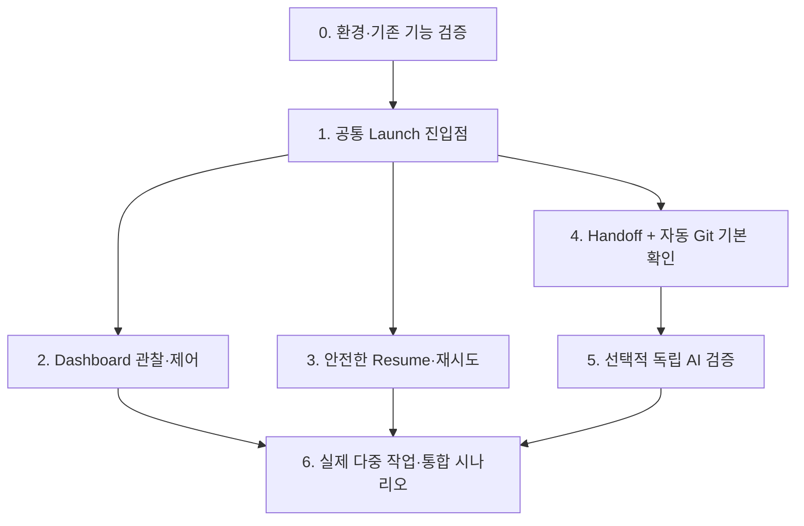

# Implementation Plan — 단계별 구현 및 검증

- 상태: **제품 요구사항에 대한 실행 계획 초안**. 기술 검증 결과에 따라 하위 구현 방법은 변경 가능.
- 작성일: 2026-10-25
- 참고: [PRD](PRD.md) · [TRD](TRD.md) · [Architecture](ARCHITECTURE.md)
- 전제: **설계 문서 작성과 코드 구현은 별개**다. 이 문서가 존재한다는 사실은 구현·호환성 검증 완료를 의미하지 않는다.

## 1. 계획의 기준

- 먼저 **실제 사용자 반복 조작을 줄이는 최소 흐름**을 완성하고, 이후 인계·검증을 연결한다.
- 기능이 없는 부분은 만들 수 있지만, 이미 존재하는 Pi·Git·tmux 기능을 새 엔진으로 복제하지 않는다.
- 사용자가 실제 개발 에이전트 생성·통합 시점을 통제한다.
- Context, Workspace, 순차/병렬 실행은 독립 선택. 네 가지 실행 조합을 유지한다.
- Main 컨텍스트를 도구 로그·긴 Diff로 채우지 않는다.
- 예상 일정·정량 성능 목표는 실측 근거 없이 임의 설정하지 않는다.
- 단계별 기능 검증은 필요하지만, **사람이 모든 단계를 승인해야 다음 단계로 가는 Gate**를 만들지 않는다.

## 2. 구현 의존 관계

이 그림은 개발 의존성이지 자체 실행 Task Graph를 만들라는 뜻이 아니다. 독립적인 단계는 병렬 구현해도 된다.

## 3. Phase 0 — 기존 기능과 호환성 확인

> **상태: 부분 검증으로 종료.** 현재 의사결정에 반드시 필요하지 않은 Pi·workmux 실연동 검증은 기능을 실제 연결·실행할 때 수행한다. [검증 기록](validation/phase0-baseline.md). 이 미검증 항목은 Phase 1을 차단하지 않는다.

### 수행

1. 실제 테스트 환경의 Pi, Git, tmux, Node, workmux 버전을 기록한다. `Pi v1.4.0`과 `workmux v0.1.277`은 **조사 당시 버전**이지 영구 고정 의존성이 아니다.
2. 기존 소스를 분석하여 `workmux add --fork`의 Pi 세션 탐색 조건, ID 선택, 작업 cwd, 실패 복구·기존 Worktree 재개를 확인한다.
3. 사용자 작업이 없는 별도 테스트 레포에서 실제 Pi로 **Fork + Worktree**를 실행한다.
4. Fork 원본 파일이 변경되지 않는지, 새 Pi 세션이 새 cwd를 사용하는지, 원래 설계상 강한 제약이 실제 작업에 반영되는지 확인한다.
5. Shared Directory에서 Fork/Independent를 실행·재개하고 대시보드에서 인식되는지 확인한다.
6. Dashboard/Hook 설치 전후의 상태 추적, 분할·전환, 기존 Extension과의 충돌 가능성을 점검한다.

### 산출·판정

| 검증 | 기대 결과 | 실패 시 |
| --- | --- | --- |
| Worktree + Pi Fork | 지정 원본 사용, 별도 cwd·Pi 세션, 원본 보존 | Pi `--fork`와 Git/tmux 직접 조합하는 경량 실행 코드 검토 |
| Shared Directory 2모드 | 지정 cwd에 New/Fork 및 Resume | 작은 실행 Script·Extension 검토 |
| Dashboard | Shared·Worktree 세션 관찰·전환 가능 | workmux 단독/ccmux 대안 비교 |
| Pi 상태 Hook | 실제 상태·불명확 상태 구분 | 부분 지원과 제한을 드러냄; 허위 완료 표시 금지 |

**P0에서 제품 기능을 축소하지 않는다.** 불충분한 패키지라면 보완 비용과 사용 비용을 평가한다. 큰 POC는 필요가 확인된 부분에만 적용한다.

## 4. Phase 1 — 공통 Launch

> **상태: 일부 구현.** CLI Launch, Pi `/compose launch|preview` 명시적 명령, Pi Session Manager 기반 원본 선택, 사용자 확인형 `compose_launch` Tool까지 작성해 이전 TypeScript 타입 검사를 확인했다. 이후 변경은 필요 시 검증한다. 실사용 Pi·workmux 연동 및 Dashboard 경로는 남아 있다. [구현 범위와 검증 기록](validation/phase1-launch.md).

### 구현 범위

- 초기 사용자 진입점: Pi 명시적 명령(예: `/compose launch`)과, 필요한 경우 같은 실행 기능을 호출하는 모델 Tool.
- 선택 옵션: 작업 목표, 원본 세션(Fork 시), Context, Workspace, 실행 cwd / branch / base, 현재 실행 여부.
- 실행 경로: workmux 등 기존 공개 CLI를 우선 사용. 특정 조합에 공백이 있으면 **해당 조합만** Script/Extension으로 보완.
- 성공 출력: 실제 Pi 세션 참조, cwd, Git/worktree/base(해당하는 경우), tmux 대상, 사용자에게 보여줄 짧은 상태.
- 실패 출력: 실패 단계, 사용자 데이터에 영향 여부, 재시도·재개 방법.

### 수용 테스트

| 테스트 | 결과 |
| --- | --- |
| Fork + Shared | 선택된 Main 세션을 현재 cwd에서 분기 |
| Fork + Worktree | 지정 원본에서 새 Worktree로 분기 |
| Independent + Shared | 원본 대화 상속 없이 지정 cwd에서 실행 |
| Independent + Worktree | 새 Worktree에 독립 Pi 세션 실행 |
| 사용자 실행 지시 없음 | Main이 개발 세션을 자동 생성하지 않음 |
| 원본 ID가 모호함 | 다른 세션을 몰래 선택하지 않고 명시적 오류·선택 처리 |
| 코드/폴더가 Dirty | 작업을 덮어쓰거나 강제 정리하지 않음 |

### 주의

Dashboard가 사용자 정의 Launch 액션을 공식적으로 받는지 확인하기 전에는 **Dashboard 버튼을 필수 선행 구현으로 고정하지 않는다**. 동일 실행 기능은 우선 Pi 명령/CLI에서 사용하고 Dashboard 연동은 검증 후 결정한다.

## 5. Phase 2 — Dashboard와 직접 제어

> **상태: 기본 Launch와 선택형 View 분리 구현.** 기본 Pi Package는 Launch Extension만 등록한다. 기존 workmux Dashboard는 `extensions/optional/workmux-dashboard.ts`에서 `/compose-workmux`로 사용자가 명시적으로 로드할 수 있다. `pi-compose dashboard` CLI는 호환성을 위해 유지했다. 별도 View Registry나 Session Engine은 만들지 않았다. 실제 Pi TUI·workmux 통합 및 이번 변경 전체 테스트 확인은 별도 기록한다. [Phase 2 기록](validation/phase2-dashboard.md) · [ADR 0004](adr/0004-pi-native-optional-views.md).

### 구현 범위

- 이미 실행 중인 Pi 세션 검색, 상태(알 수 없으면 Unknown), 이동, 직접 입력·분할 화면을 기존 패키지로 지원.
- Worktree뿐 아니라 Shared Directory 실행도 표시할 수 있는지 확인.
- Session Idle / Waiting / Development Complete / Handoff 완료를 혼동하지 않는다.
- Hook 설치는 중복 도구가 쓰는 같은 이벤트를 중첩 설치하지 않도록 기존 설정을 먼저 확인.

### 수용 기준

- 최소 Main + Shared 개발 세션 + Worktree 개발 세션을 쉽게 찾고 전환할 수 있음.
- Dashboard 종료가 Pi 작업의 무단 종료를 의미하지 않음.
- 대시보드에 표시되지 않는 세션은 사라졌다고 가정하지 않음; Pi/tmux 원본으로 발견 가능.

## 6. Phase 3 — Resume·재시도·안전한 정리

> **상태: 읽기 전용 Git Worktree 진단과 정확한 Pi 세션 Resume 1차 구현.** `inspect`와 `resume --session-file` CLI, Pi `/compose resume`을 추가했다. Git의 Worktree 위치·Dirty 상태 및 원래 Pi 세션 cwd를 확인하고, tmux 이름 충돌 시 중복 실행을 차단한다. **다른 tmux Pane에서의 동일 Pi 세션 실행은 식별하지 못하며 자동 Cleanup은 없다.** 실제 Pi/tmux 통합 및 최신 코드 타입 검사는 미검증. [Phase 3 기록](validation/phase3-resume.md).

### 시나리오

1. Pi 실행 전 Worktree만 생성된 상태에서 실패.
2. 생성 성공 후 응답을 잃어 같은 명령 재실행.
3. 기존 tmux Pane 종료 후 Pi 기록은 남은 상태.
4. 동일 디렉터리에 여러 Pi 세션 존재.
5. 통합 전에 Dirty Worktree 삭제 또는 세션 종료 요청.

### 수용 기준

- 새 세션·Fork·Resume·Handoff·Integration·Cleanup을 별도 동작으로 식별.
- 기존 세션과 Worktree가 있으면 불필요한 중복 생성을 피함.
- 생성 작업의 실패 원인을 보여주고 안전한 재시도를 지원.
- **사용자 변경을 강제 삭제하지 않음**. 사용자 소유의 Worktree와 생성한 Worktree를 구분.
- 영구 상태 DB부터 만들지 않고 기존 도구의 ID·상태와 최소한의 연결 정보만 활용.

> **테스트 정책:** 단위 테스트는 직접 만든 Pi Extension의 핵심 동작에 집중한다. CLI·Script와 기존 Git·tmux·workmux 기능은 테스트 추가가 기본 의무가 아니며, 실제 필요한 시점에 직접 명령·결과로 확인한다. [TRD](TRD.md#테스트-작성-기준-2026-10-25-확정).

## 7. Phase 4 — 간결한 Handoff와 자동 기본 확인

> **상태: 선택형 Handoff Extension 1차 구현.** `extensions/optional/handoff.ts`는 사용자가 명시적으로 `/compose-handoff`를 실행할 때만 보고서를 준비한다. 모델 Tool `compose_handoff`는 Git HEAD·브랜치·staged·unstaged·untracked 파일을 조회하고, 원래 WHY·실제 수행 검사·미해결 문제를 함께 담는다. 대상 에이전트 전송은 사용자 확인 후 `workmux send`에 위임한다. **전송 성공은 수신·검증 완료가 아니다.** 기본 Launch Package에는 포함하지 않았다. 반복 전달 방지와 실제 Pi/workmux 연동은 아직 미검증/미구현이며, 전체 Phase 4 완료를 주장하지 않는다. CLI·Git을 위한 신규 단위 테스트는 작성하지 않았다.

### 구현 범위

- Developer가 **완료를 명시적으로 인계하는 단일 진입점**. 세션 종료나 Idle을 완료 이벤트로 사용하지 않는다.
- Handoff 지침은 필요한 정보만 유지: 구현·WHY·검사 결과·미해결 문제·Git/Pi 위치.
- 인계 후 Git 기본 확인: base SHA, HEAD, staged·unstaged·untracked, 변경 파일의 전체 경로, `git diff --check`, 확인 가능한 기존 검사 결과.
- 모델을 호출하지 않아도 되는 데이터 수집은 결정적 CLI/Script로 수행.
- 이미 완료된 동일 인계에 중복 검증 실행이 발생하지 않도록 **실제 구현 상태·식별자 기준**으로 처리(별도 작업 DB를 우선 도입하지 않음).

### 수용 기준

- 매번 사용자가 인계 텍스트를 복사해 Main/Verifier에 붙이지 않아도 됨.
- 실제 신규 파일이 Git Diff 메타데이터에서 누락돼도 전체 변경 경로를 발견함.
- 스냅샷 이후 코드가 바뀌었다면 검증 결과의 적용 한계를 알 수 있음.
- Main에 길고 원시적인 Git 출력이 누적되지 않음.

## 8. Phase 5 — 선택적 독립 AI 검증

> **상태: 선택형 검증 Extension 1차 구현.** 사용자 명시적 `/compose-verify [base-ref]` 명령과 UI 승인 후, 읽기 전용 도구만 가진 **독립 일회성 Pi**를 실행한다. Git의 실제 변경 파일·패치·공백 오류 및 프로젝트 계약을 기반으로 위험 우선 검토를 요청한다. 현재 Pi 세션에 명시적 Handoff가 존재하면 마지막 보고서를 **검증되지 않은 주장**으로 전달한다. 다른 Pi 세션의 원본 Main 대화 전문은 가져오지 않으며 계약 출처가 없다면 그 한계를 보고한다. 큰 Diff, Binary·ignored 파일, 동시 수정도 검증 한계로 표시한다. 기본 Package에 포함하지 않고 새 런타임·스케줄러·항상 실행하는 Reviewer는 만들지 않았다. 실제 Pi 실행과 신규 코드의 TypeScript 검사·Extension 테스트는 미검증. 자세한 사용 방법은 [README](../README.md#phase-5--선택적-독립-검증).

### 검증 조건

- 기존 프로젝트 검사 실패.
- Handoff에 미해결 계약 충돌·불확실성이 명시됨.
- API·공통 타입·외부 인터페이스·권한·중요 동작에 영향이 있는 변경.
- Git 메타데이터로 의미를 확정할 수 없거나 사용자가 직접 요청.
- 그 외 작업은 기본 검사에서 끝날 수 있으나 **심층 검증 완료로 표시하지 않음**.

### 검증 역할

- 변경 경로는 빠짐없이 발견하되 의미 분석은 위험 영역 우선.
- Handoff 주장 vs 실제 Diff, 테스트 결과 vs 실행 가능한 검사 결과 비교.
- 사용자의 실제 확정 결정과 프로젝트의 기존 계약을 참조.
- 원래 이유가 “절대 금지”였으면 원래 강도 유지.
- 결론은 **이유·파일/라인 근거·검증한 범위·미검증 범위·다음 판단**을 포함.
- Main에는 핵심 판단만 전달하고 원시 로그·전체 Diff는 검증 세션에 남김.

### 구현 전략

Pi `--print` 일회성 실행, 별도 지속 Pi 세션, 기존 Sub-agent 패키지를 비교한다. 어떤 방식을 택할지는 **실제 토큰·속도·원본 근거 접근성**에 달렸다. 첫 버전부터 Reviewer 여러 명과 점수 필터를 항상 실행하지 않는다.

## 9. Phase 6 — 실제 협업·통합 시나리오

> **상태: 실제 Pi·tmux·workmux 실행 연동 부분 확인.** 일회성 Ubuntu 환경에서 `npm run typecheck`, Extension 테스트(24개), Pi TUI 로딩, Shared Launch, 정확한 Resume의 중복 생성 방지, 실제 workmux Worktree 생성·`inspect`를 확인했다. 격리된 Git API/UI 병합 시나리오도 이미 검증했다. **Main 컨텍스트 Fork의 WHY 보존, 인증된 두 Pi 모델의 협업·Handoff·Reviewer·사용자 주도 통합은 아직 미검증**이다. 외부 터미널에서 tmux 여러 세션의 부모 대상이 모호하면 workmux가 거부하므로 Pi가 속한 tmux Pane에서 실행해야 한다. 별도 스케줄러, 자동 병합, 영구 CI Gate는 추가하지 않는다. [실제 실행 기록](validation/phase6-integration.md).

### End-to-end 확인

- 사용자와 Main이 API 변경 금지 이유를 합의한다.
- 두 개발 에이전트를 병렬로 실행: 한쪽은 Fork + Worktree, 다른 쪽은 사용자가 선택한 독립/Shared 조합.
- 한 에이전트가 다른 에이전트에 영향이 있는 변경 필요성을 발견한다.
- **발견·제안·승인·적용** 상태를 구분하여 공유한다. Main은 상시 중계자가 아니다.
- 각 Agent가 자체 검사와 Handoff를 완료하면 기본 검사를 수행하고 선택적 독립 검증한다.
- 사용자가 Git 통합을 선택하고 실제로 통합한 뒤 관련 테스트를 수행한다.
- API/UI는 개별 테스트가 통과해도 함께 쓰면 불일치할 수 있음을 잡아낸다.
- 원본 Main 세션의 장기 컨텍스트가 일시적 실행 로그로 오염되지 않았는지 확인한다.

### 완료 기준

- 제품 핵심 요구사항 `FR-01~FR-12`의 사용 시나리오가 검증됨.
- 운영 안전과 복구 항목 `FR-13~FR-20`이 재현 가능한 테스트나 명시적 제약으로 검증됨.
- 채택한 기존 패키지의 정확한 버전·설정·알려진 한계가 TRD에 반영됨.
- 새로운 Extension/Script를 구현했다면 **어떤 실제 기능 공백 때문에 필요했는지** 설명할 수 있음.
- 자동 Gate, 자체 Runtime/DB, 모든 프로젝트의 강제 문서 관리가 추가되지 않음.

## 핵심 기능 마무리 범위 — 사용성 재설계 전 점검 (2026-10-25)

**기준:** 기존 도구의 기능을 재구현하지 않고, 사용자가 검증할 실제 모델 동작과 코드 공백을 구분한다. 다음 표의 "미완료"는 새 Framework를 만들라는 의미가 아니다.

| 계약 / 단계 | 확인된 구현 | 핵심 공백 또는 실제 환경 확인 | 취급 |
| --- | --- | --- | --- |
| FR-02·03 / Phase 1 | Fork/Independent × Shared/Worktree 실행 경로 | **Fork + Worktree 실제 모델 맥락·강한 금지 보존** 확인, 새 Pi 세션 식별자의 반환 여부 | 사용자의 실환경 검증; 확인된 실패만 수정 |
| FR-05·07 / Phase 2 | workmux View 선택형 로드, 기존 Dashboard 위임 | **Main·Shared Pi·Worktree를 실제로 찾고 전환**하는 과정이 연결되지 않음 | Pi 세션 선택기·tmux·workmux의 기존 발견 기능 우선 비교 후 결정 |
| FR-16·17 / Phase 3 | 정확한 JSONL·cwd 기반 Resume, Git Worktree Inspect, 같은 tmux 이름 중복 생성 차단 | 기존 실행 중인 Pi를 재연결하는 과정, **다른 tmux 대상에서 같은 대화를 실행 중인 경우**의 중복 판단, 실패 후 리소스 소유 판별 | 실행 상태를 섣불리 완료라 추정하지 않음; 탐색 UX 결정과 연동 |
| FR-09·11·14 / Phase 4 | 명시적 Handoff, Git 변경 수집, 승인 후 workmux send | Main 또는 관련 Agent가 workmux로 식별되지 않을 때 직접 전달, **수신·읽음/승인 확인**, 원래 사용자 결정의 출처 | 전송 성공과 승인 분리; 필요 시 Pi·workmux 원래 기능으로 연결 |
| FR-10·15·20 / Phase 5 | 선택적 독립 읽기 전용 Pi 검토 | 다른 Pi 세션의 **원본 WHY와 승인 근거** 접근, 코드 변경 후 검증의 적용 범위 | Main 전문 자동 투입 금지, 검증 불가능하면 모름으로 보고 |
| FR-12·19 / Phase 6 | 격리 Git 통합 시나리오, Pi·tmux·workmux 일부 실연동 | **실제 두 모델 Agent의 Fork → 개발 → Handoff → 리뷰 → 사용자 통합** | 사용자가 실사용 검증, 미실행을 성공으로 취급하지 않음 |

### 이번 점검에서 수행한 최소 보완

- `extensions/optional/handoff.ts`: 메시지는 앞 30개 파일 경로만 보여주되 **전체 경로 목록을 Tool details에 보존**한다. 파일 수와 메시지 미표시 수를 구별한다.
- Handoff 수집 전후 `git status --porcelain -z`와 `HEAD`를 다시 확인해 **관찰된 Git 상태가 변한 인계는 전송하지 않는다**. 동일한 상태 문자열에서 파일 내용이 바뀌는 경합까지 완벽하게 막는 스냅샷은 아니다.
- 기존 Pi Extension 테스트의 Handoff 동작 계약만 수정한다. Git/tmux의 기본 동작에 대한 단위 테스트나 새로운 필수 CI Gate는 추가하지 않는다.
- **이 실행의 실제 TypeScript 검사·Extension 테스트는 수행하지 않았다.** 사용자는 본인 Pi 환경에서 통합을 확인할 계획이다.

### 사용성 결정에 앞서 필요한 판단

1. 실행 중인 Agent로 **이동**하는 것과 저장된 대화를 **재개**하는 것을 사용자가 어떤 경험으로 기대하는가?
2. 프로젝트 안팎의 Pi 세션과 workmux/tmux 창의 연결을 **기존 조회 명령만으로** 얼마만큼 찾을 수 있는가?
3. 자연어 Tool은 메타데이터만 조회하고, 사용자 승인이 필요한 Launch·Worktree 생성·인계 전달·병합은 **명확한 시점**에 수행하는가?
4. 선택형 Extension을 기본 설치에서 강제하지 않으면서도 자연어 요청의 기능 차이를 어떻게 알려줄 것인가?
5. Main에는 세션 목록과 간결한 상태·출처만 남기고, **로그·전체 Diff는 대상 세션이나 검증 실행**에 남길 수 있는가?

**사용성 개선을 위해 새 명령 체계, 영구 세션 DB, 범용 Provider/Registry를 먼저 도입하지 않는다.**
기존 Pi SessionManager·Pi Tool/Skill·tmux·workmux의 관찰 가능한 동작과
사용자 의도를 연결하는 가장 작은 범위를 비교·합의한 뒤 구현한다.

## 사용성 개선 — `pic` 진입점과 Pi 네이티브 설정 (2026-10-25)

- **확정/구현:** `bin/pic.mjs` + npm 전역 `bin.pic`로 어느 cwd에서든 기존
  Pi Runtime을 시작한다. 기본 `extensions/compose.ts`만 `--extension`으로 전달한다.
  Pi 설정·인증·프로젝트 범위·모델을 따로 저장하지 않는다.
- **확정/구현:** `pic config [--local]`은 `pi config`를 그대로 실행한다.
  기존 Pi의 Package 관리 명령과 임시 Pi 실행 옵션도 유지한다.
- **확정/구현:** 선택형 Dashboard·Handoff·Verify는
  `packages/optional`이라는 별도 Pi Package로 제공한다.
  `pic features [--local]`를 사용자가 명시적으로 선택할 때만
  Pi Package를 등록하고 **Pi의 config TUI**를 연다.
  설치 직후 세 리소스가 모두 활성화되는 상태를 숨기지 않는다.
- **설정 경계:** 지속 설정은 `pi`와 `pic`가 공유한다.
  일반 `pic` 실행은 사용자·프로젝트 설정을 변경하지 않는다.
  과거 Pi Package 설치 기록도 자동 삭제·마이그레이션하지 않는다.
- **격리 환경에서 확인:** Node 22.19.0·Pi 1.4.0에서 전역 npm 설치 후 `pic` 실행, 옵션·cwd·exit-code 전달,
  `pi install` 선택형 묶음 등록, TypeScript 검사와 기존 Extension 테스트 24개 통과.
  [실행 기록](https://github.com/SEONGMINY/pi-compose/actions/runs/40182260770).
- **실사용 미검증:** `pi config`에서 세 기능의 활성화·비활성화 및 세션 간 설정 유지,
  macOS에서의 npm 전역 설치, 실제 인증된 Pi 모델·TUI 사용.
- **제외:** 별도 Settings Engine·Plugin Registry·TUI 관리 화면·Pi Runtime.

결정 근거: [ADR 0005](adr/0005-pic-entry-and-pi-settings.md).

## 사용성 개선 — 기존 작업 탐색·복귀 1차 (2026-10-25)

- **구현:** 기본 Compose Extension에 `/compose back [검색어]`를 추가했다.
  현재 Pi 프로젝트의 저장 세션은 **Pi `SessionManager.list`**로,
  workmux 관리 Worktree는 **`workmux list --json`**으로 읽는다.
  현재 Pi 대화 자체는 재선택 대상에서 제외한다.
- **사용자 직접 선택:** 기존 Pi 대화를 선택하면 Pi Extension의
  `ctx.switchSession(path)`로 현재 프로세스 안에서 전환한다.
  새로운 tmux Session이나 Pi Agent를 생성하지 않는다.
- **workmux 이동:** Target이 열려 있는 것으로 보고된 경우에만 사용자에게
  workmux handle·브랜치와 **잠재적인 새 Window 생성 경합**을 알리고 승인받는다.
  명령 직전에 같은 Target의 열린 상태를 재확인한 뒤 `workmux open`에 위임한다.
  `is_open`은 Pi 대화 프로세스의 실시간 실행·원래 Session ID의 증거가 아니다.
- **닫힌 Worktree (2차 구현):** 선택된 Worktree 경로에서 Pi `SessionManager.list`로
  저장된 세션을 조회하고, **사용자가 정확한 대화를 선택**한 경우에만
  기존 `planResume`으로 브랜치·실제 Worktree·세션 cwd·tmux 점유를 확인한다.
  새 Pi 프로세스 생성 전에는 별도 승인과 workmux Target 상태 재확인을 거친다.
  등록된 세션이 없다면 "최근 대화"를 추측하거나 새 Agent를 만들지 않는다.
  기본 위치가 아닌 Pi 세션 저장 경로는 여전히 기존 `/compose resume`에서 직접 선택한다.
- **닫힌 Worktree 2차 검증:** [Extension 타입 검사·테스트 결과](https://github.com/SEONGMINY/pi-compose/actions/runs/40183532219).
  실제 사용자의 macOS Pi TUI에서 저장된 Worktree 세션 목록 선택과 모델 재개는 미검증.
  새로 작성한 테스트는 **저장 대화가 없을 때 무실행 경계**만 확인한다.
- **자연어:** 모델용 `compose_find_work` Tool은 **읽기 전용 조회**만 하고,
  간결한 후보 이름·짧은 ID·Worktree handle·상태를 반환한다.
  Extension Tool 실행으로 Pi 세션을 직접 전환하는 API는 제공되지 않으므로
  자연어만으로 자동 전환하는 기능은 **현재 미구현**이다.
- **검증:** Pi 1.4.0 환경의 타입 검사와 직접 구현한 Extension 핵심 동작 테스트만
  일회성 GitHub Actions에서 확인. [실행 기록](https://github.com/SEONGMINY/pi-compose/actions/runs/40183020052).
  실제 workmux TUI와 실행 중인 다른 프로젝트 Agent 복귀는 미검증.
- **미구현/의도된 한계:** 모든 프로젝트 통합 검색, 자연어 Tool의 직접 세션 전환,
  다른 tmux 대상에서의 동일 Pi 세션 중복 실행 식별, 자체 Registry/DB.
  조회 가능한 상태와 검증된 실제 Pi Session 상태를 혼동하지 않는다.

비용 대비 효과: 새로운 세션 관리 엔진·TUI 없이 Pi의 직접 전환 API와
workmux JSON 조회를 재사용한다. Main 컨텍스트에는 전체 세션 로그 대신
최대 8개의 일치 후보를 각 출처별로 제공한다.

## 사용성 개선 — 자연어 복귀와 Pi 기본 구성 유지 (2026-10-25)

- **자연어 의도 구분:** `compose_find_work`는 **조회 전용**이고,
  `compose_return_work`는 사용자가 이전 작업으로 **돌아가겠다고 명시한 경우**에만
  Pi 기본 선택 UI를 연다. 두 Tool은 같은 후보 조회·선택 로직을 사용한다.
- **저장된 Pi 대화:** Pi 1.4.0의 `ExtensionToolContext`에는
  `switchSession()`이 없고 `ExtensionCommandContext`에만 있다.
  모델 Tool은 선택한 **정확한 세션 ID**를 포함한 `/compose back id:<ID>`를
  Pi 입력창에 준비한다. 사용자가 **Enter를 눌러 명시적으로 제출**한 후에만
  Slash Command가 Pi 공식 `switchSession()`을 호출한다.
  입력 중인 사용자 초안이 있으면 덮어쓰지 않는다.
- **Worktree 복귀:** 모델 Tool도 열린 Target의 이동 승인·재조회,
  닫힌 Target의 정확한 저장 대화 선택·새 Pi 프로세스 승인 등
  기존 `/compose back` 안전 경계를 동일하게 재사용한다.
  Worktree의 `is_open`으로 실제 Pi 세션 ID·모델 준비 상태를 추정하지 않는다.
- **실행 연속성:** 기본 Compose Extension으로 시작한 Shared Launch와
  명시적 Resume에서는 새 Pi CLI에 Compose Extension 경로를 추가한다.
  `pic`의 설정·인증·세션 저장소를 복제하지 않고 Pi에 위임한다.
  CLI 독립 사용 동작과 선택형 Extension 활성화 방식은 유지한다.
- **이번 범위에 포함하지 않음:** Tool 안에서 Pi 세션을 강제로 전환하기,
  입력창 초안 덮어쓰기, Main 전체 세션 로그 주입,
  다른 프로젝트 전체 검색, 별도 세션 DB·Viewer·상시 Agent Manager,
  Worktree `workmux add`의 Pi 프로세스 옵션을 확인 없이 재구성하기.
- **검증:** [일회성 타입 검사와 Extension 테스트 실행](https://github.com/SEONGMINY/pi-compose/actions/runs/40184299619).
  실제 모델 요청에서의 UI 선택과 Pi 세션 전환은 사용자 환경의 실사용 검증이 남아 있다.

## 사용성 개선 — 설치와 업데이트 일원화 (2026-10-25)

- **구현:** macOS용 `scripts/install.sh` 제공. `curl -fsSL <공개 스크립트> | bash`
  한 줄로 Node/Git 확인 → 기존 Pi 확인 또는 설치 → tmux/workmux 준비 →
  GitHub HEAD 정확한 SHA의 npm 전역 설치 → `pic` 실행 확인.
- **동일 명령으로 업데이트:** Pi Compose만 해당 시점 Git HEAD에서 다시 설치한다.
  Pi·tmux·workmux의 기존 설치는 자동으로 업그레이드하지 않는다.
- **안전 경계:** 기존 Node가 구버전이면 강제로 교체하지 않고 중단한다.
  Homebrew가 필요한데 없다면 설치 안내 후 중단한다.
  `sudo` 실행, Shell rc/PATH 수정, Pi 설정·세션 삭제,
  선택형 Extension 강제 활성화·자동 로그인은 하지 않는다.
- **실제 확인:** macOS runner에서 Pi/npm, Homebrew tmux/workmux, GitHub 직접 npm 설치,
  CLI/Extension 파일 포함, `pic` 실행, 같은 명령 재실행 및 기존 설정·세션 파일 보존.
  [설치·재설치 기록](https://github.com/SEONGMINY/pi-compose/actions/runs/40185554756).
  **이전 커밋 → 최신 커밋 업데이트**도 동일한 `curl | bash` 명령으로 확인했다.
  [업데이트 검증](https://github.com/SEONGMINY/pi-compose/actions/runs/40185838846).
- **미검증:** macOS Intel, Homebrew 없는 신규 환경과 사용자 Node 버전 매니저 충돌,
  실제 Pi 인증 모델 실행과 tmux/workmux 세션 사용성.
- 결정 근거: [ADR 0006](adr/0006-github-installer.md).

## 실행 명령어 변경 — `pic` (2026-10-25)

- 기존 Pi Compose `pico` bin을 제거하고 `pic`만 제공한다. 일반 Pi 설정·모델·세션·Extension·Skill·Theme 및 작업 cwd의 동작은 변경하지 않는다.
- macOS 시스템의 `pico` 편집기는 보존한다. npm이 소유한 이전 Pi Compose 링크만 npm 업그레이드에서 정리한다.
- GNU groff에도 `pic` 명령이 있다. **기존 `pic`이 있으면 설치 전에 충돌을 알리고 중단**한다. 어떤 시스템에서도 이름이 고유하다고 주장하지 않는다.
- 설치·이전 `pico` 버전에서 업데이트·`pic` 실행을 실제 macOS 환경에서 확인하고, 결과를 기록한다.

## 10. 비기능 평가 항목

추측으로 목표치를 정하지 않고, 작업별로 비교 가능한 근거를 수집한다.

| Metric | 관찰 방식 | 기대 방향 |
| --- | --- | --- |
| 에이전트 1개 실행을 위한 사용자 수동 조작 | 동일 시나리오에서 실행 단계 수 | 감소 |
| Main 활성 컨텍스트의 도구 출력 점유 | 긴 Diff·테스트 로그 직접 노출량 | 감소 |
| 세션 실행 추가 토큰 | Skill·Extension·검증 비용 비교 | 영향에 비례 |
| 작업 시작·재개 실패 | 오류 원인·복구 소요 비교 | 재작업 감소 |
| 잘못된 계약 적용 | 원본 지시와 구현 결과 비교 | 감소 |
| 서드파티 유지보수 부담 | 버전 충돌·Hook 충돌·로컬 패치 수 | 필요 이상 증가 방지 |

## 11. 구현 시작 전 남길 판단 근거

- 왜 workmux 단독, ccmux 조합, 또는 다른 대시보드를 선택했는가?
- Context Fork + Workspace 독립 선택의 네 조합이 어떻게 지원되는가?
- 자연어 진입점이 Main의 컨텍스트를 어디까지 사용하는가?
- Handoff 신호가 무엇이고 실수·중복 인계를 어떻게 처리하는가?
- 기본 Git 검사와 AI 심층 검증의 실행 경계는 무엇인가?
- 실패한 실행이 남긴 리소스를 어떻게 파악하고 안전하게 복구하는가?

이 항목은 **실제 구현 중 검증해야 하는 설계 질문**이지 새로운 승인 Gate·별도 문서 생성 의무가 아니다.

## 12. 구현에서 제외

자동 개발 작업 Scheduler, 범용 세션·계약 데이터베이스, 모든 변경 이벤트 방송, 모든 파일 전수 AI 분석, 필수 다단계 승인, Git 병합 엔진 재구현, 자체 Dashboard 전체 재개발.

→ [ADR 0001](adr/0001-context-and-delegation.md) · [ADR 0002](adr/0002-user-controlled-execution.md) · [ADR 0003](adr/0003-composable-execution-and-verification.md)
