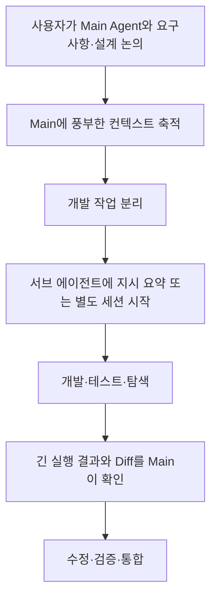

# Domain Storytelling 01 — AS-IS와 문제

> 이 문서는 화면이나 기능 명세 이전에 **개발자가 코딩 에이전트로 실제 개발하는 업무**를 이해하기 위한 기록이다. 사용자 경험에서 확인된 문제와 그 원인을 구분하며, 모든 프로젝트에서 항상 같은 문제가 발생한다고 일반화하지 않는다.

## 1. 업무의 범위와 참여자

- **개발자(사용자):** 문제를 정의하고, 요구사항·설계·실행 방식·통합 시점을 결정한다.
- **Main Agent:** 개발자와 긴 대화를 거치며 무엇을 왜 해야 하는지, 어떤 대안이 거절됐고 무엇이 금지됐는지 학습한다.
- **Development Agent:** 선택된 범위의 기능을 코드로 구현한다.
- **Explore / Web Search / Test / Verification Agent:** 맥락과 독립적인 조사·탐색·실행·검증을 맡을 수 있다.
- **프로젝트:** 기존 `AGENTS.md`, 요구사항, 코드, 테스트, Git 이력 등에 이미 중요한 계약이 존재한다.

Pi Compose는 프로젝트별 정책을 스스로 결정하는 서비스가 아니다. **기존 결정을 올바르게 전달하고, 실제 코드 변경이 그 결정과 맞는지 확인하는 범용 코딩 Harness**다.

## 2. AS-IS 업무 흐름

실제 사용에서는 위 순서가 항상 고정되는 것은 아니다. 상황에 따라 단일 세션에서 계속 개발하거나, 독립 Sub-agent를 병렬 활용하기도 한다.

## 3. 관찰된 문제

| Pain Point | 발생 상황 | 왜 문제인가 | 해결할 대상 |
| --- | --- | --- | --- |
| **의도 전달 손실** | 긴 설계 맥락을 짧은 개발 지시로 요약 | “X 때문에 Y는 절대 안 된다”가 “가능하면 Y를 피한다”로 약해질 수 있음 | 이유·금지 강도를 유지하는 컨텍스트 전달 |
| **Main 컨텍스트 오염** | Main이 탐색 결과·테스트 로그·Git Diff 전체를 읽음 | 비싼 고품질 맥락이 일시적인 결과로 채워지고 Compaction 시점이 빨라짐 | 독립 실행 및 간결한 결과 인계 |
| **위임 단위의 부적합** | 모든 개발을 무조건 독립 Sub-agent로 실행하거나 반대로 모두 Main에서 처리 | 전자는 맥락 손실, 후자는 맥락·도구 출력 비용 | 맥락 의존성과 독립성에 따른 선택 |
| **사용자에게 전가된 준비 비용** | Worktree 생성 → 디렉터리 이동 → Pi Fork → tmux 연결을 매번 수행 | Harness 코드가 적어도 반복 조작·실수 비용은 높음 | 공통 실행 진입점과 결정적 도구 조합 |
| **불필요한 Gate** | 모든 단계에 승인·체크리스트·별도 문서 생성 요구 | 개발 진행 중단, 관리 비용·컨텍스트 비용 증가 | 필요한 결정만 사람에게 요청 |
| **과도한 에이전트 통신** | 변경사항 전부를 Main에 보고하거나 모든 에이전트에 방송 | 비용 증가, 중요한 변경이 소음에 묻힘 | 영향을 받는 작업에만 직접 공유 |
| **인계 결과 과신** | “구현했고 테스트 통과”라는 말만 믿음 | 실제 Diff·계약 불일치가 누락될 수 있음 | 독립적인 사실 확인과 검증 |
| **Git 상태 귀속의 모호함** | 동일 디렉터리를 여러 에이전트가 동시에 수정 | 변경을 어떤 에이전트가 작성했는지 Git만으로 확정하기 어려움 | 범위·확실성 표현, 과도한 추적 시스템 배제 |
| **환경별 실행 강제** | 모든 작업을 Worktree나 병렬 실행으로 고정 | 프로젝트와 의존성에 맞지 않는 실행·병합 부담 | 컨텍스트·작업 공간·실행 방식 독립 선택 |

## 4. 근본 원인과 해결에 관한 구분

- **문제:** 긴 논의가 많다. **원인 아님:** “Main의 대화가 불필요하다.” 오히려 이유와 대안 검토의 축적이 개발 품질을 높인다.
- **문제:** 새 세션은 설계 배경을 모른다. **원인:** 독립 세션에 필요한 맥락이 자동 보존된다고 가정한다.
- **문제:** Main이 금방 꽉 찬다. **원인:** 설계 판단과 일회성 실행 데이터를 같은 활성 컨텍스트에서 처리한다.
- **문제:** Harness를 사용해도 번거롭다. **원인:** 기존 CLI를 재사용하는 것과 반복 조작을 추상화하는 것을 혼동한다.
- **문제:** 테스트가 통과해도 통합 시 깨진다. **원인:** 개별 구현, 통합 결과, 사용자 계약 준수를 동일하게 취급한다.

## 5. 의도적인 경계

이번 범위에서 해결하지 않을 문제도 있다.

- 모든 프로젝트의 정책·요구사항을 새 계약 데이터베이스로 옮기는 문제.
- 완전한 자동 멀티 에이전트 스케줄링·의사결정 대행.
- 어느 에이전트의 어느 문장이 어떤 파일 변경을 만들었는지 완벽하게 추적하는 문제.
- 모든 AI 검증 결과를 무조건 신뢰하거나, 모든 개발 작업에 필수 승인 Gate를 붙이는 문제.

## 6. TO-BE로 이어지는 질문

1. Main의 이유·강한 제약을 개발 에이전트가 어떻게 최대한 온전하게 이어받는가?
2. 어떤 작업은 Context Fork, 어떤 작업은 독립 세션이 더 효율적인가?
3. 사용자가 선택만 하면 반복적인 Pi·Git·tmux 준비를 어떻게 안전하게 수행할 수 있는가?
4. 개발 결과를 검증할 때 Main의 컨텍스트를 얼마나 아낄 수 있는가?
5. 실제 통합과 다음 의사결정은 누가, 어떤 근거로 하는가?

→ [TO-BE와 업무 시나리오](02-to-be-and-scenarios.md) · [PRD](../PRD.md)
