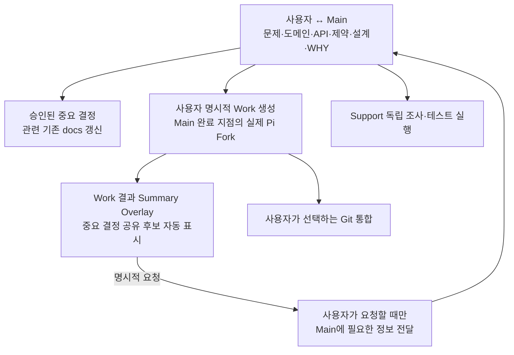

# Domain Storytelling — 목표 개발 경험

- 기준: 2026-10-30 [PRD](../PRD.md)
- 상태: 사용자가 원하는 업무 흐름. **새 Ghostty 구현은 아직 검증되지 않았음**

## 1. 중심 흐름

모든 작업을 병렬화하거나 모든 단계를 거칠 필요는 없습니다. 맥락 의존성에 따라 하나의 Work만 실행할 수 있습니다.

## 2. 설계를 이해한 상태로 구현

Main에서 API 필드 `label`을 삭제하지 않는 이유와 구버전 호환성 정책을 논의했습니다. 사용자가 Work를 명시적으로 만들면 선택한 Main의 **정확한 완료 Pi 분기**를 Fork합니다. Work는 기존 이유와 금지 강도를 이해한 채 개발하고, 반복 코드 탐색·실패 로그를 Main에 남기지 않습니다.

## 3. 테스트와 독립 작업

테스트 코드를 작성하려면 서비스 정책이나 구현 의도가 필요할 수 있으므로 맥락을 가진 Work가 적합합니다. 기존 테스트를 **실행**하고 오류 로그를 수집하는 일은 독립 Support에서 수행할 수 있습니다. 문제가 발견되면 맥락을 아는 Work에서 수정을 이어갈 수 있습니다.

## 4. Main 대화가 길어졌을 때

대화에 축적한 중요한 확정 결정과 이유는 기존 `docs/*`의 해당 원본에 보존합니다. 문서 간 길잡이는 짧은 `AGENTS.md`를 지향합니다.

맥락이 없는 세션은 **사용자가 명시적으로 요청했을 때만** 관련 문서를 선택적으로 읽습니다. 대화 분기를 과거 시점으로 되돌리더라도 프로젝트 문서는 자동 되돌리지 않습니다.

## 5. Work 결과 및 중요 결정

Work는 작업 결과와 함께 다른 Agent가 알아야 할 만한 **중요 결정 공유 후보**를 Summary Overlay에 자동 표시합니다. 사용자가 요약을 확인하고 실제 Pi 화면을 열어 원문을 볼 수 있습니다.

Work의 결정을 Main에 자동 전송하지 않으며, 사용자가 요청하면 결정과 이유·출처를 전달할 수 있어야 합니다. 다른 Work에서 아직 받지 못한 결정의 발견/전달 방식은 다음 정책 논의 대상입니다.

## 6. 세션 종료와 재접속

Ghostty를 종료하면 실행 중인 Agent도 종료하되 저장된 Pi 대화·Git 파일은 보존합니다. 다음 실행에서 사용자가 이전 Main을 선택하면 **Main만** 재개합니다. Work/Support를 자동 재실행하지 않습니다.

**성공 경험:** 사용자는 Main에서 맥락을 누적하고, 정확한 Fork로 개발을 분리하고, 실행 중에는 결과를 쉽게 파악하며, 중요한 결정만 스스로 선택해 Main과 연결합니다.
