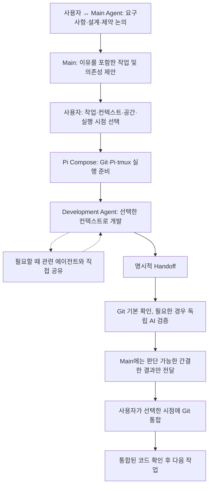

# Domain Storytelling 02 — TO-BE와 업무 시나리오

> 사용자는 **무엇을 어떤 방식으로 개발할지 결정**하고, Harness는 결정된 실행의 반복 절차를 처리한다. Main Agent는 사용자와 설계·판단을 이어갈 여력을 보존한다.

## 1. 목표 업무 흐름

이는 **가능한 전체 흐름**이지 모든 작업에 강제하는 파이프라인이 아니다. 단순 작업은 기존 단일 Pi 세션에서 끝낼 수 있다.

## 2. 시나리오 A — 설계 맥락에 의존하는 개발

**상황:** 사용자는 Main과 API 호환성, 불변 조건, 거절한 대안을 논의했다. 개발에서는 그 원인이 중요하다.

1. Main은 작업과 의존성·실행 방법을 제안한다.
2. 사용자는 개발을 진행하기로 하고 `Fork Main + Worktree + 지금 실행`을 선택한다.
3. Pi Compose는 **명시된 원본 세션 ID**를 사용하여 Worktree를 준비하고 Pi Fork를 실행·연결한다. Main은 계속 살아 있다.
4. Development Agent는 원본 설계 맥락을 활용하면서 새 작업 공간에서만 개발한다.
5. Handoff 이후 Git 기본 확인을 수행하고, 계약 영향이 있다면 독립 검증으로 전달한다.

**성공 조건:** 개발자는 Worktree·tmux·Pi 명령을 따로 입력하지 않고도 원래 결정의 이유를 활용할 수 있다.

**주의:** Fork는 컨텍스트를 복제하지 미커밋 코드를 Worktree에 자동 복제하지 않는다. 원본의 Compaction 이후라면 원래 지시가 활성 컨텍스트에 전부 남는다고 보장하지 않는다.

## 3. 시나리오 B — 맥락과 독립적인 병렬 작업

**상황:** Main은 구조 설계 중이고 독립적인 코드 탐색, 레퍼런스 조사, 테스트 실행이 필요하다.

1. 조사·탐색·테스트 전용의 새 세션이나 Sub-agent를 사용한다.
2. 각 실행은 상세 파일 목록·로그·웹 문서를 독립 컨텍스트에서 읽는다.
3. Main은 **결론, 결정에 필요한 이유, 출처, 불확실성**만 받는다.

**성공 조건:** Main의 활성 컨텍스트를 길고 일시적인 출력으로 채우지 않는다.

## 4. 시나리오 C — Shared Directory에서 개발

**상황:** Worktree가 불필요하거나 프로젝트 특성상 동일 작업 디렉터리에서 개발하려 한다.

- 독립 세션 + Shared Directory, Fork + Shared Directory 모두 선택할 수 있어야 한다.
- 여러 에이전트의 동시 수정은 충돌·작업 손실 가능성을 수반한다. 경고는 가능하지만 모든 병렬 작업에서 Worktree를 강제하지 않는다.
- 공유 디렉터리에서는 Git 변경만으로 에이전트별 작성 내용을 확정하지 않는다.

## 5. 시나리오 D — 개발 중 중요한 발견

Agent A가 공통 인터페이스의 변경 필요성을 발견했다.

- **영향 없는 내부 구현 변경:** 자체 해결한다.
- **관련 Agent B의 전제에 영향:** B에게 발견·원인·영향·출처·요청을 직접 공유한다.
- **기존 계약의 변경 제안:** “제안/미확정”으로 표시한다. 사용자의 실제 승인 없이 새 계약으로 취급하거나 다른 에이전트에게 적용을 명령하지 않는다.
- **답변을 기다려야 진행 가능:** 필요한 상대에게 질문한다. 단순 알림까지 동기 응답으로 만들지 않는다.
- **사용자의 제품 판단이 실제 필요:** 이유와 대안을 압축해 전달한다.

**성공 조건:** Main이 모든 메시지의 중계자가 되지 않으면서도 기존 금지사항이 약화되지 않는다.

## 6. 시나리오 E — Handoff와 독립 검증

개발 에이전트는 “완료”를 명시적으로 인계한다. **Pi 턴 종료·tmux Idle·테스트 통과는 완료 신호가 아니다.**

1. 무엇을 구현했고 왜 그렇게 했는지, 검증 내용·문제·세션·브랜치·기준을 간결하게 정리한다.
2. Git으로 모든 변경 경로(추적·신규 파일 포함), 변경 규모, staged/unstaged 및 기준을 확인한다.
3. 검사 명령이 확인되면 관련 검사를 실행하거나 이미 실행한 결과를 검증한다.
4. 계약 영향·불확실성이 있으면 독립적인 AI 검증이 Diff와 원본 계약을 확인한다.
5. Main에는 **변경 및 이유, 계약 충돌·미해결 문제, 검증 범위와 근거 위치**만 보낸다.

기본 검사만 끝난 상황에서 **“계약 검증 완료”라고 표시하지 않는다.** 세션은 인계 후에도 재개할 수 있다.

## 7. 시나리오 F — 통합과 복구

- 사용자가 선택한 시점에 Git 통합을 실행한다. 개별 완료·검증·통합·세션 종료·Worktree 삭제는 모두 다른 행위다.
- Worktree를 합친 후에도 통합 코드에서 테스트·타입 검사 등 필요한 검증을 수행한다.
- 중단·재시도 시 이미 있는 세션·Worktree를 우선 발견·재사용한다.
- 정리 과정에서 사용자 미커밋 작업이나 기존 작업 공간을 임의로 삭제하지 않는다.

## 8. 사용자에게 남는 의사결정

| 사용자의 몫 | Pi Compose의 몫 |
| --- | --- |
| 목표·계약·주요 우선순위 결정 | 관련 프로젝트 계약과 실행 상황을 찾도록 도움 |
| 실행할 작업 및 컨텍스트·공간·시점 선택 | 결정된 옵션으로 반복 준비·실행·연결 |
| 실제 계약 변경 승인 | 관찰과 제안, 이미 승인된 계약을 구분 |
| 코드 통합 시점 결정 | 기존 Git 도구 활용, 통합 결과 확인 지원 |
| 다음 단계 결정 | 상세 로그 대신 판단 가능한 결과 인계 |

→ [PRD](../PRD.md) · [Architecture](../ARCHITECTURE.md)
